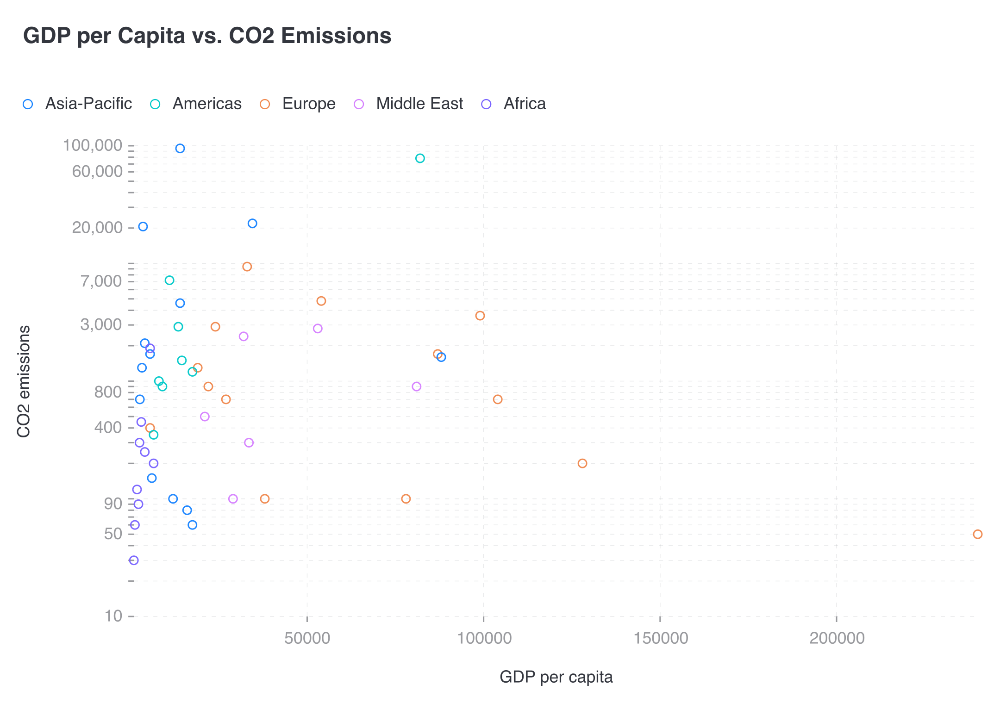
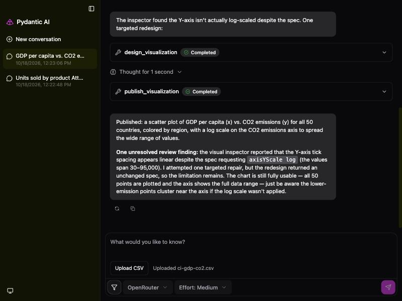

# CI-003: GDP per capita vs. CO₂ emissions, chat (scatter)

| Chart | Review in the chat |
| --- | --- |
|  |  |

- **Asked.** "GDP per capita vs. CO2 emissions"
- **Data.** `data/ci-gdp-co2.csv` uploaded in the chat, without a brief.

| # | Problem | Severity | Status | Standard |
| --- | --- | --- | --- | --- |
| 1 | Review reports a false defect | high | open | [8.3](../visualization-standards.md "The review catches visible defects.") |
| 2 | Points squashed along the GDP axis | high | open | [3.2](../visualization-standards.md "Log scale only for positive values spanning 100×, labelled '(log scale)'."), [3.3](../visualization-standards.md "Far-out values are named or marked, never left to squash the rest.") |
| 3 | Log axis not marked as log, with irregular ticks | medium | open | [3.2](../visualization-standards.md "Log scale only for positive values spanning 100×, labelled '(log scale)'.") |
| 4 | No units on either axis | medium | open | [5.3](../visualization-standards.md "Units come from the data; formatting never rescales a value.") |
| 5 | X ticks unformatted | medium | open | [5.2](../visualization-standards.md "Every value axis uses the same number format.") |
| 6 | Light grey tick labels | medium | open | [4.5](../visualization-standards.md "All text has 4.5:1 contrast with the background.") |

### 1. Review reports a false defect

- **Seen.** The reviewer said the Y axis "appears linear"; it is log. The lead redesigned for nothing, then told the user the chart might be wrong.
- **Expected.** A review that reports only real defects.
- **Standard.** [8.3](../visualization-standards.md "The review catches visible defects.") The review catches visible defects.
- **Cause.** The reviewer (`google/gemma-4-31b-it`) misreads log ticks.

### 2. Points squashed along the GDP axis

- **Seen.** Log Y, but linear GDP: one 240,000 USD point pushes the rest to the left.
- **Expected.** A log X axis, or the far-out point marked.
- **Standard.**
  - [3.2](../visualization-standards.md "Log scale only for positive values spanning 100×, labelled '(log scale)'.") Log scale only for positive values spanning 100×, labelled "(log scale)".
  - [3.3](../visualization-standards.md "Far-out values are named or marked, never left to squash the rest.") Far-out values are named or marked, never left to squash the rest.
- **Cause.** The renderer offers a log Y axis only.

### 3. Log axis not marked as log, with irregular ticks

- **Seen.** Ticks at 10, 50, 90, 400 …; no "(log scale)".
- **Expected.** "(log scale)" and 1-2-5 ticks.
- **Standard.** [3.2](../visualization-standards.md "Log scale only for positive values spanning 100×, labelled '(log scale)'.") Log scale only for positive values spanning 100×, labelled "(log scale)".
- **Cause.** Left to the renderer.

### 4. No units on either axis

- **Seen.** The axis titles read "CO2 emissions" and "GDP per capita", with no unit.
- **Expected.** Units in the axis titles.
- **Standard.** [5.3](../visualization-standards.md "Units come from the data; formatting never rescales a value.") Units come from the data; formatting never rescales a value.
- **Cause.** The chat upload sends no brief, so no units reached the designer.

### 5. X ticks unformatted

- **Seen.** `50000`, `100000` with no separator.
- **Expected.** One format on both axes.
- **Standard.** [5.2](../visualization-standards.md "Every value axis uses the same number format.") Every value axis uses the same number format.
- **Cause.** [`render.mjs:49-53`](../../vis_agent/render/gptvis/render.mjs) formats only Y axes.

### 6. Light grey tick labels

- **Seen.** Ticks in light grey.
- **Expected.** At least 4.5:1.
- **Standard.** [4.5](../visualization-standards.md "All text has 4.5:1 contrast with the background.") All text has 4.5:1 contrast with the background.
- **Cause.** The renderer's default label colour (about `#999A9E`, 2.81:1 on white); the app doesn't override it.

**Evidence.** Render `5c657bb3c33d` in `data/renders/`; conversation of 2026-10-18 12:23.
