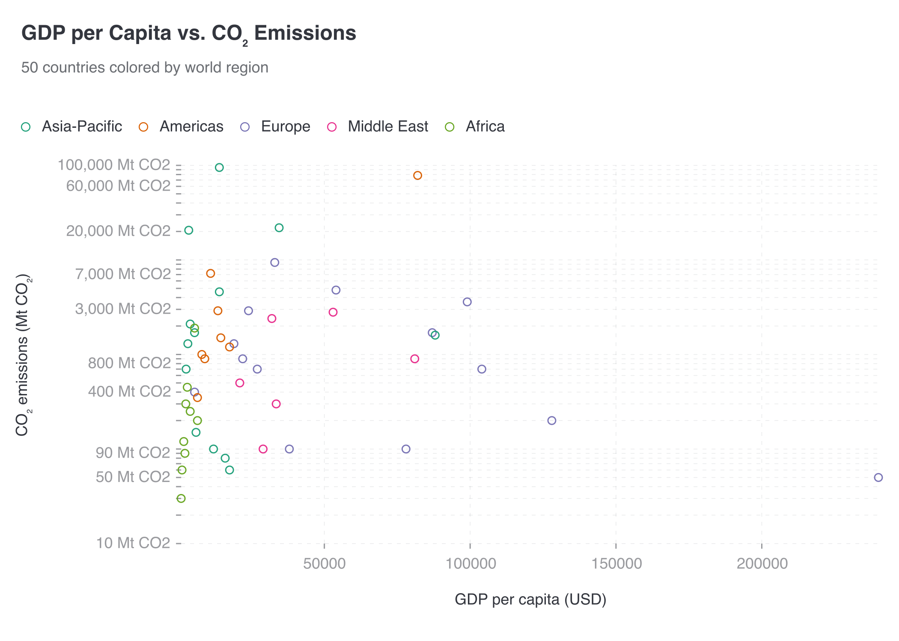

# CI-002: GDP per capita vs. CO₂ emissions, command line (scatter)

| Chart |
| --- |
|  |

- **Asked.** "GDP per capita vs. CO2 emissions"
- **Data.** `data/ci-gdp-co2.csv` with its brief.

| # | Problem | Severity | Status | Standard |
| --- | --- | --- | --- | --- |
| 1 | Points squashed along the GDP axis | high | open | [3.2](../visualization-standards.md "Log scale only for positive values spanning 100×, labelled '(log scale)'."), [3.3](../visualization-standards.md "Far-out values are named or marked, never left to squash the rest.") |
| 2 | Log axis not marked as log, with irregular ticks | medium | open | [3.2](../visualization-standards.md "Log scale only for positive values spanning 100×, labelled '(log scale)'.") |
| 3 | Far-out points have no names | medium | open | [3.3](../visualization-standards.md "Far-out values are named or marked, never left to squash the rest.") |
| 4 | Full numbers with units on Y ticks; X ticks unformatted | medium | open | [5.1](../visualization-standards.md "Short numbers on axes and bars (`2.5M`); full numbers in tooltips; unit once, in the axis title."), [5.2](../visualization-standards.md "Every value axis uses the same number format.") |
| 5 | Light grey tick labels | medium | open | [4.5](../visualization-standards.md "All text has 4.5:1 contrast with the background.") |
| 6 | Review didn't finish, so the chart went out unreviewed | medium | open | [8.2](../visualization-standards.md "A chart that couldn't be reviewed says so."), [8.3](../visualization-standards.md "The review catches visible defects.") |
| 7 | Alt text says both axes are log | low | open | [4.6](../visualization-standards.md "A title and a one-sentence description.") |
| 8 | Small hollow markers overlap | low | open | – |

### 1. Points squashed along the GDP axis

- **Seen.** Emissions are on a log scale, but GDP stays linear, so one 240,000 USD point pushes the rest into the left sixth.
- **Expected.** A log X axis, or the far-out point marked at the edge.
- **Standard.**
  - [3.2](../visualization-standards.md "Log scale only for positive values spanning 100×, labelled '(log scale)'.") Log scale only for positive values spanning 100×, labelled "(log scale)".
  - [3.3](../visualization-standards.md "Far-out values are named or marked, never left to squash the rest.") Far-out values are named or marked, never left to squash the rest.
- **Cause.** The renderer offers a log Y axis only (the designer said so in its explanation).

### 2. Log axis not marked as log, with irregular ticks

- **Seen.** Ticks at 10, 50, 90, 400, 800, 3,000 …; the title has no "(log scale)".
- **Expected.** "(log scale)" in the title, ticks at 1, 2, 5 of each decade.
- **Standard.** [3.2](../visualization-standards.md "Log scale only for positive values spanning 100×, labelled '(log scale)'.") Log scale only for positive values spanning 100×, labelled "(log scale)".
- **Cause.** Ticks are left to the renderer; nothing adds the label.

### 3. Far-out points have no names

- **Seen.** The far-out points are unlabelled dots.
- **Expected.** A few far-out points named.
- **Standard.** [3.3](../visualization-standards.md "Far-out values are named or marked, never left to squash the rest.") Far-out values are named or marked, never left to squash the rest.
- **Cause.** Nothing proposes point labels.

### 4. Full numbers with units on Y ticks; X ticks unformatted

- **Seen.** `100,000 Mt CO2` on every Y tick; X ticks read `50000`.
- **Expected.** Short numbers, the unit once in the axis title, one format on both axes.
- **Standard.**
  - [5.1](../visualization-standards.md "Short numbers on axes and bars (`2.5M`); full numbers in tooltips; unit once, in the axis title.") Short numbers on axes and bars (`2.5M`); full numbers in tooltips; unit once, in the axis title.
  - [5.2](../visualization-standards.md "Every value axis uses the same number format.") Every value axis uses the same number format.
- **Cause.** [`render/gptvis/format.js:23`](../../vis_agent/render/gptvis/format.js) adds the unit to every number; short numbers are opt-in and unused. [`render.mjs:49-53`](../../vis_agent/render/gptvis/render.mjs) formats only Y axes.

### 5. Light grey tick labels

- **Seen.** Ticks in light grey, 2.81:1.
- **Expected.** At least 4.5:1.
- **Standard.** [4.5](../visualization-standards.md "All text has 4.5:1 contrast with the background.") All text has 4.5:1 contrast with the background.
- **Cause.** The renderer's default label colour (about `#999A9E`, 2.81:1 on white); the app doesn't override it.

### 6. Review didn't finish, so the chart went out unreviewed

- **Seen.** "The reviewer could not finish: Exceeded maximum output retries (2)".
- **Expected.** A review that finishes.
- **Standard.**
  - [8.2](../visualization-standards.md "A chart that couldn't be reviewed says so.") A chart that couldn't be reviewed says so.
  - [8.3](../visualization-standards.md "The review catches visible defects.") The review catches visible defects.
- **Cause.** The reviewer must quote column metadata exactly and failed twice.

### 7. Alt text says both axes are log

- **Seen.** The description says "Both axes use logarithmic scales"; only Y is.
- **Expected.** A description that matches the chart.
- **Standard.** [4.6](../visualization-standards.md "A title and a one-sentence description.") A title and a one-sentence description.
- **Cause.** The designer wrote it before learning X can't be log.

### 8. Small hollow markers overlap

- **Seen.** Small rings stack near the origin.
- **Expected.** Filled, slightly transparent markers.
- **Cause.** The renderer's default scatter marker.

**Evidence.** Request `rq_4fa32cc0752746ac8694399533574a42`, artifact `art_ef20a4d213f545788537628bf6f87a54`. Designer `deepseek/deepseek-v4-pro`, reviewer `google/gemma-4-31b-it`.
