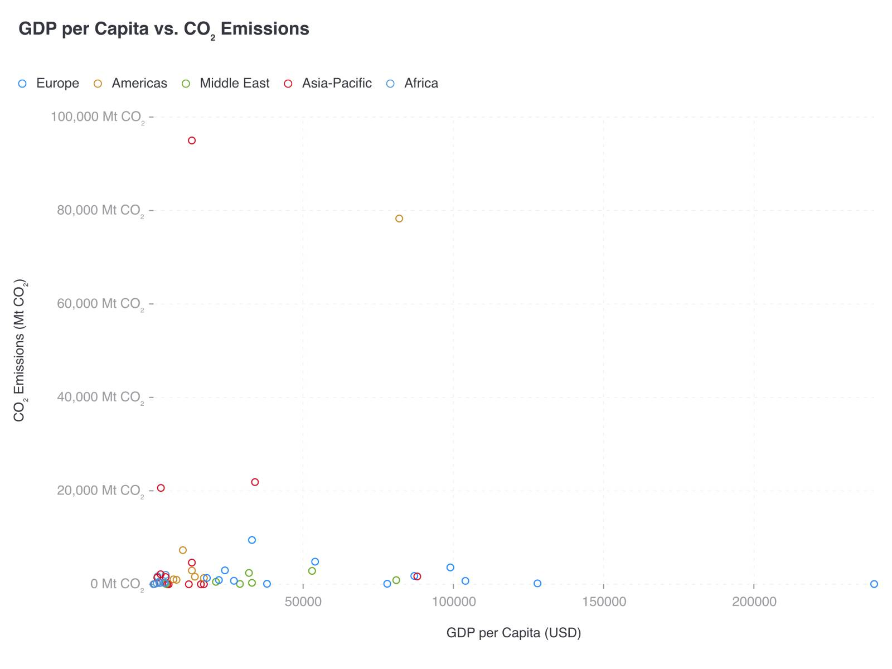

# CI-001: GDP per capita vs. CO₂ emissions, old repo (scatter)

| Chart |
| --- |
|  |

- **Asked.** "GDP per capita vs. CO2 emissions"
- **Data.** 50 countries in five regions; GDP per capita in USD, emissions in Mt CO₂. Mimicked in `data/ci-gdp-co2.csv`.

| # | Problem | Severity | Status | Standard |
| --- | --- | --- | --- | --- |
| 1 | Points squashed by a few far-out values | high | open | [3.2](../visualization-standards.md "Log scale only for positive values spanning 100×, labelled '(log scale)'."), [3.3](../visualization-standards.md "Far-out values are named or marked, never left to squash the rest.") |
| 2 | Far-out points have no names | medium | open | [3.3](../visualization-standards.md "Far-out values are named or marked, never left to squash the rest.") |
| 3 | Europe and Africa in near-identical blues | medium | open | [3.7](../visualization-standards.md "One series, one colour; distinct hues for unordered categories; grey only for 'Other' or no data.") |
| 4 | Full numbers with units on Y ticks; X ticks unformatted | medium | open | [5.1](../visualization-standards.md "Short numbers on axes and bars (`2.5M`); full numbers in tooltips; unit once, in the axis title."), [5.2](../visualization-standards.md "Every value axis uses the same number format.") |
| 5 | Light grey tick labels | medium | open | [4.5](../visualization-standards.md "All text has 4.5:1 contrast with the background.") |
| 6 | Small hollow markers overlap near the origin | low | open | – |

### 1. Points squashed by a few far-out values

- **Seen.** Both axes linear: about 45 of the 50 points sit in the bottom-left corner.
- **Expected.** Log scales where positive values span orders of magnitude; otherwise the far-out points marked or named.
- **Standard.**
  - [3.2](../visualization-standards.md "Log scale only for positive values spanning 100×, labelled '(log scale)'.") Log scale only for positive values spanning 100×, labelled "(log scale)".
  - [3.3](../visualization-standards.md "Far-out values are named or marked, never left to squash the rest.") Far-out values are named or marked, never left to squash the rest.
- **Cause.** Old repo; not traced.

### 2. Far-out points have no names

- **Seen.** The two highest emitters and the richest country are unlabelled dots.
- **Expected.** A few far-out points named.
- **Standard.** [3.3](../visualization-standards.md "Far-out values are named or marked, never left to squash the rest.") Far-out values are named or marked, never left to squash the rest.
- **Cause.** Old repo; not traced.

### 3. Europe and Africa in near-identical blues

- **Seen.** Two regions can't be told apart.
- **Expected.** Clearly different hues for every region, also for colour-blind readers.
- **Standard.** [3.7](../visualization-standards.md "One series, one colour; distinct hues for unordered categories; grey only for 'Other' or no data.") One series, one colour; distinct hues for unordered categories; grey only for "Other" or no data.
- **Cause.** Old repo; not traced.

### 4. Full numbers with units on Y ticks; X ticks unformatted

- **Seen.** `100,000 Mt CO₂` on every Y tick; X ticks read `50000`, `100000`.
- **Expected.** Short numbers (`100K`, `50K`), the unit once in the axis title, one format on both axes.
- **Standard.**
  - [5.1](../visualization-standards.md "Short numbers on axes and bars (`2.5M`); full numbers in tooltips; unit once, in the axis title.") Short numbers on axes and bars (`2.5M`); full numbers in tooltips; unit once, in the axis title.
  - [5.2](../visualization-standards.md "Every value axis uses the same number format.") Every value axis uses the same number format.
- **Cause.** Old repo; not traced.

### 5. Light grey tick labels

- **Seen.** Ticks in light grey, below 4.5:1.
- **Expected.** At least 4.5:1.
- **Standard.** [4.5](../visualization-standards.md "All text has 4.5:1 contrast with the background.") All text has 4.5:1 contrast with the background.
- **Cause.** Old repo; not traced.

### 6. Small hollow markers overlap near the origin

- **Seen.** Dozens of small rings stack on one another in the corner.
- **Expected.** Readable points: filled, slightly transparent markers.
- **Cause.** Old repo; not traced.

**Evidence.** Screenshot only; no request ID.
