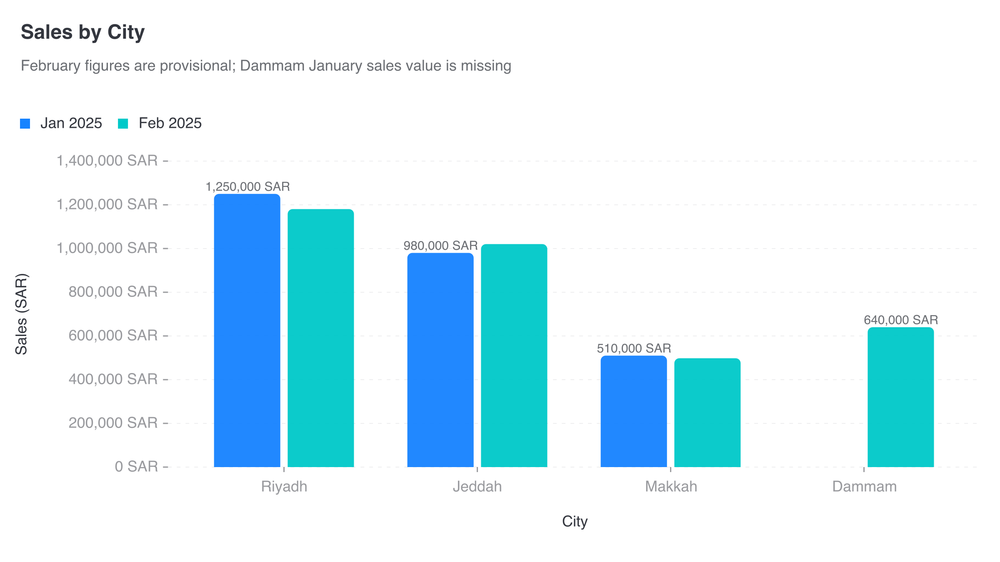

# CI-015: Sales by city from a messy CSV, command line (grouped columns)

| Chart |
| --- |
|  |

- **Asked.** "Sales by city"
- **Data.** `data/ci-messy-sales-c.csv`: the messy file with every row the right width.

| # | Problem | Severity | Status | Standard |
| --- | --- | --- | --- | --- |
| 1 | 84 s and the whole request budget, with nothing shown meanwhile | medium | open | [1.4](../visualization-standards.md "No re-summing, percentages, 'Other' or other calculations unless the lead asked.") |
| 2 | Review timed out, so the chart went out unreviewed | medium | open | [8.2](../visualization-standards.md "A chart that couldn't be reviewed says so.") |
| 3 | February bars have no value labels | medium | open | [4.2](../visualization-standards.md "Every category name shows; labels are never dropped silently.") |
| 4 | Full numbers with units on ticks and labels | medium | open | [5.1](../visualization-standards.md "Short numbers on axes and bars (`2.5M`); full numbers in tooltips; unit once, in the axis title.") |
| 5 | Light grey axis labels | medium | open | [4.5](../visualization-standards.md "All text has 4.5:1 contrast with the background.") |

### 1. 84 s and the whole request budget, with nothing shown meanwhile

- **Seen.** The analyst cleaned the file with SQL; the chart arrived after 84 s using all 18 requests. For a minute and a half nothing shows, which reads as stuck.
- **Expected.** A decision on whether cleaning is this team's job, since AGENTS.md treats the CSV as final; if it stays, budget left for review.
- **Standard.** [1.4](../visualization-standards.md "No re-summing, percentages, 'Other' or other calculations unless the lead asked.") No re-summing, percentages, "Other" or other calculations unless the lead asked.
- **Cause.** The lead delegates cleaning to the analyst; with design, render and review the run reaches its limit.

### 2. Review timed out, so the chart went out unreviewed

- **Seen.** "The reviewer could not finish: TimeoutError" after 30 s.
- **Expected.** A review that finishes.
- **Standard.** [8.2](../visualization-standards.md "A chart that couldn't be reviewed says so.") A chart that couldn't be reviewed says so.
- **Cause.** The 30 s review limit, under load.

### 3. February bars have no value labels

- **Seen.** January bars show values; February bars don't.
- **Expected.** Every bar labelled, or none.
- **Standard.** [4.2](../visualization-standards.md "Every category name shows; labels are never dropped silently.") Every category name shows; labels are never dropped silently.
- **Cause.** The renderer hides labels that would overlap.

### 4. Full numbers with units on ticks and labels

- **Seen.** `1,400,000 SAR` on every tick and `1,250,000 SAR` on the bars.
- **Expected.** Short numbers, the unit once in the axis title.
- **Standard.** [5.1](../visualization-standards.md "Short numbers on axes and bars (`2.5M`); full numbers in tooltips; unit once, in the axis title.") Short numbers on axes and bars (`2.5M`); full numbers in tooltips; unit once, in the axis title.
- **Cause.** [`render/gptvis/format.js:23`](../../vis_agent/render/gptvis/format.js) adds the unit to every number; short numbers are opt-in and unused.

### 5. Light grey axis labels

- **Seen.** City names and ticks in light grey.
- **Expected.** At least 4.5:1.
- **Standard.** [4.5](../visualization-standards.md "All text has 4.5:1 contrast with the background.") All text has 4.5:1 contrast with the background.
- **Cause.** The renderer's default label colour (about `#999A9E`, 2.81:1 on white); the app doesn't override it.

**Evidence.** Request `rq_bedee7bf2b4a40368087cb7a228308ab`, artifact `art_004705202f9045358909427de401b5ca`.
