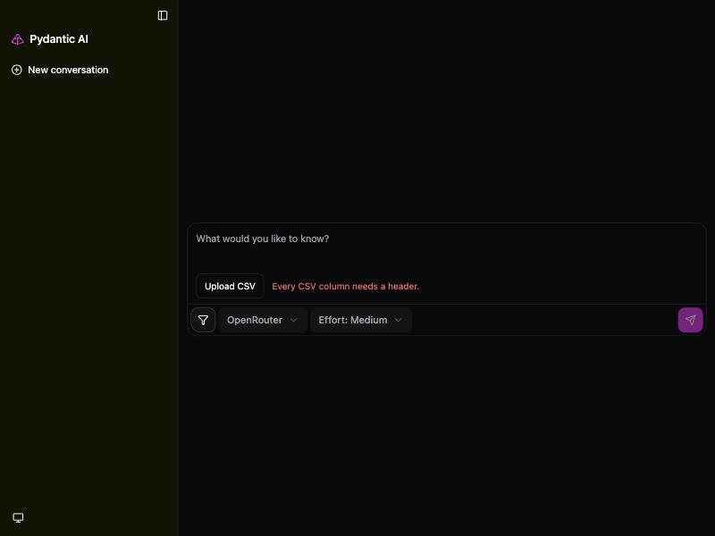

# CI-014: Sales by city from a messy CSV, chat (refused at upload)

| Refusal in the chat |
| --- |
|  |

- **Asked.** "Sales by city"
- **Data.** `data/ci-messy-sales.csv`: a title row above the header, numbers as text, `N/A` and `-` cells, a repeated header, a total row and a note row.

| # | Problem | Severity | Status | Standard |
| --- | --- | --- | --- | --- |
| 1 | Refused with a terse message, nothing in the conversation | medium | open | – |

### 1. Refused with a terse message, nothing in the conversation

- **Seen.** "Every CSV column needs a header." as one short red line beside Upload CSV, in 3 s. A row with extra commas (`data/ci-messy-sales-b.csv`) gets "CSV row 3 has 6 fields; expected 4."
- **Expected.** A refusal that names the row and the fix ("row 1 looks like a title: remove it"), in the conversation.
- **Cause.** The reader is rightly strict, but its message only goes to the upload status line ([`static/chat_upload.js`](../../vis_agent/static/chat_upload.js)).

**Evidence.** Reproduced in the browser on 2026-10-18; no request is created for a refused upload.
