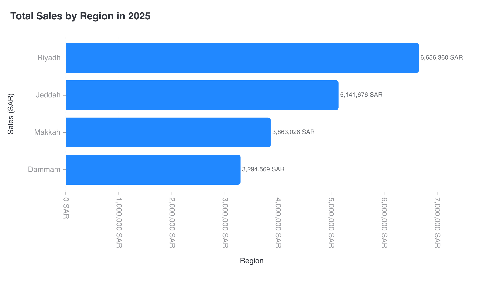

# CI-005: Total sales by region in 2025, command line (horizontal bars)

| Chart |
| --- |
|  |

- **Asked.** "Total sales by region in 2025"
- **Data.** `data/ci-sales-region.csv` with its brief.

| # | Problem | Severity | Status | Standard |
| --- | --- | --- | --- | --- |
| 1 | Axis titles on the wrong axes | high | open | [4.4](../visualization-standards.md "Axis titles sit on the right axes.") |
| 2 | Review passed the swapped titles | medium | open | [8.3](../visualization-standards.md "The review catches visible defects.") |
| 3 | Full numbers with units, ticks turned sideways | medium | open | [5.1](../visualization-standards.md "Short numbers on axes and bars (`2.5M`); full numbers in tooltips; unit once, in the axis title.") |
| 4 | Light grey axis labels | medium | open | [4.5](../visualization-standards.md "All text has 4.5:1 contrast with the background.") |

### 1. Axis titles on the wrong axes

- **Seen.** "Sales (SAR)" beside the city names and "Region" under the values.
- **Expected.** "Region" beside the cities, "Sales (SAR)" under the values.
- **Standard.** [4.4](../visualization-standards.md "Axis titles sit on the right axes.") Axis titles sit on the right axes.
- **Cause.** The designer wrote titles by role, against [`designer/rulebook.md:73`](../../vis_agent/designer/rulebook.md); [`resolve.py:362-368`](../../vis_agent/designer/resolve.py) swaps them for horizontal bars and swaps back only when a title contains the column name.

### 2. Review passed the swapped titles

- **Seen.** The visual review gave it a pass.
- **Expected.** A title on the wrong axis is reported.
- **Standard.** [8.3](../visualization-standards.md "The review catches visible defects.") The review catches visible defects.
- **Cause.** The reviewer didn't check titles against the axes.

### 3. Full numbers with units, ticks turned sideways

- **Seen.** `7,000,000 SAR` ticks, so long they're rotated 90°; `6,656,360 SAR` on the bars.
- **Expected.** Short numbers, the unit once in the axis title.
- **Standard.** [5.1](../visualization-standards.md "Short numbers on axes and bars (`2.5M`); full numbers in tooltips; unit once, in the axis title.") Short numbers on axes and bars (`2.5M`); full numbers in tooltips; unit once, in the axis title.
- **Cause.** [`render/gptvis/format.js:23`](../../vis_agent/render/gptvis/format.js) adds the unit to every number; short numbers are opt-in and unused.

### 4. Light grey axis labels

- **Seen.** City names and ticks in light grey, 2.81:1.
- **Expected.** At least 4.5:1.
- **Standard.** [4.5](../visualization-standards.md "All text has 4.5:1 contrast with the background.") All text has 4.5:1 contrast with the background.
- **Cause.** The renderer's default label colour (about `#999A9E`, 2.81:1 on white); the app doesn't override it.

**Evidence.** Request `rq_9d7870e93b774972908de099b4b8bde0`, artifact `art_bdb3076b31cc4717ac8334e38fea22b8`. Designer `deepseek/deepseek-v4-pro`.
