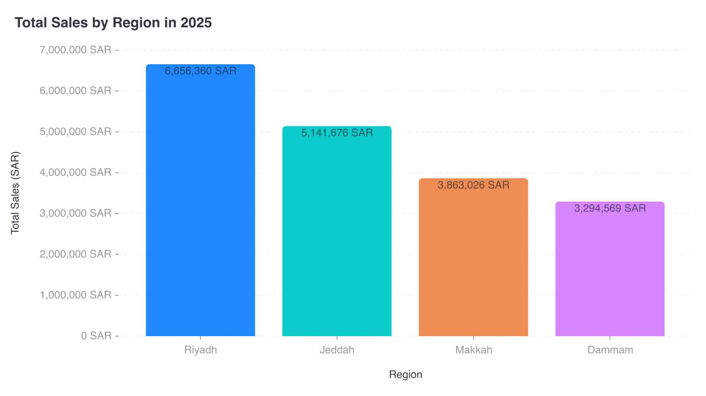

# CI-004: Total sales by region in 2025, old repo (columns)

| Chart |
| --- |
|  |

- **Asked.** "Total sales by region in 2025"
- **Data.** Four cities, one total each, in SAR. Mimicked in `data/ci-sales-region.csv`.

| # | Problem | Severity | Status | Standard |
| --- | --- | --- | --- | --- |
| 1 | Every column a different colour | medium | fixed | [3.7](../visualization-standards.md "One series, one colour; distinct hues for unordered categories; grey only for 'Other' or no data.") |
| 2 | Full numbers with units on ticks and labels | medium | open | [5.1](../visualization-standards.md "Short numbers on axes and bars (`2.5M`); full numbers in tooltips; unit once, in the axis title.") |
| 3 | Dark value labels inside strongly coloured columns | medium | open | [4.5](../visualization-standards.md "All text has 4.5:1 contrast with the background.") |
| 4 | Light grey tick labels | medium | open | [4.5](../visualization-standards.md "All text has 4.5:1 contrast with the background.") |

### 1. Every column a different colour

- **Seen.** Four colours for one series, with no legend.
- **Expected.** One series, one colour.
- **Standard.** [3.7](../visualization-standards.md "One series, one colour; distinct hues for unordered categories; grey only for 'Other' or no data.") One series, one colour; distinct hues for unordered categories; grey only for "Other" or no data.
- **Cause.** Old repo; not traced.
- **Fix.** Not seen in this repo: [`resolve.py:393-395`](../../vis_agent/designer/resolve.py) gives a single-series chart one colour. A palette in the spec overrides it, so it can come back.

### 2. Full numbers with units on ticks and labels

- **Seen.** `7,000,000 SAR` on every tick and `6,656,360 SAR` on the columns.
- **Expected.** Short numbers (`7M`, `6.66M`), the unit once in the axis title.
- **Standard.** [5.1](../visualization-standards.md "Short numbers on axes and bars (`2.5M`); full numbers in tooltips; unit once, in the axis title.") Short numbers on axes and bars (`2.5M`); full numbers in tooltips; unit once, in the axis title.
- **Cause.** Old repo; not traced.

### 3. Dark value labels inside strongly coloured columns

- **Seen.** Dark text on saturated blue and purple.
- **Expected.** Value labels readable against what they sit on.
- **Standard.** [4.5](../visualization-standards.md "All text has 4.5:1 contrast with the background.") All text has 4.5:1 contrast with the background.
- **Cause.** Old repo; not traced.

### 4. Light grey tick labels

- **Seen.** City names and ticks in light grey.
- **Expected.** At least 4.5:1.
- **Standard.** [4.5](../visualization-standards.md "All text has 4.5:1 contrast with the background.") All text has 4.5:1 contrast with the background.
- **Cause.** Old repo; not traced.

**Evidence.** Screenshot only; no request ID.
