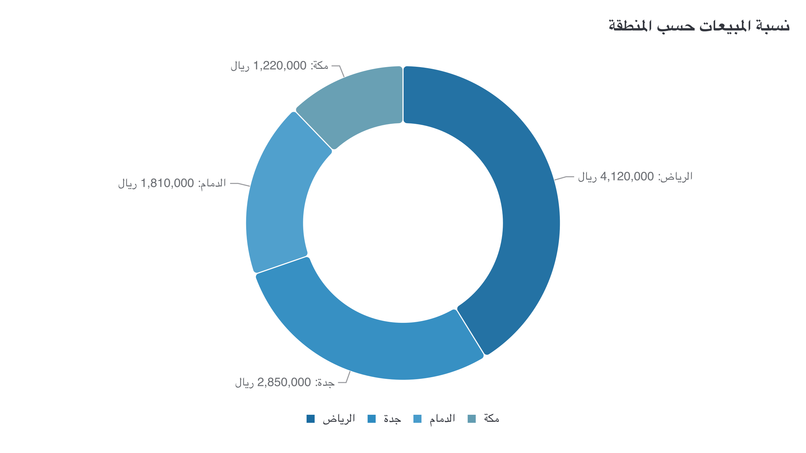

# CI-009: Sales share by region in Arabic, command line (donut)

| Chart |
| --- |
|  |

- **Asked.**

  > ما نسبة المبيعات حسب المنطقة؟

- **Data.** `data/ci-sales-share-ar.csv` with its brief (sales in riyals).

| # | Problem | Severity | Status | Standard |
| --- | --- | --- | --- | --- |
| 1 | A share question is answered with amounts | medium | open | [2.9](../visualization-standards.md "The chart answers the question's form: a share question shows shares.") |
| 2 | Shades of one blue for unordered regions | medium | open | [3.7](../visualization-standards.md "One series, one colour; distinct hues for unordered categories; grey only for 'Other' or no data.") |
| 3 | The legend runs left to right | medium | open | [6.4](../visualization-standards.md "Arabic charts read right to left, legend included.") |

### 1. A share question is answered with amounts

- **Seen.** Titled "sales share", but the labels are amounts in riyals (Riyadh 4,120,000); the designer's explanation lists the shares, the chart doesn't.
- **Expected.** Each region's share on its label (Riyadh 41.2%), the amount in the tooltip.
- **Standard.** [2.9](../visualization-standards.md "The chart answers the question's form: a share question shows shares.") The chart answers the question's form: a share question shows shares.
- **Cause.** The pie label is always `category: value` ([`display.js:16`](../../vis_agent/render/gptvis/display.js)); the designer can't ask for shares.

### 2. Shades of one blue for unordered regions

- **Seen.** Palette `#1A6BA0 #2E8BC0 #489CCB #629CB1`; the middle two are hard to tell apart.
- **Expected.** Clearly different hues.
- **Standard.** [3.7](../visualization-standards.md "One series, one colour; distinct hues for unordered categories; grey only for 'Other' or no data.") One series, one colour; distinct hues for unordered categories; grey only for "Other" or no data.
- **Cause.** The designer chose it on purpose ("shades of blue to tell the regions apart"); nothing checks palettes.

### 3. The legend runs left to right

- **Seen.** The legend starts with Riyadh on the left.
- **Expected.** First item on the right.
- **Standard.** [6.4](../visualization-standards.md "Arabic charts read right to left, legend included.") Arabic charts read right to left, legend included.
- **Cause.** The renderer has no right-to-left legend; the card lists this as a compromise.

**Evidence.** Request `rq_04ed34dc3aeb4b608f3153692143e3c4`, artifact `art_da8f613d2afe4b8f81bcdfc013e29d50`. Designer `deepseek/deepseek-v4-pro`.
