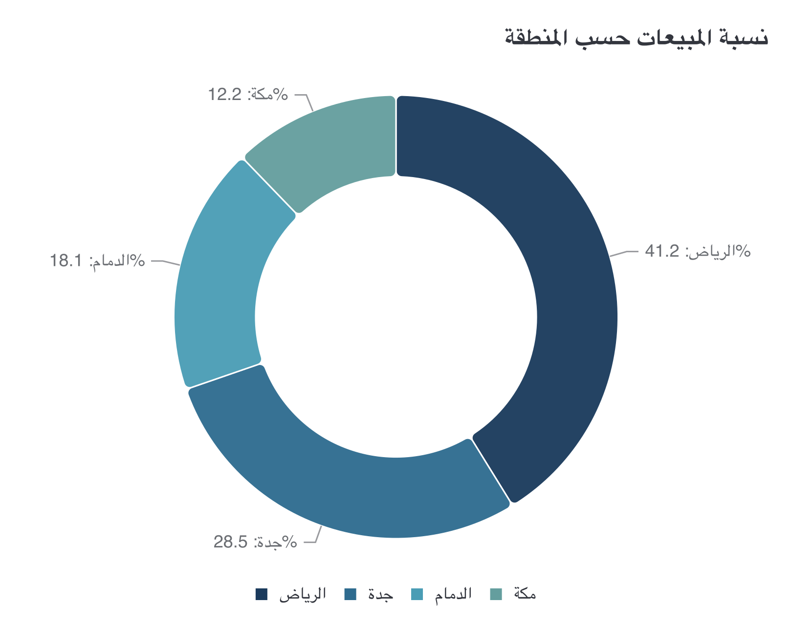

# CI-008: Sales share by region in Arabic, old repo (donut)

| Chart |
| --- |
|  |

- **Asked.**

  > ما نسبة المبيعات حسب المنطقة؟

- **Data.** Four regions with Arabic names. Mimicked in `data/ci-sales-share-ar.csv`.

| # | Problem | Severity | Status | Standard |
| --- | --- | --- | --- | --- |
| 1 | The % sign sits on the wrong side of each label | high | open | [5.4](../visualization-standards.md "A number keeps its `%` or unit next to it, in Arabic too.") |
| 2 | Shades of one blue for unordered regions | medium | open | [3.7](../visualization-standards.md "One series, one colour; distinct hues for unordered categories; grey only for 'Other' or no data.") |
| 3 | The legend runs left to right | medium | open | [6.4](../visualization-standards.md "Arabic charts read right to left, legend included.") |

### 1. The % sign sits on the wrong side of each label

- **Seen.** On every label the % sign sits at the far end, against the region name, instead of right after the number.
- **Expected.** The sign stays with its number: the region name, then 41.2%.
- **Standard.** [5.4](../visualization-standards.md "A number keeps its `%` or unit next to it, in Arabic too.") A number keeps its `%` or unit next to it, in Arabic too.
- **Cause.** Old repo; not traced. In this repo pie labels are `category: value` ([`display.js:16`](../../vis_agent/render/gptvis/display.js)), so a trailing `%` may move the same way.

### 2. Shades of one blue for unordered regions

- **Seen.** Four shades of blue, darkest for the largest, suggest an order regions don't have.
- **Expected.** Clearly different hues.
- **Standard.** [3.7](../visualization-standards.md "One series, one colour; distinct hues for unordered categories; grey only for 'Other' or no data.") One series, one colour; distinct hues for unordered categories; grey only for "Other" or no data.
- **Cause.** Old repo; not traced.

### 3. The legend runs left to right

- **Seen.** The legend starts with Riyadh on the left, each swatch left of its name.
- **Expected.** First item on the right, swatch right of its name.
- **Standard.** [6.4](../visualization-standards.md "Arabic charts read right to left, legend included.") Arabic charts read right to left, legend included.
- **Cause.** Old repo; not traced.

**Evidence.** Screenshot only; no request ID.
