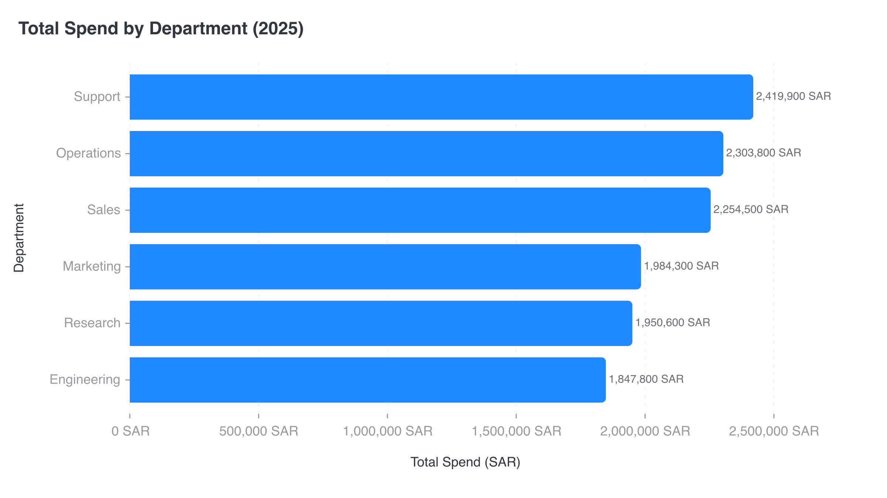

# CI-007: Total spend by department 2025, command line (horizontal bars)

| Chart |
| --- |
|  |

- **Asked.** "Total spend by department (2025)"
- **Data.** `data/ci-spend-department.csv` with its brief.

| # | Problem | Severity | Status | Standard |
| --- | --- | --- | --- | --- |
| 1 | Full numbers with units on ticks and labels | medium | open | [5.1](../visualization-standards.md "Short numbers on axes and bars (`2.5M`); full numbers in tooltips; unit once, in the axis title.") |
| 2 | Light grey axis labels | medium | open | [4.5](../visualization-standards.md "All text has 4.5:1 contrast with the background.") |

### 1. Full numbers with units on ticks and labels

- **Seen.** `2,500,000 SAR` on every tick and `2,419,900 SAR` on the bars.
- **Expected.** Short numbers, the unit once in the axis title.
- **Standard.** [5.1](../visualization-standards.md "Short numbers on axes and bars (`2.5M`); full numbers in tooltips; unit once, in the axis title.") Short numbers on axes and bars (`2.5M`); full numbers in tooltips; unit once, in the axis title.
- **Cause.** [`render/gptvis/format.js:23`](../../vis_agent/render/gptvis/format.js) adds the unit to every number; short numbers are opt-in and unused.

### 2. Light grey axis labels

- **Seen.** Department names and ticks in about `#999A9E`: 2.81:1, measured on the "Support" label.
- **Expected.** At least 4.5:1.
- **Standard.** [4.5](../visualization-standards.md "All text has 4.5:1 contrast with the background.") All text has 4.5:1 contrast with the background.
- **Cause.** The renderer's default label colour (about `#999A9E`, 2.81:1 on white); the app doesn't override it.

**Evidence.** Request `rq_88e7ef3fb4f142bbabfaecff631d57b5`, artifact `art_7080c6df1de94e45bd2471cec7f1f89e`.
