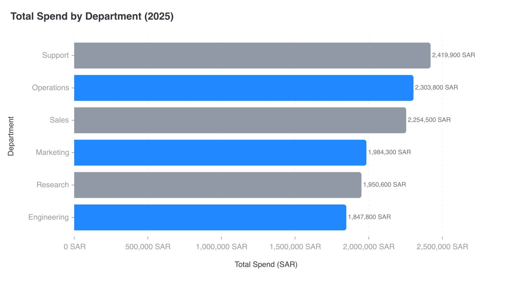

# CI-006: Total spend by department 2025, old repo (horizontal bars)

| Chart |
| --- |
|  |

- **Asked.** "Total spend by department (2025)"
- **Data.** Six departments, one total each, in SAR. Mimicked in `data/ci-spend-department.csv`.

| # | Problem | Severity | Status | Standard |
| --- | --- | --- | --- | --- |
| 1 | Bars alternate grey and blue | medium | fixed | [3.7](../visualization-standards.md "One series, one colour; distinct hues for unordered categories; grey only for 'Other' or no data.") |
| 2 | Full numbers with units on ticks and labels | medium | open | [5.1](../visualization-standards.md "Short numbers on axes and bars (`2.5M`); full numbers in tooltips; unit once, in the axis title.") |
| 3 | Light grey axis labels | medium | open | [4.5](../visualization-standards.md "All text has 4.5:1 contrast with the background.") |

### 1. Bars alternate grey and blue

- **Seen.** Grey and blue bars with no legend; grey reads as "other".
- **Expected.** One series, one colour; grey only for "Other" or no data.
- **Standard.** [3.7](../visualization-standards.md "One series, one colour; distinct hues for unordered categories; grey only for 'Other' or no data.") One series, one colour; distinct hues for unordered categories; grey only for "Other" or no data.
- **Cause.** Old repo; not traced.
- **Fix.** Not seen in this repo: [`resolve.py:393-395`](../../vis_agent/designer/resolve.py) gives a single-series chart one colour.

### 2. Full numbers with units on ticks and labels

- **Seen.** `2,500,000 SAR` on every tick and `2,419,900 SAR` on the bars.
- **Expected.** Short numbers (`2.5M`, `2.42M`), the unit once in the axis title.
- **Standard.** [5.1](../visualization-standards.md "Short numbers on axes and bars (`2.5M`); full numbers in tooltips; unit once, in the axis title.") Short numbers on axes and bars (`2.5M`); full numbers in tooltips; unit once, in the axis title.
- **Cause.** Old repo; not traced.

### 3. Light grey axis labels

- **Seen.** Department names and ticks in light grey.
- **Expected.** At least 4.5:1.
- **Standard.** [4.5](../visualization-standards.md "All text has 4.5:1 contrast with the background.") All text has 4.5:1 contrast with the background.
- **Cause.** Old repo; not traced.

**Evidence.** Screenshot only; no request ID.
