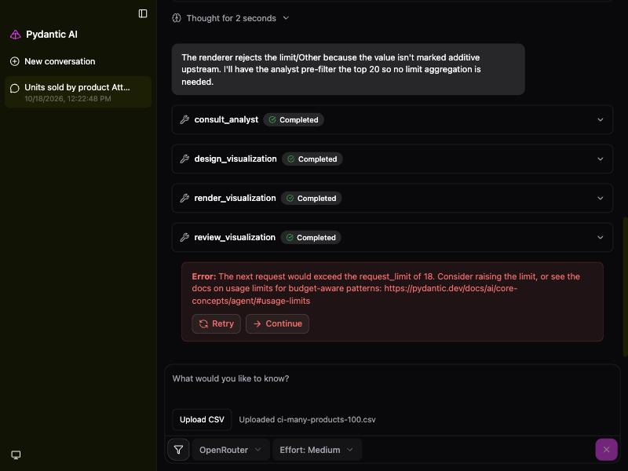
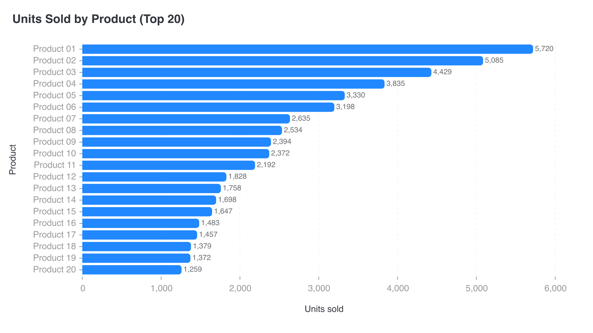

# CI-013: Units sold by product, 100 products, chat (not delivered)

| The error in the chat | Rendered, never delivered |
| --- | --- |
|  |  |

- **Asked.** "Units sold by product"
- **Data.** `data/ci-many-products-100.csv` uploaded in the chat, without a brief.

| # | Problem | Severity | Status | Standard |
| --- | --- | --- | --- | --- |
| 1 | No chart delivered: the run runs out of model requests | high | open | [1.4](../visualization-standards.md "No re-summing, percentages, 'Other' or other calculations unless the lead asked."), [7.3](../visualization-standards.md "Nothing is sampled or aggregated silently; a limit is reported as a limit.") |
| 2 | 80 of 100 products dropped without saying so | high | open | [1.4](../visualization-standards.md "No re-summing, percentages, 'Other' or other calculations unless the lead asked."), [7.3](../visualization-standards.md "Nothing is sampled or aggregated silently; a limit is reported as a limit.") |
| 3 | Light grey axis labels | medium | open | [4.5](../visualization-standards.md "All text has 4.5:1 contrast with the background.") |

### 1. No chart delivered: the run runs out of model requests

- **Seen.** The chat ends with "The next request would exceed the request_limit of 18" after the chart was rendered and reviewed.
- **Expected.** The rendered chart is delivered.
- **Standard.**
  - [1.4](../visualization-standards.md "No re-summing, percentages, 'Other' or other calculations unless the lead asked.") No re-summing, percentages, "Other" or other calculations unless the lead asked.
  - [7.3](../visualization-standards.md "Nothing is sampled or aggregated silently; a limit is reported as a limit.") Nothing is sampled or aggregated silently; a limit is reported as a limit.
- **Cause.** Two designs failed on `limit` ("Other" needs a value marked additive; defect 5 in the [lead gap analysis](../experiments/2026-09-19-lead-gap-analysis.md)), then the analyst cut the table and the lead designed again.

### 2. 80 of 100 products dropped without saying so

- **Seen.** The lead had the analyst keep the top 20; the title says "Top 20" but not "of 100", and nothing mentions the rest.
- **Expected.** Pages that show every product, or a clear "top 20 of 100" note.
- **Standard.**
  - [1.4](../visualization-standards.md "No re-summing, percentages, 'Other' or other calculations unless the lead asked.") No re-summing, percentages, "Other" or other calculations unless the lead asked.
  - [7.3](../visualization-standards.md "Nothing is sampled or aggregated silently; a limit is reported as a limit.") Nothing is sampled or aggregated silently; a limit is reported as a limit.
- **Cause.** The analyst's filter was the lead's workaround for the failed `limit`.

### 3. Light grey axis labels

- **Seen.** Product names and ticks in light grey.
- **Expected.** At least 4.5:1.
- **Standard.** [4.5](../visualization-standards.md "All text has 4.5:1 contrast with the background.") All text has 4.5:1 contrast with the background.
- **Cause.** The renderer's default label colour (about `#999A9E`, 2.81:1 on white); the app doesn't override it.

**Evidence.** Render `706fab55dd9f` in `data/renders/`; conversation of 2026-10-18 12:22. Lead `z-ai/glm-5.3`.
