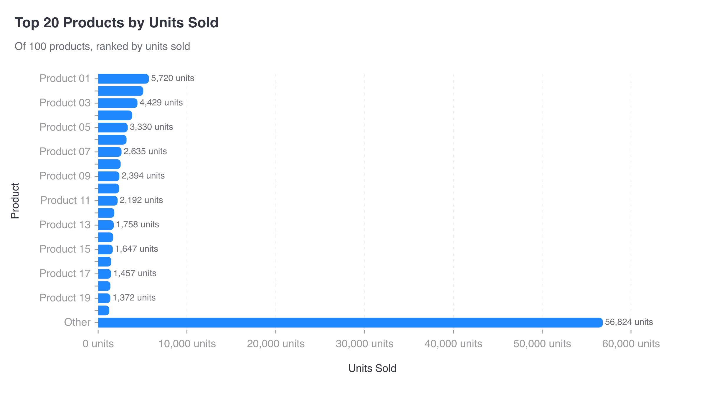

# CI-012: Units sold by product, 100 products, command line (not delivered)

| Rendered, never delivered |
| --- |
|  |

- **Asked.** "Units sold by product"
- **Data.** `data/ci-many-products-100.csv`: 100 products, one row each.

| # | Problem | Severity | Status | Standard |
| --- | --- | --- | --- | --- |
| 1 | No chart delivered: the run runs out of model requests | high | open | [1.4](../visualization-standards.md "No re-summing, percentages, 'Other' or other calculations unless the lead asked."), [7.3](../visualization-standards.md "Nothing is sampled or aggregated silently; a limit is reported as a limit.") |
| 2 | An "Other" bar holds 57% of the total | high | open | [3.7](../visualization-standards.md "One series, one colour; distinct hues for unordered categories; grey only for 'Other' or no data."), [4.3](../visualization-standards.md "Long rankings are paged (up to 20 bars a page), not folded into a huge 'Other'.") |
| 3 | The real bars are flattened into the left tenth | high | open | [4.3](../visualization-standards.md "Long rankings are paged (up to 20 bars a page), not folded into a huge 'Other'."), [S-001](../standards-suggestions.md "Suggested: No broken axes on bars, columns or areas; use a log scale (3.2) or name the far-out value (3.3) instead.") |
| 4 | Every second bar loses its name and value | medium | open | [4.2](../visualization-standards.md "Every category name shows; labels are never dropped silently.") |

### 1. No chart delivered: the run runs out of model requests

- **Seen.** "The next request would exceed the request_limit of 18". The chart below was rendered but never published.
- **Expected.** The rendered chart is delivered, marked unreviewed if needed.
- **Standard.**
  - [1.4](../visualization-standards.md "No re-summing, percentages, 'Other' or other calculations unless the lead asked.") No re-summing, percentages, "Other" or other calculations unless the lead asked.
  - [7.3](../visualization-standards.md "Nothing is sampled or aggregated silently; a limit is reported as a limit.") Nothing is sampled or aggregated silently; a limit is reported as a limit.
- **Cause.** The lead asked the analyst to re-sum a table that already had one row per product, which spent the budget (`REQUEST_LIMIT = 18`, [`requests/service.py:27`](../../vis_agent/requests/service.py)); running out ends the run with an exception (defect 2 in the [lead gap analysis](../experiments/2026-09-19-lead-gap-analysis.md)).

### 2. An "Other" bar holds 57% of the total

- **Seen.** Top 20 plus "Other" (56,824 units), ten times longer than any real bar and in the same blue.
- **Expected.** Pages instead; a requested "Other" at most 20% of the total, last and grey.
- **Standard.**
  - [3.7](../visualization-standards.md "One series, one colour; distinct hues for unordered categories; grey only for 'Other' or no data.") One series, one colour; distinct hues for unordered categories; grey only for "Other" or no data.
  - [4.3](../visualization-standards.md "Long rankings are paged (up to 20 bars a page), not folded into a huge 'Other'.") Long rankings are paged (up to 20 bars a page), not folded into a huge "Other".
- **Cause.** `limit` folds the rest into "Other" with no size rule and no muted colour.

### 3. The real bars are flattened into the left tenth

- **Seen.** "Other" sets the axis at 0–60,000; the real bars (1,259–5,720) look almost the same length.
- **Expected.** Each page scaled to its own bars.
- **Standard.**
  - [4.3](../visualization-standards.md "Long rankings are paged (up to 20 bars a page), not folded into a huge 'Other'.") Long rankings are paged (up to 20 bars a page), not folded into a huge "Other".
  - [S-001](../standards-suggestions.md "Suggested: No broken axes on bars, columns or areas; use a log scale (3.2) or name the far-out value (3.3) instead.") (proposed suggestion) No broken axes on bars, columns or areas; use a log scale (3.2) or name the far-out value (3.3) instead.
- **Cause.** One axis for the whole chart, set by "Other".

### 4. Every second bar loses its name and value

- **Seen.** Product 02, 04, 06 … have no name and no value.
- **Expected.** Every name shown; labels that don't fit change the chart.
- **Standard.** [4.2](../visualization-standards.md "Every category name shows; labels are never dropped silently.") Every category name shows; labels are never dropped silently.
- **Cause.** The renderer hides overlapping labels, and nothing reports it.

**Evidence.** Request `rq_bf85d2f1ccb54731b60a45c860ee22ec` (18 of 18 requests; steps analyze, design, render). Lead `z-ai/glm-5.3`.
