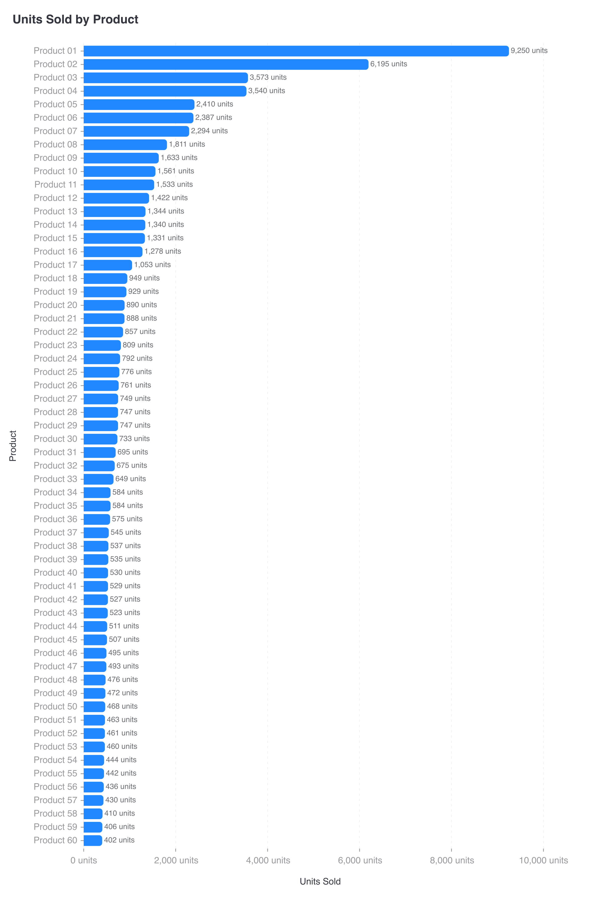

# CI-011: Units sold by product, 60 products, command line (horizontal bars)

| Chart |
| --- |
|  |

- **Asked.** "Units sold by product"
- **Data.** `data/ci-many-products-60.csv`: 60 products, one row each.

| # | Problem | Severity | Status | Standard |
| --- | --- | --- | --- | --- |
| 1 | The leader flattens the tail, so bars can't be compared | high | open | [4.3](../visualization-standards.md "Long rankings are paged (up to 20 bars a page), not folded into a huge 'Other'.") |
| 2 | Every bar in one very tall chart | medium | open | [4.3](../visualization-standards.md "Long rankings are paged (up to 20 bars a page), not folded into a huge 'Other'.") |
| 3 | Full numbers with units on ticks and labels | medium | open | [5.1](../visualization-standards.md "Short numbers on axes and bars (`2.5M`); full numbers in tooltips; unit once, in the axis title.") |
| 4 | Light grey axis labels | medium | open | [4.5](../visualization-standards.md "All text has 4.5:1 contrast with the background.") |

### 1. The leader flattens the tail, so bars can't be compared

- **Seen.** The top product (9,250 units) sets the axis; the 400–900-unit tail is 4–10% of it.
- **Expected.** Pages, each scaled to its own bars; no broken axis on bars.
- **Standard.** [4.3](../visualization-standards.md "Long rankings are paged (up to 20 bars a page), not folded into a huge 'Other'.") Long rankings are paged (up to 20 bars a page), not folded into a huge "Other".
- **Cause.** One axis for the whole ranking.

### 2. Every bar in one very tall chart

- **Seen.** 60 bars in one 3,600-pixel-tall image.
- **Expected.** Pages of up to 20 bars, at most 3, then the table.
- **Standard.** [4.3](../visualization-standards.md "Long rankings are paged (up to 20 bars a page), not folded into a huge 'Other'.") Long rankings are paged (up to 20 bars a page), not folded into a huge "Other".
- **Cause.** The chart language has no paging.

### 3. Full numbers with units on ticks and labels

- **Seen.** `10,000 units` ticks, `9,250 units` labels.
- **Expected.** Short numbers, the unit once in the axis title.
- **Standard.** [5.1](../visualization-standards.md "Short numbers on axes and bars (`2.5M`); full numbers in tooltips; unit once, in the axis title.") Short numbers on axes and bars (`2.5M`); full numbers in tooltips; unit once, in the axis title.
- **Cause.** [`render/gptvis/format.js:23`](../../vis_agent/render/gptvis/format.js) adds the unit to every number; short numbers are opt-in and unused.

### 4. Light grey axis labels

- **Seen.** Product names and ticks in light grey.
- **Expected.** At least 4.5:1.
- **Standard.** [4.5](../visualization-standards.md "All text has 4.5:1 contrast with the background.") All text has 4.5:1 contrast with the background.
- **Cause.** The renderer's default label colour (about `#999A9E`, 2.81:1 on white); the app doesn't override it.

**Evidence.** Request `rq_12c0b70cc1234230890fb7c422355129`, artifact `art_2226fb81315f4150a17399e4bc3240fe`.
