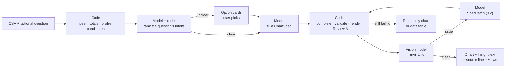

# 1. The System Structure

[Index](README.md) · [2. Stack & Architecture →](02-stack-and-architecture.md)

## 1.1 Goal

Turn a clean CSV and an optional question into a well-chosen chart that passed automated review before the user sees it. If the question is unclear, offer ranked options instead of guessing. After a chart, the user can refine it or ask for other ways to plot it.

| Principle                        | In practice                                                                          |
| -------------------------------- | ------------------------------------------------------------------------------------ |
| **Deterministic first**          | Code parses, profiles, filters charts by rule, renders and checks every number.      |
| **Models choose, never compute** | A model fills a `ChartSpec` that names columns. It never writes code or data values. |
| **Rules narrow first**           | The model picks only from the charts a guideline allows.                             |
| **Local models**                 | Production uses local Ollama; hosted Ollama Cloud only in development (ADR 0025).    |
| **Reviewed before shown**        | Code checks (Review A) and a vision review (Review B).                               |
| **Bilingual**                    | Arabic and English everywhere, with mirrored layout.                                 |

## 1.2 At a glance

The model sees the data profile, at most 10 sample rows and the question, never the full CSV.

## 1.3 Main parts

| Part                     | Who          | Does                                                               |
| ------------------------ | ------------ | ------------------------------------------------------------------ |
| Ingest and profile       | Code         | Reads the CSV, drops total rows, finds roles, units and additivity |
| Candidates               | Code         | Lists the insights the data supports, each with its allowed charts |
| Intent ranker            | Model + code | Scores which insight answers the question                          |
| Chart generator          | Model        | Fills the `ChartSpec`                                              |
| `complete_spec`          | Code         | Sets aggregates, top-N, "Other" and pages; the model can't         |
| Renderer                 | Code         | Spec → Plotly figure → PNG                                         |
| Review A                 | Code         | 47 checks; numbers recomputed in DuckDB                            |
| Review B and reviser     | Models       | Vision critique; a small `SpecPatch`                               |
| Numbers and insight text | Model + code | The model names what to compute; code computes and checks the text |
| `ChartAgent` + API + UI  | Code         | Runs, sessions, SSE, React chat with Mapbox maps                   |

Code lives under `backend/app/services/` and `frontend/src/features/`.

## 1.4 Terms

- **Insight type:** what a chart is for (trend, comparison, ranking, composition, distribution, relationship,
map, single number…).
- **Code-owned field:** a spec field hidden from the model and set by code (ADR 0049).
- **Fidelity:** the drawn numbers equal the numbers recomputed from the CSV.
- **Golden / held-out:** evaluation cases used during development / labelled blind before any run.

