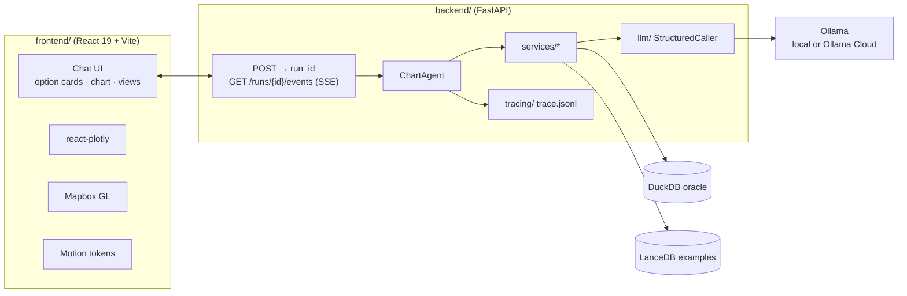

# 2. Stack & Architecture

[← 1. System Structure](01-system-structure.md) · [Index](README.md) · [3. How It Works →](03-how-it-works.md)

## 2.1 Stack

| Layer | Stack |
| --- | --- |
| Backend | Python 3.12, uv, FastAPI + SSE, Pydantic v2 |
| Data and charts | pandas, DuckDB (SQL checks), Plotly, Kaleido for PNGs |
| Models | Gemma 4 through Ollama: `gemma4:31b` on Ollama Cloud in development, `12b`/`e4b` locally |
| Retrieval | LanceDB with a local embedding model |
| Frontend | React 19, Vite, TypeScript, react-plotly, Mapbox GL, Motion, i18next |

## 2.2 Pattern

A **fixed pipeline run by code**, with model calls at named points. One `ChartAgent` handles each user action
(ask, choose an option, give feedback, ask for alternatives), and every run ends with exactly one final event.
visualization-agent is the opposite: there, a lead model chooses each step.

## 2.3 Model roles

Nine roles, all `gemma4:31b` on the cloud tier, none with tools. Each returns a small JSON shape: column roles
(only when unsure), intent ranking, alternatives ranking, feedback type, metric request, chart spec, spec revision,
visual review and insight text. Thinking is off: it was measured as slower and no better (ADRs 0024, 0026). Quota
and rate-limit errors are retried, then the step degrades.

## 2.4 Where things are defined

- **Contracts:** Pydantic in `backend/app/domain/`, generated into TypeScript.
- **Rules and limits:** `backend/knowledge/guidelines/v1/` and `backend/config/app.yaml`, listed in
  `docs/visualization-standards.md`.
- **Prompts:** `backend/prompts/<role>/<version>/`.
- **Text and styles:** `frontend/src/i18n/` and `shared/design-tokens/tokens.json`.

**Run it:** `make api` and `make web`. **Read first:** `docs/PROJECT_BRIEF.md`, `docs/architecture.md`,
`backend/app/services/orchestration/chart_loop.py`.
