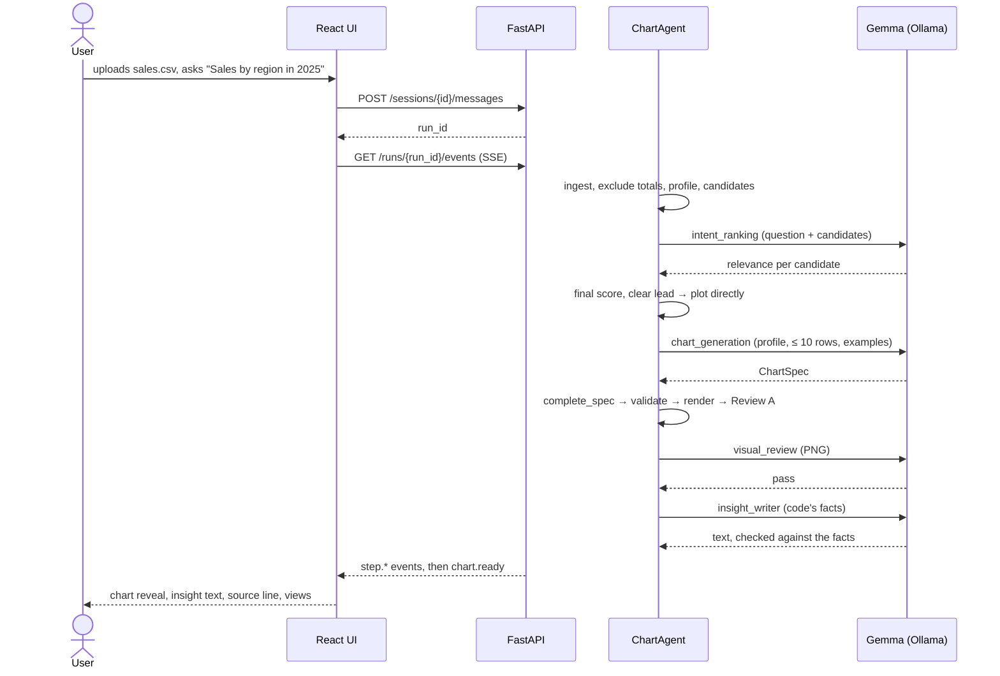
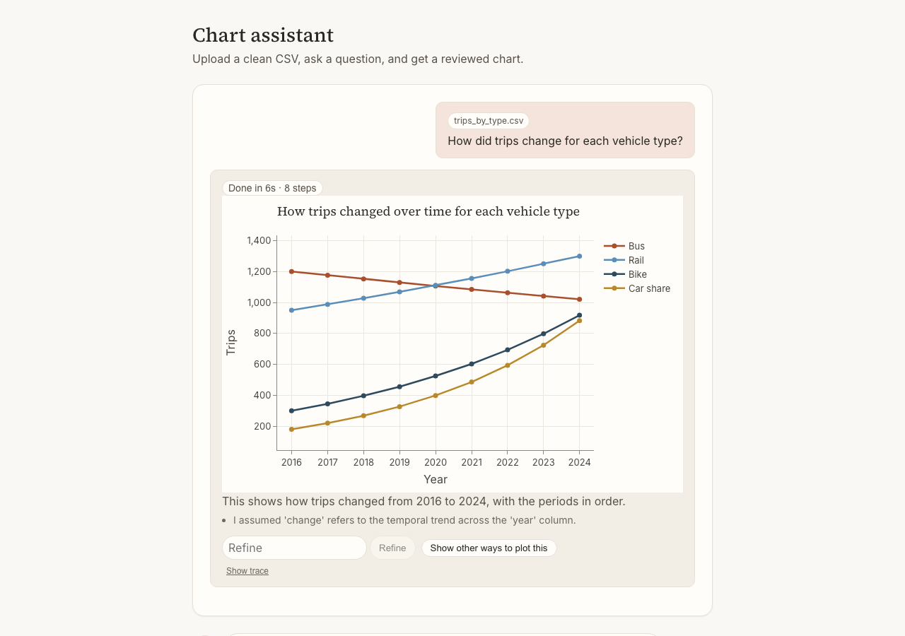
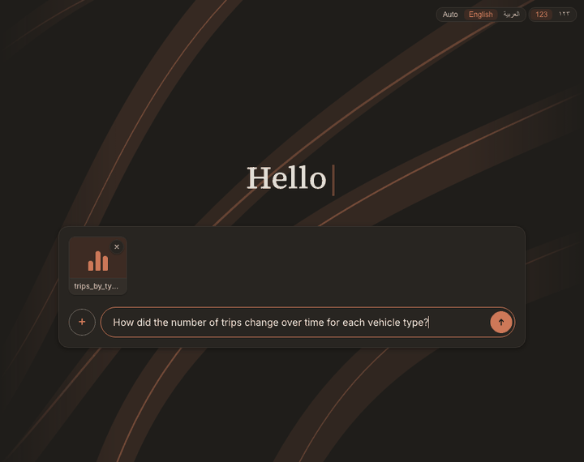
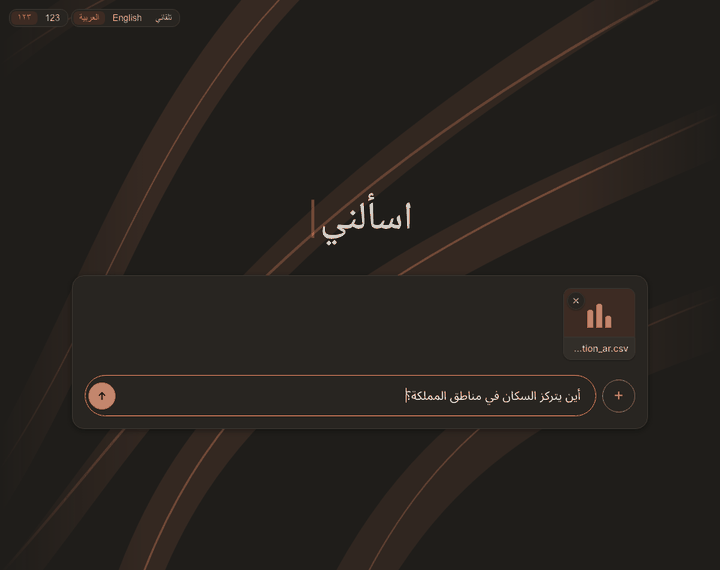
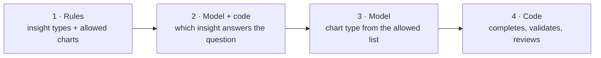
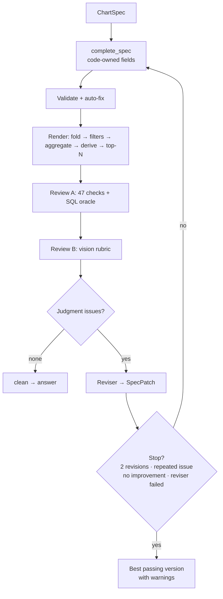

# 3. How It Works

[← 2. Stack & Architecture](02-stack-and-architecture.md) · [Index](README.md) · [4. Rulesets →](04-rulesets.md)

## 3.1 One request

About 4 model calls and 6 seconds per request **[Measured]**.

| The first chart reply | Insight text, English | Arabic with a Mapbox map |
| --- | --- | --- |
|  |  |  |

Click to enlarge. Sample data, from `docs/phase-notes/media/`.

## 3.2 How the chart is chosen

- **Score** = 45% model relevance + 25% code's evidence (the question names the columns) + 30% structural fit.
- **Plot directly** only when the top score is ≥ 0.75 and leads by ≥ 0.15; otherwise show 3–5 option cards.
- A requested chart ("as a pie") is settled by rule first, with a note if refused.

## 3.3 Review and revise

If nothing passes, the user gets a rules-only chart, then a data table. A failed model call degrades its step
instead of failing the run.

## 3.4 Other requests

- **Single number** ("How many orders in 2025?"): the model names the metric, code computes it, SQL checks it.
- **Named comparison** ("Riyadh vs. Jeddah"): code finds the names and draws by rule.
- **Refine** ("sort ascending") or **other ways to plot**: a patch to the current chart, or new option cards.
- **Instant views:** switch orientation, measure, page or table without another model call.
