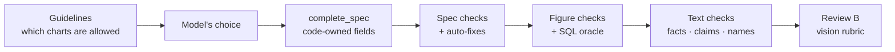
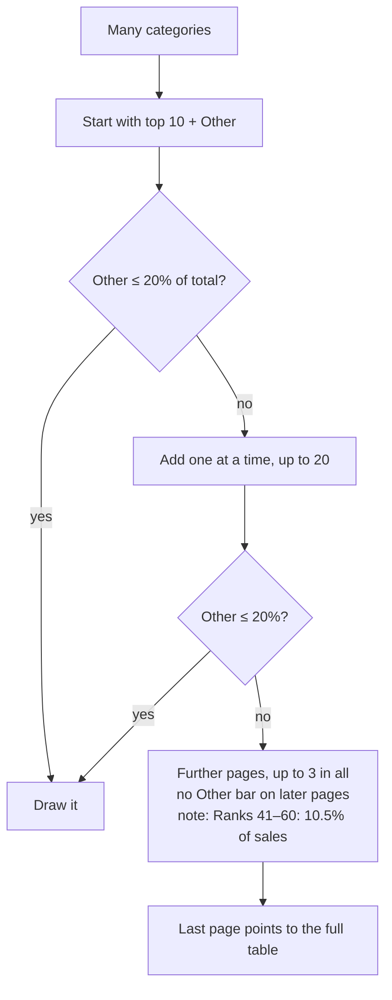

# 4. Rulesets

[← 3. How It Works](03-how-it-works.md) · [Index](README.md) · [5. Design Decisions →](05-design-decisions.md)

The rules are what make a weak model safe to use: they decide which charts are possible, what the numbers are, and
whether the result may be shown. All 87 are numbered in `docs/visualization-standards.md`; this is the summary.

## 4.1 How the rules run

A rule is either set by code (the model can't break it), **blocking** (the chart is never shown), or **revise**
(sent back, up to 2 times). A test fails if the standards doc and the config disagree on a number.

## 4.2 Choosing the chart

| Insight | Rule |
| --- | --- |
| Trend | A line; never a pie, donut or scatter for time. |
| Comparison | Vertical bars up to 12 categories, horizontal above; never a pie or a line. |
| Ranking | Sorted horizontal bars. |
| Composition | Bars; a pie or donut only with ≤ 5 parts. |
| Change between two periods | A dumbbell, or a slope with ≤ 8 categories. |
| Distribution | A histogram, or box plots per group; never pooled across periods. |
| Relationship | A scatter with ≥ 5 rows. |
| Maps | Regions: filled map. Points up to 1,000, then density. |

## 4.3 Honest charts

- Bars and areas start at zero. No dual axes, no 3D.
- A log scale only when it's clearly better; far-out values are marked at the axis edge, never hidden.
- Pie and stacked charts only for parts that add up.
- Time keeps its order and equal intervals; an unfinished latest period is marked partial.
- Green and red only when the measure has a known better side.

## 4.4 Readability

At most 5 pie slices, 8 series, 20 vertical bars or 30 horizontal bars per chart. Every bar label shows, with its
value at the end (up to 25 bars), and stacks show their totals. Long lists use this rule:

## 4.5 Correct numbers

- **Total rows** ("All regions") are found, left out and disclosed.
- **Code picks the aggregate:** sums for additive measures, weighted means for rates. A plain average of rates is
  blocked.
- **Derived values** come from a short list: share, change, % change, per capita, rank.
- **The model may not** filter unasked, invent a unit, or write a number that isn't in the data.
- **Every plotted number is recomputed in SQL** from the CSV, separately from the drawing code, and must match.
- Every reply ends with a **source line**: method, rows used, periods and the check result.

## 4.6 Text, language and maps

- **Insight text:** code computes up to 12 facts; every number, name and claim word ("doubled") in the text must
  match one. No causes or advice. One rewrite, then a template.
- **Language:** chart text follows the question's language; Arabic-Indic digits are a display setting only.
- **Tooltips:** one `column: value` line per fact.
- **Maps:** places matched in English and Arabic; filled maps carry no labels; the interactive map must equal the
  checked one.

## 4.7 Not enforced yet

Sequential colours for ordered categories, bars that hide small differences far from zero, measures without a true
zero, and periods the data marks as partial.
