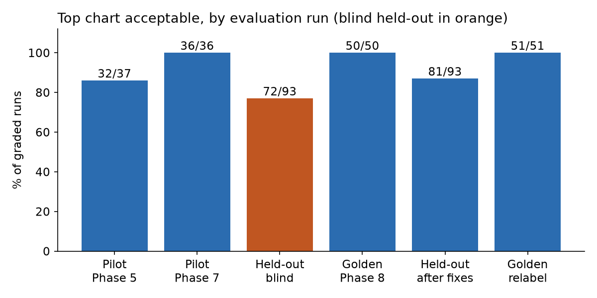
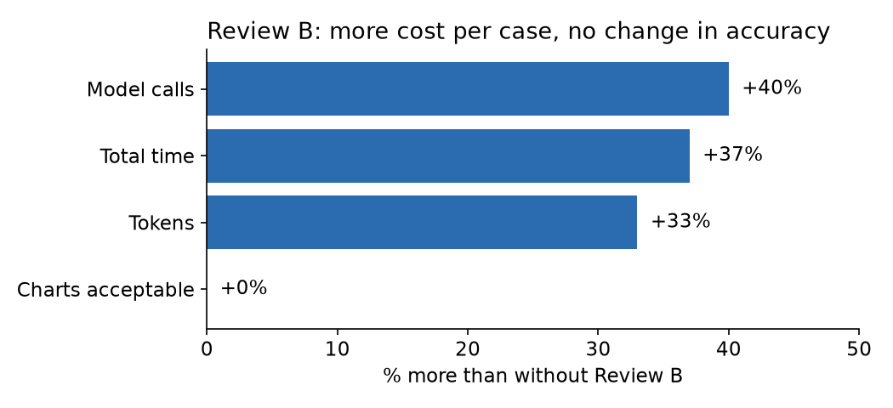
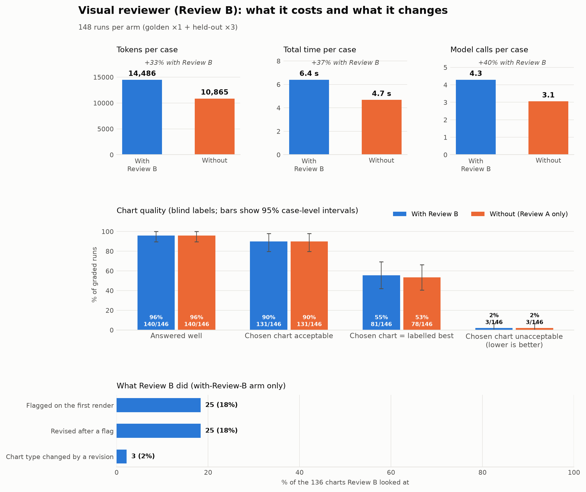
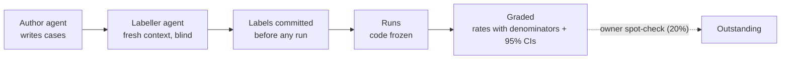

# 5. Design Decisions

[← 4. Rulesets](04-rulesets.md) · [Index](README.md) · [6. Work Log →](06-work-log.md)

Each decision has an ADR in `docs/decisions/` (0001–0081).

## 5.1 The main decisions

| Decision | Why | Cost |
| --- | --- | --- |
| **A fixed pipeline; models only at named points** | Local models are weak, so code narrows the choice first | Each new request kind needs its own path |
| **The model fills a spec; it never writes code or values** | Nothing a model writes is ever executed | Every chart type needs compiler code |
| **Code owns aggregates, top-N and pages** | The model got sums, rate averages and list sizes wrong | More code in `complete_spec` (ADR 0049) |
| **Numbers re-checked in SQL, separately** | A check must not share the code it checks | Two ways to compute every number (ADR 0050) |
| **Intent = model + code's evidence + structure** | The model alone guessed poorly without a question | Weights to tune (ADR 0051) |
| **Insight text only from code's facts** | Free model text invented numbers and causes | A fact engine and a validator (ADR 0059) |
| **Ollama Cloud in development only** | Local 12b took 102 s a run vs. 4.6 s | Only non-sensitive data in development (ADR 0025) |
| **Arabic and English everywhere** | The users read Arabic | Every screen built for both directions |

## 5.2 Results

The share of runs whose first chart was acceptable, judged against blind labels **[Measured]**:

| Run | Acceptable | Unacceptable |
| --- | --- | --- |
| Pilot, Phase 5 (09-20) | 32/37 | 5/37 |
| Pilot, after Phase 7 fixes (09-24) | 36/36 | 0/36 |
| **Held-out, blind (10-01)** | **72/93** | **9/93** |
| Golden (10-01) | 50/50 | 0/50 |
| Held-out after fixes (10-07) | 81/93 | 0/93 |
| Golden after relabel (10-08) | 51/51 | 0/51 |

**72/93 is the honest number.** The later fixes saw the held-out cases, so 81/93 needs a fresh set to confirm.
Single-number answers were exact in 12/12 runs.

## 5.3 Is an extra model worth it?

Each optional model was run with and without it on the same cases **[Measured]**:

- **Vision reviewer (Review B):** the same accuracy (131/146 either way), at 40% more calls and 37% more time. It
  mostly rewrote titles.
- **Retrieved examples:** the same score with none, fixed or embedded examples (32/37); they only changed style.
- **Bigger model:** local 12b scored the same as cloud 31b, but was 22× slower.

| The full benchmark (click to enlarge) |
| --- |
|  |

## 5.4 How the evaluation stayed honest

Labellers saw only the question, a data preview and the candidate images. Every rate keeps its denominator, and
comparisons too close to call were reported as unresolved rather than given a winner.

## 5.5 Still open **[Open]**

- The owner's review of Phases 6–8, the label spot-checks, and 16 decisions taken conservatively.
- 37 evaluation cases need a blind relabel after the latest chart changes, and the held-out set needs replacing.
- Whether to keep Review B on (5.3).

## 5.6 Takeaways

1. Code that narrows and checks lets a mid-size model choose charts well.
2. Quote the first number that wasn't tuned to the cases.
3. An extra model must earn its cost in a with/without test.
4. Most real bugs were in the data (totals, rates, long lists, time axes), not in chart choice.
