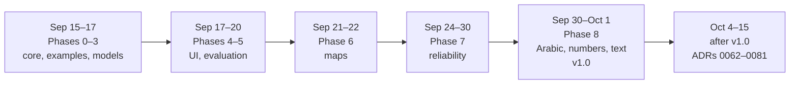
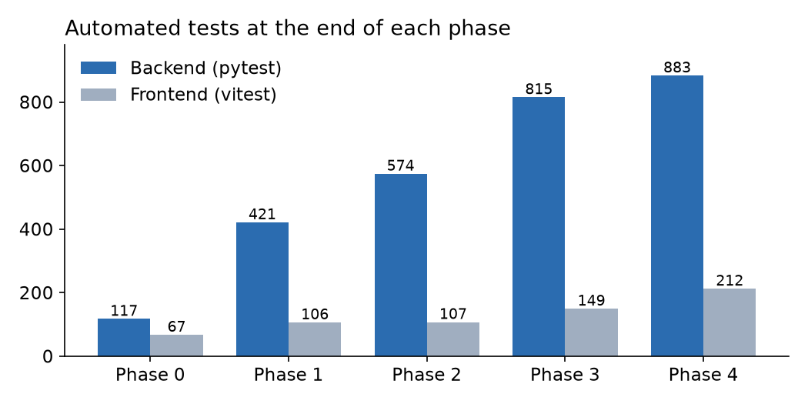

# 6. Work Log

[← 5. Design Decisions](05-design-decisions.md) · [Index](README.md)

How the experiment unfolded over one month, what it taught, and what is worth bringing into visualization-agent.

## 6.1 Timeline

| Phase | Built | Result |
| --- | --- | --- |
| 0–2 | Scaffold, code-only core (read, profile, render, 30 checks), 56 worked examples | `make render` draws a hand-written spec |
| 3 | The model roles and `ChartAgent` | Six real-model scenarios pass |
| 4 | FastAPI, React chat UI, motion system | Upload to chart in about 6–9 s |
| 5 | Blind labels, evaluation runner, ablations | Pilot 32/37 |
| 6 | Maps: Saudi regions, countries, points, Mapbox | 12/12 on map cases |
| 7 | Total rows, code-owned fields, SQL re-check | Pilot 36/36 |
| 8 | Arabic everywhere, single numbers, insight text, held-out set | Held-out 72/93 |
| After v1.0 | 46 commits, ADRs 0062–0081 | See 6.2 |

Counts as reported in the phase notes (later phases stopped reporting them).

## 6.2 The chats

Four Claude Code chats remain (09-17 to 10-15); the Phase 0–3 chat is gone, so its phase notes stand in. Most of
the work came from requests like these:

- **Phases 4–5:** plan first, answer review questions, then build; label the evaluation blind with Claude vision.
- **Maps and traces:** interactive Mapbox maps in the theme, no text on filled regions, tooltips as
  `column: value`, a business-level trace view.
- **Reliability (Phase 7):** a full review of how the agent could be wrong, then 16 fixes.
- **After v1.0:** benchmark Review B, size long lists by "Other" with pages, comparisons of named places, instant
  view switches, honest log axes, green/red only with meaning, and many Arabic fixes.

## 6.3 Lessons

- **Narrow, then check.** The model chose well among allowed options; its errors were in fields code could own.
- **Questions help the model.** With a question, 1 of 18 first charts was unacceptable; without one, 4 of 19.
- **Quote the untuned number.** 72/93 before the fixes, not 81/93 after.
- **Labels must see what the agent draws.** 11 cases changed when the test images matched the real charts.
- **Extra models must pay their way.** Review B, retrieval and the bigger model added cost, not accuracy.
- **Most bugs are in the data.** Totals, averaged rates, long lists and time axes, more than chart choice.
- **Arabic is a whole surface.** Text direction, digits, plurals, fonts and axis spacing each needed work.

## 6.4 What carries over to visualization-agent

This repo works differently: the upstream CSV is final, and a lead model chooses each step (`AGENTS.md`).

| Idea | Carries over? |
| --- | --- |
| Every number computed by code and re-checked in SQL | **Yes** |
| Honest axes, labels on every bar, rankings as horizontal bars | **Yes**, already in [the standards](../visualization-standards.md) |
| Insight text checked against facts | **Yes**, as a tool the lead calls |
| Arabic labels and digits as display only | **Yes**, matches `display_labels` |
| A with/without test for each extra model | **Yes**, for the visual inspector |
| Blind evaluations with denominators | **Yes** |
| Long lists with pages | **Partly**: "Other" sums would re-aggregate the CSV |
| Total-row removal, derived measures | **No**: the CSV is prepared upstream |
| Option cards and an automatic revise loop | **No**: the lead decides, without asking the user |

Problems seen in this repo's charts are logged in [chart issues](../chart-issues/README.md).
