# Chart Generator Agent — How I Built It

*An experiment in letting an LLM choose charts without letting it break them.* · As of 2026-10-18

> **The result in one line:** drop any CSV / Excel / JSON file and get the right interactive chart, fully in Arabic, where Gemini *chooses* the chart and deterministic rules *decide* whether that choice ships.

**Upload → Analyze → Localize → Generate the best chart → Explore**

---

## 1 · The experiment

| | |
|---|---|
| **Problem** | People pick the wrong chart (a 30-slice pie, a line across unrelated categories, a bar axis starting at 900), and building a chart by hand takes ten minutes. |
| **Hypothesis** | An LLM is good at *judgement* (which framing answers the question, what to call it) but bad at *guarantees* (arithmetic, consistency, obeying every rule). Pair it with code that owns the guarantees, and you get charts that are both smart and correct. |
| **Setup** | Browser profiles the data → rules list every valid chart → Gemini picks one and writes an Arabic title → validator approves, repairs or replaces it. |
| **Constraints** | Rows never leave the browser. Gemini returns JSON, never code. Everything on screen is Arabic. The app must work with no API key at all. |
| **Outcome** | 19 chart types, 48 encoded rules, maps of real places, Arabic localization, a full pipeline log, and 214 automated tests. The rules-only fallback was proven live when the Gemini free-tier quota ran out mid-development: every chart still rendered. |

### What it can do

| Capability | Detail |
|---|---|
| Formats | CSV, TSV, XLSX/XLS, JSON — up to 30 MB, first 250,000 rows analyzed |
| Chart types | 19 in 7 families (see §6) |
| Choice | At most **3** charts per dataset: one recommendation + up to 2 alternatives |
| Language | Arabic RTL interface; English labels translated for display only |
| Maps | Choropleth, bubble map, geographic heatmap — Saudi regions and world countries |
| Rules | 48 encoded visualization rules |
| Offline | No Gemini key → the rules engine picks, and the page says so |

---

## 2 · Architecture

Two processes, one origin: a browser app that holds the data, and a tiny Node server that holds the Gemini key.

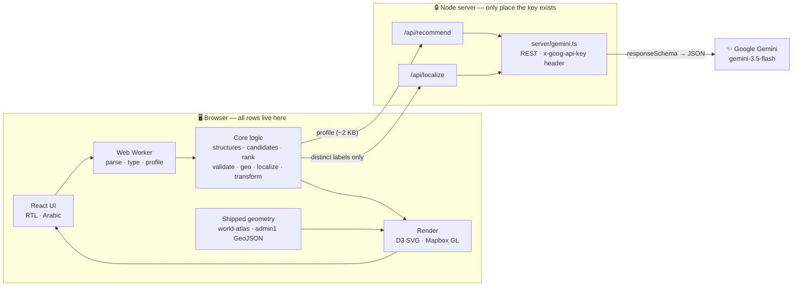

| Layer | Stack |
|---|---|
| Build | Vite 8, TypeScript 6 |
| UI | React 19 + `motion` |
| Charts | D3 7 — one persistent SVG, no chart library |
| Maps | Mapbox GL JS 3 + boundary files shipped in the repo |
| Parsing | papaparse, SheetJS, native JSON — inside a Web Worker |
| Validation | zod (spec + translations) |
| AI | Gemini `gemini-3.5-flash` over plain REST, structured output |
| Tests | Vitest, ESLint, `tsc` |

- **Dev:** `server/vitePlugin.ts` mounts both handlers inside Vite.
- **Prod:** `server/start.ts` serves `dist/` and both routes from one Node process.
- Both are Fetch-style `(Request) => Response` handlers → the same code deploys to Vercel / Netlify / Cloudflare / Deno.

### Where the code went

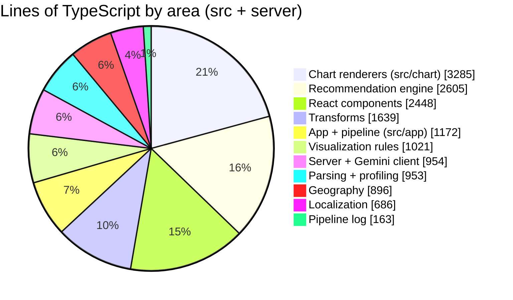

Plus **3,049 lines of tests** and 2,162 lines of CSS. The two largest areas are drawing charts and *deciding* charts — the AI call itself is a small slice.

---

## 3 · The pipeline, upload to pixels

Eight stages. Only stage 5 touches the network, and every failure narrows what is offered rather than blanking the screen.

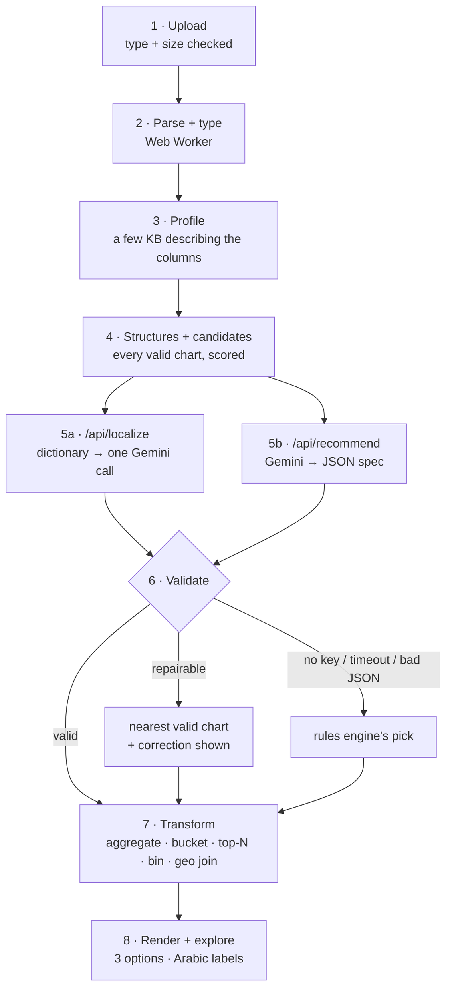

| Stage | Code | What it does |
|---|---|---|
| 1 Upload | `UploadScreen.tsx` | Rejects empty, unsupported or >30 MB files with an Arabic message |
| 2 Parse + type | `src/core/data/` in `dataWorker.ts` | Infers quantitative / temporal / categorical / identifier / text / empty. 90 s watchdog |
| 3 Profile | `profileDataset.ts` | Min/max/mean/median/quartiles, top 12 categories, date granularity, Pearson r, 6 sample rows |
| 4 Candidates | `structures.ts`, `candidates.ts`, `rank.ts` | Names the data's shape, scores every chart that fits, trims to 1 + 2 |
| 5a Localize | `src/app/localize.ts` | Distinct non-Arabic labels → dictionary → one Gemini call for the rest |
| 5b Recommend | `src/app/api.ts` | Profile + top 6 candidates + rules → schema-constrained JSON |
| 6 Validate | `validateSpec.ts` | Fields exist, types fit, 12 overrides, scale rules → repair or fall back |
| 7 Transform | `src/core/transform/` | Aggregation, time buckets, top-N + gray "All others", bins, scatter sampling to 4,000 points |
| 8 Render | `src/chart/`, `MapCanvas.tsx` | Keyed marks morph between chart types; bidi-isolated Arabic text |

### One request, as a sequence

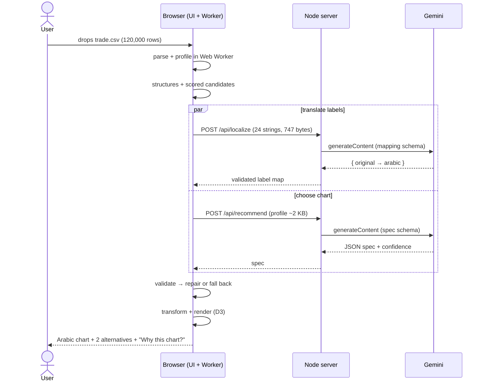

---

## 4 · Why not just send the file to the model?

| Concern | "Send the whole file" | This architecture |
|---|---|---|
| Size | A 6 MB CSV is millions of tokens | Profile is a few KB regardless of file size |
| Cost & latency | Pay per token, every time | One small request |
| Correctness | Model eyeballs rows and guesses | Browser *computes* min, max, distinct counts, correlations exactly |
| Determinism | Same file → different charts, invented columns | Columns resolved against the real schema; invalid answers rejected |
| Safety | Model code gets executed | Model returns a fixed JSON shape; renderer only draws data |
| Data exposure | Every row leaves the browser | Only a description + a few sample rows + category names |

**What actually goes over the wire** (measured on the real fixture):

| Payload | Size |
|---|---|
| Raw trade file — 120,000 rows × 4 columns | **4.4 MB** |
| Profile sent to `/api/recommend` | **≈ 2 KB** |
| Labels sent to `/api/localize` — 20 countries + 4 products | **747 bytes** (collected in 0.5 ms) |

That is a **~2,000× reduction** before the model sees anything.

---

## 5 · How the right chart gets chosen

The model never has the first word or the last: rules write the menu, Gemini picks from it, validation decides whether the pick ships.

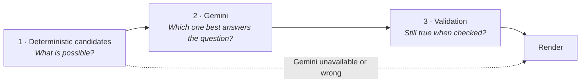

| | Deterministic rules | Gemini | Validation |
|---|---|---|---|
| **Good at** | Being right every time, cheaply | Picking the framing; naming things | Catching where the model is wrong |
| **Bad at** | Knowing what the user cares about | Consistency, arithmetic, every constraint | Can only choose among valid options |
| **Owns** | What is possible; how it is drawn | Which one, and what it is called | Whether the answer ships |

### Step 1 — Find the structure

Column types alone ("two categorical, one numeric") don't say which chart fits. `structures.ts` names the data's shape first.

| Structure | Signal | Charts it argues for |
|---|---|---|
| hierarchy | one category nests inside another | treemap, sunburst |
| timeSeries | a date + a measure | line, area |
| matrix | two categories crossing into 20+ cells | heatmap |
| distribution | one measure, measured repeatedly | histogram, box plot |
| correlation | two measures with \|r\| ≥ 0.5 | scatter |
| multiMeasure | 3+ measures per row | bubble |
| ranking | 5+ categories to order | horizontal bar, lollipop |
| partToWhole | parts sum to a meaningful total | donut (≤ 6), 100% stacked |
| groupedComparison | two categories, few series | grouped, stacked bars |
| geography | values resolve to real places | choropleth, bubble map |

### Step 2 — Score every candidate

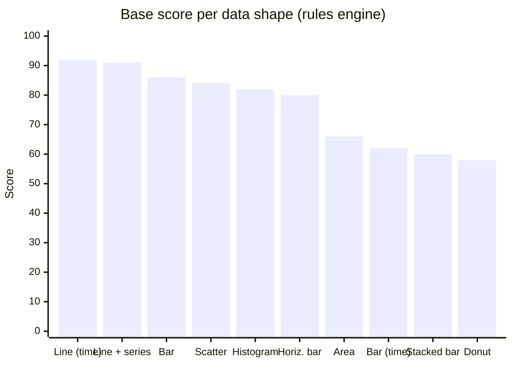

Time series score highest; donuts lowest (and only when 2–6 parts sum to a whole). Scatter drops to 48 when a time or category column is present; histogram drops to 45 when other shapes exist.

### Step 3 — Gemini proposes

`prompt.ts` sends the profile, top 6 candidates, the structures and the rules. Settings: `responseMimeType: application/json`, a `responseSchema`, temperature 0.2, low thinking level. Gemini returns chart type (an enum — it cannot invent `"3d-pie"`), fields, aggregation, sort, scale hints, an Arabic title + reason, and its own **confidence (0–1)**.

### Step 4 — Validation repairs or replaces

Twelve overrides run on every answer. Each adds a plain-Arabic note under **"Why this chart?"**.

| If Gemini proposes… | It becomes | Because |
|---|---|---|
| a donut with > 6 slices | horizontal bar | too many slices to compare |
| a donut over negatives | bar | parts can't be negative |
| a donut / stacked bar over averages | bar / grouped bar | averages don't sum to a whole |
| a grouped bar with > 4 series | stacked bar | side-by-side becomes unreadable |
| a vertical bar with > 12 categories | horizontal bar | labels must stay readable |
| a horizontal bar over time | vertical bar | time runs left to right |
| a line over unordered categories | bar | a line implies a trend that isn't there |
| an area with several series | line | overlapping areas hide each other |
| a scatter vs. a category / time | bar / line | scatter needs two measures |
| a choropleth below 80% match | bar | a map with holes misleads |

### Step 5 — Rank what the reader sees

`rank.ts`: recommendation first; alternatives lose 25 points for dropping a field, gain 5 for a different family; near-twins (bar vs. horizontal bar) never both appear; anything below a floor is dropped instead of padding the menu.

### Example rule: where should the axis start?

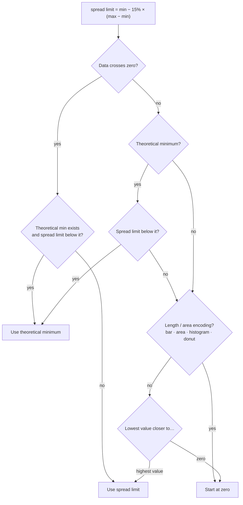

A bar's length *is* the message, so bars always start at zero. A line forced to zero can flatten the trend it exists to show — so the tree decides instead of a blanket rule.

---

## 6 · Chart catalog

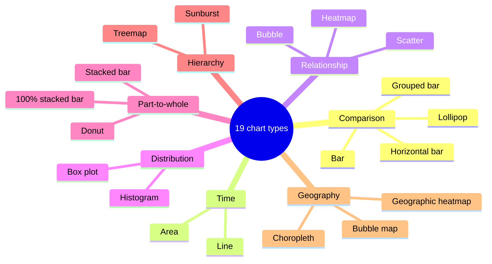

---

## 7 · Arabic localization

**The data keeps its original names; only the screen speaks Arabic.** Renaming columns in the data would break every lookup the moment a translation changed — silently, as an empty chart.

| Internal (never changes) | Display (what the eye reads) |
|---|---|
| `spec.x = "Country"` | الدولة |
| `spec.y = "Trade Value"` | قيمة التجارة |
| `category.key = "China"` | الصين |
| `series.key = "Crude Oil"` | النفط الخام |

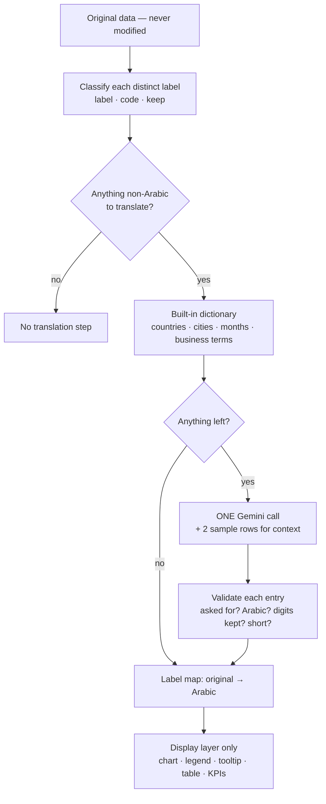

- **Never sent:** numbers, dates, IDs, URLs, emails, coordinates, free text, anything already Arabic.
- **Abbreviations** (HR, IT, R&D) are translated only if the dataset makes the meaning certain; otherwise Gemini returns an empty string.
- **Caps:** 60 values per column, 300 per dataset. Cached per dataset in memory + `localStorage`.
- Arabic SVG text is wrapped in Unicode bidi isolates so words and numbers read in the right order.

---

## 8 · Geography and maps

Geography is one more structure, not a special mode — and a map is refused when it would mislead.

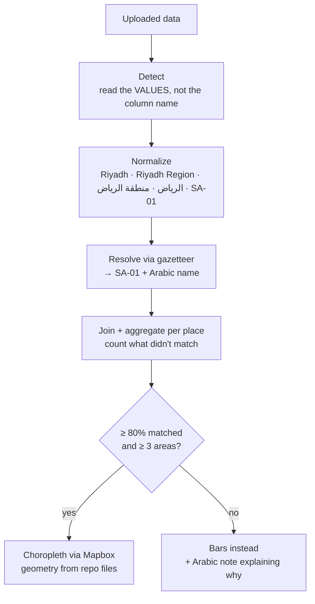

- **Gemini never produces geometry** — it's told which columns resolved and how completely, never asked for a coordinate.
- **Holes are reported:** unmatched values show in the log, notes, data table and headline ("9 of 13 regions").
- **The city trap:** eight Saudi cities share their region's name, so a `city` column would match 100% and still draw the wrong map. Finer-than-boundary columns are never drawn as areas.
- **Adding a country is a data change:** drop GeoJSON into `public/geo/admin1/` + rows in `gazetteer/admin1.ts`.

---

## 9 · Failure handling

**A failure narrows what we can offer; it never blanks the screen.**

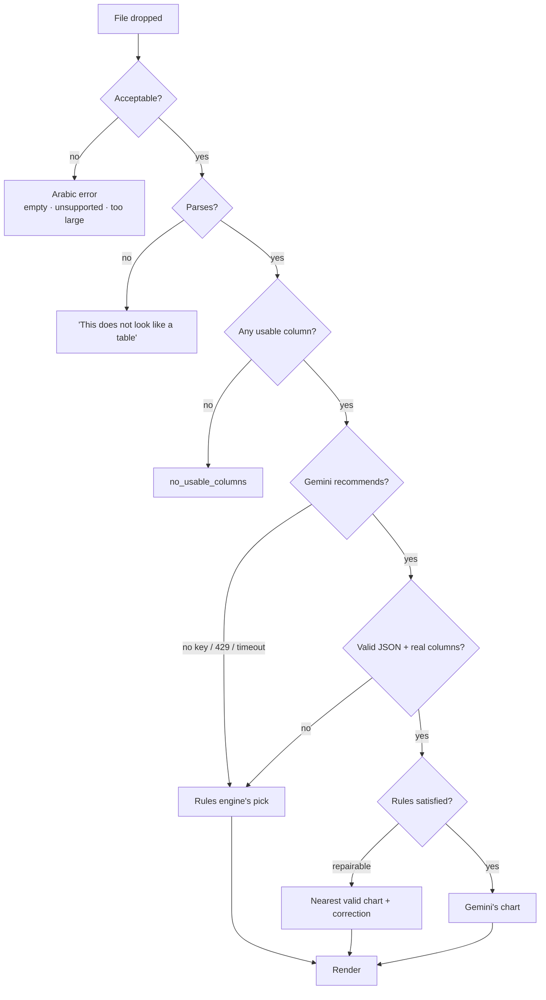

| Situation | What happens |
|---|---|
| No API key | `/api/recommend` → 503; sidebar says the rules engine chose |
| Rate limit / 5xx / timeout | Arabic reason shown; 25 s server / 30 s client timeout; rules fallback |
| Invalid JSON from Gemini | zod rejects → fallback |
| Translation fails | Dictionary answers kept, the rest stays original; chart never blocked |
| Invalid numbers in a column | Cell → null, counted, reported; chart drawn from valid rows |
| Huge file | > 30 MB rejected; 250,000 rows parsed; scatter sampled to 4,000 points |

---

## 10 · Observability — the pipeline log

Open **سجل المعالجة** (bottom corner) to watch a run: every stage with real durations, the exact profile sent to Gemini, its answer, and each rule that passed or failed.

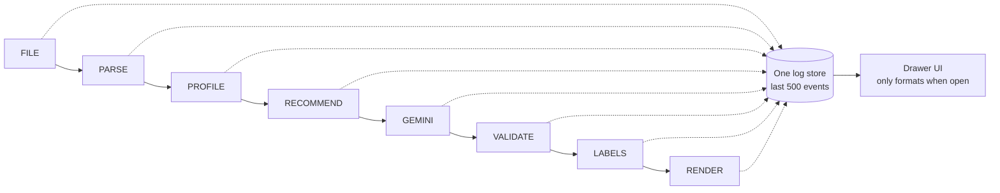

This turned "why did it pick that chart?" from a guess into evidence — the most useful debugging tool in the project.

---

## 11 · Testing

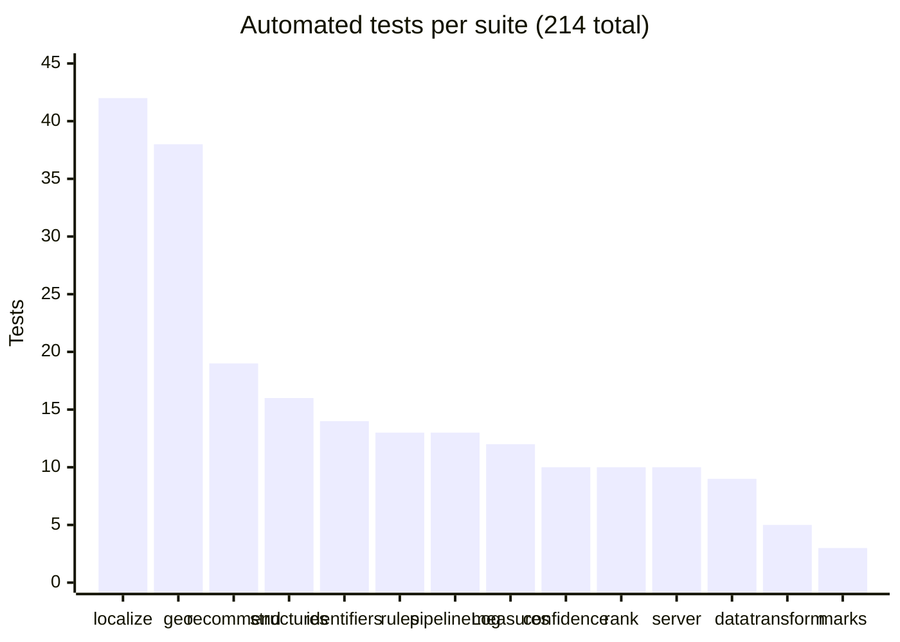

| Suite | What it proves |
|---|---|
| `localize` | What is translated, dictionary, validating Gemini's answer, label resolution |
| `geo` | Name normalization, gazetteer, detection, maps as candidates |
| `recommend` | Offline pick, validating Gemini proposals, chart switching, the prompt |
| `structures`, `measures` | Shapes detected; safeguards hold |
| `identifiers` | Keys never reach a chart — even if Gemini names one |
| `rules` | Axis decision tree, formatting, colour rules |
| `rank` | ≤ 3 options; alternatives genuinely different |
| `confidence` | Confidence shown only for the chart on screen |
| `pipelineLog` | Log store; what a Gemini call may reveal |
| `server` | `/api/recommend` + execution trace |

Test count grew from **82** at the first Gemini commit to **214** today, mostly from geography (38) and localization (42).

**Status on 2026-10-18:** 213 pass, 1 fails — `localize.test.ts › never carries a key, not even one the model echoed into a translation`. If Gemini echoes an API-key-like string into a translation, the trace redacts it but the returned `translation` field doesn't. Next fix on the list.

---

## 12 · Build timeline

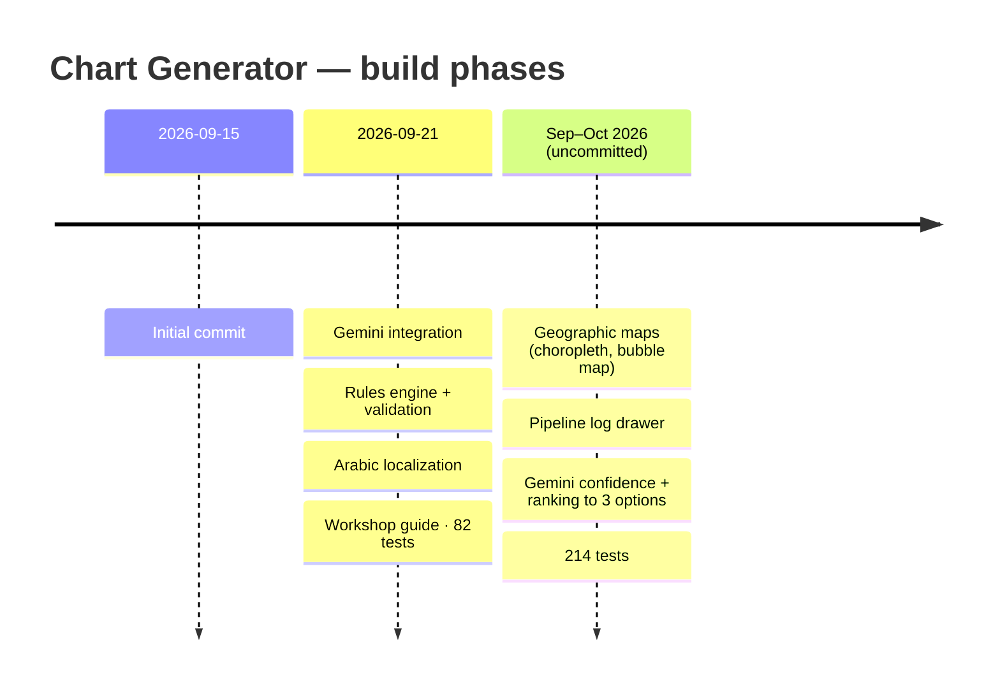

---

## 13 · Lessons learned

**The big one:** an LLM is most useful as a *judge* choosing among options code already proved valid — not as the thing that computes, draws or decides alone.

### Working with the model

| Lesson | Why |
|---|---|
| Send a profile, not the file | Payload depends on the schema, not row count; numbers are computed exactly |
| Constrain with a schema, then validate anyway | `responseSchema` makes answers parseable; zod + semantic checks catch wrong fields |
| Never let the model write code | A JSON spec can only name a chart + existing columns. Model-written D3/HTML = code execution in the user's browser |
| Always have a deterministic fallback | The free-tier quota ran out mid-development; every chart still rendered |
| Let the model say "I don't know" | Empty string when unsure beats a confident wrong transliteration |
| Show confidence honestly | Labelled as Gemini's judgement, hidden when the rules replaced its chart |
| Expect API drift | Gemini 3 uses `thinkingLevel`, 2.x `thinkingBudget`; retry once without it if rejected |

### Data and charts

| Lesson | Why |
|---|---|
| Find the structure before the chart | "Two categories + a number" could be a grid, a hierarchy or a ranking |
| Detect identifiers structurally | `name.includes('id')` catches `humidity`, `valid`, `android` |
| Fewer options beat more | 3 charts max, no near-twins → alternatives worth a look |
| Encode the rules in code | A model won't reliably apply 1-2-5 ticks or "never stack averages" |
| Read values, not column names | A `region` of North/South isn't geography |
| Report what failed to match | A map that hides its holes lies |

### Engineering

| Lesson | Why |
|---|---|
| Translate the display, never the data | Renaming columns breaks lookups silently |
| Keep secrets out of `VITE_*` | Vite inlines those into the bundle; the Mapbox token is public by design, secret `sk.` tokens refused |
| Heavy work in a Web Worker | The analysis animation is when the user is watching |
| One handler shape everywhere | Same `(Request) => Response` in dev, prod and serverless |
| Make the pipeline observable | The log drawer turns "why this chart?" into evidence |

---

## 14 · Demo script

| # | Do | Say |
|---|---|---|
| 1 | Open the app on the upload screen | "One screen, one action. No chart types to choose." |
| 2 | Drop `trade-flows-en.csv` | "This file is entirely in English." |
| 3 | Watch the steps run | "Each step appears when it really starts." |
| 4 | Chart appears | "Arabic title, countries, axis — and the file was never modified." |
| 5 | Read **لماذا هذا الرسم؟** | "It explains itself, and lists any rule that overrode the model." |
| 6 | Switch chart types | "The marks morph — only the spec changed." |
| 7 | Open **سجل المعالجة** | "Here's exactly what Gemini saw and answered." |
| 8 | Drop `saudi-regions-population.csv` | "Arabic region names → real boundaries → a choropleth." |
| 9 | Restart with a dud key, upload again | "No AI — the rules pick, and the page says why. It degrades, it doesn't break." |

---

