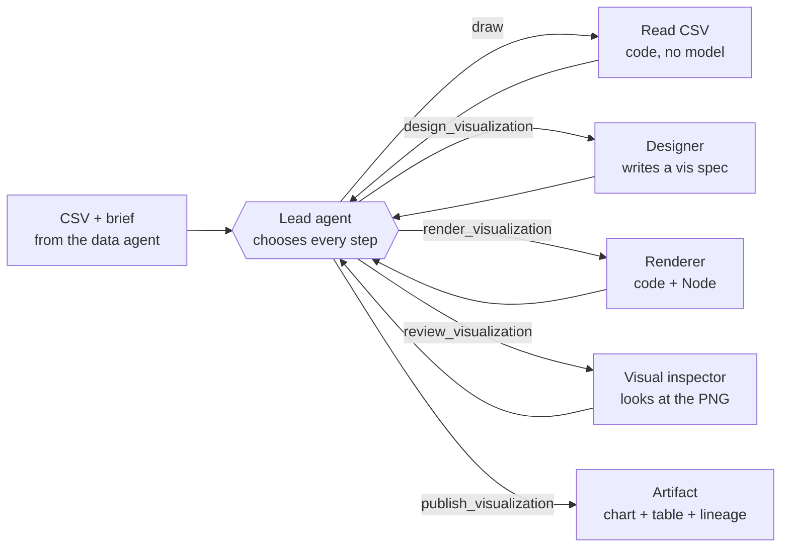
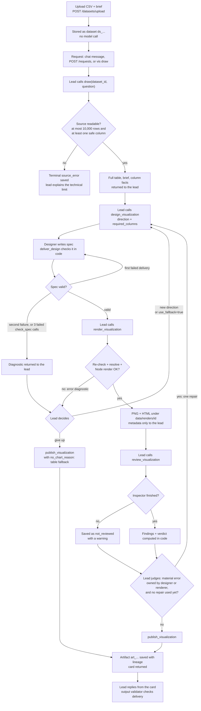
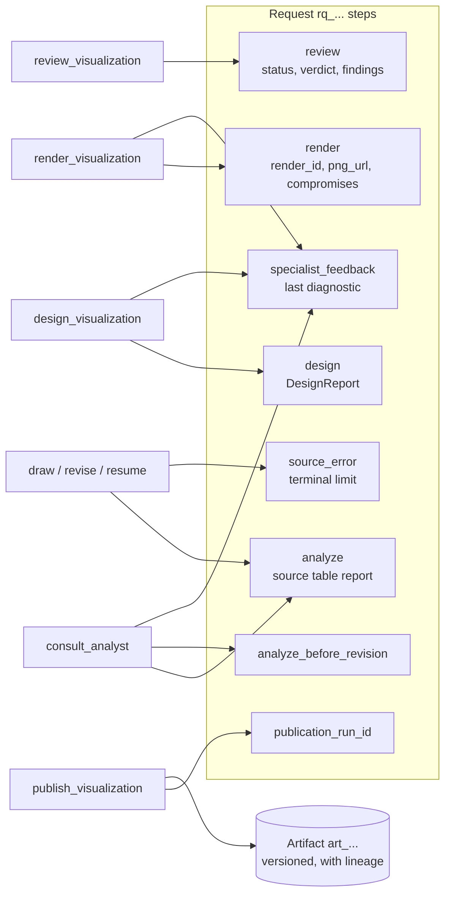

# 1. The System Structure

What the system is for, its parts, the end-to-end flow, and what each stage saves.

> Snapshot of branch `test-agent` at commit `8da1564`, verified against the code on 2026-10-18. `file.py:120` means line 120 of that file at this commit. Status labels such as **[Runtime]** are defined in the [index](README.md#status-labels).

[← Index](README.md) · [Index](README.md) · [2. Stack & Architecture →](02-stack-and-architecture.md)

---

## 1.1 Overview

The **visualization team** turns a finished CSV from an upstream *data agent* into a correct, readable chart. A
separate *brief* explains what the data means and what to communicate.

| Principle | What it means in practice | Source |
| --- | --- | --- |
| **The CSV is authoritative** | The team presents it. It never redoes the research, invents rows, checks for missing data, or re-aggregates prepared totals. | `AGENTS.md`, `docs/lead-directed-team.md` |
| **One lead decides** | A single lead agent calls specialists and code tools one at a time. Every tool returns to the lead. There is no fixed pipeline. | `vis_agent/lead.py` |
| **Code checks, models judge** | Code: CSV reading, spec validation, read-only SQL, rendering, persistence, budgets. Models: chart choice, encodings, whether a visual defect is real, when to publish. | `AGENTS.md` |
| **Priorities** | 1. Correct charts. 2. Low latency. | `AGENTS.md`, "Product contract" |

### At a glance

Every arrow out of the lead is a tool call, and every tool returns to the lead. The arrows back to the lead are the
core idea of the design. People reach the same lead three ways: the Pydantic AI **web chat**, an **HTTP agent API**,
and the **`vis` CLI**. The full component and route diagram is in
[Stack & Architecture 2.2](02-stack-and-architecture.md).

## 1.2 Main components

| Component | Kind | Responsibility | Main files |
| --- | --- | --- | --- |
| **Lead** (`vis-lead`) | LLM agent | Owns the request. Chooses tools, directs specialists, judges results, decides when to publish. | `vis_agent/lead.py` |
| **Designer** | LLM agent | Writes one chart spec in the project's `vis` DSL. Can deliver in one response. | `vis_agent/designer/agent.py`, `vis_agent/designer/rulebook*.md` |
| **Visual inspector** (reviewer) | Vision LLM agent | Looks at the rendered PNG and reports only *visible* defects, with evidence. | `vis_agent/reviewer/` |
| **Analyst** | LLM agent **[Optional]** | Runs a calculation in read-only SQL, only when the lead explicitly asks for one. | `vis_agent/analyst/agent.py`, `vis_agent/analyst/query.py`, `vis_agent/analyst/checks.py` |
| **Profiler** | LLM agent + DuckDB stats **[Optional]** | Describes a file's columns semantically, only on explicit request. | `vis_agent/profiler/` |
| **Source reader** | Code | Loads the CSV as-is, with no model call. | `vis_agent/analyst/source.py` |
| **Spec checker** | Code | Parses and validates a spec against the table and the renderer. | `vis_agent/designer/syntax.py`, `vis_agent/designer/check.py`, `vis_agent/designer/indicator.py` |
| **Resolver + renderer** | Code (Python + Node) | Binds the table to renderer options and draws a PNG and HTML page with the pinned GPT-Vis SSR package. | `vis_agent/designer/resolve.py`, `vis_agent/render/` |
| **Request service and stores** | Code + DuckDB | Saves requests, tool results, and versioned artifacts, and publishes. | `vis_agent/requests/`, `vis_agent/store.py` |
| **Entry points** | Code | Web chat, upload, render, and agent API routes, plus the CLI. | `vis_agent/app.py`, `vis_agent/providers.py`, `vis_agent/requests/api.py`, `vis_agent/uploads.py`, `vis_agent/renders.py`, `vis_agent/cli.py` |

## 1.3 End-to-end pipeline

This is the **typical** path. The lead can take a different path at any decision point. Only the checks and budgets
in code are mandatory.

Stage-by-stage detail, the lead's 14 tools, and the budgets: [How It Works](03-how-it-works.md). The checks applied at
each step: [Rulesets](04-rulesets.md).

## 1.4 Who writes which saved state

A request is one row in DuckDB's `requests` table holding a `Request` model (`vis_agent/requests/models.py:76`). Its
`steps` dictionary keeps each tool's latest result. The name is historical: the keys imply no order
(`docs/lead-directed-team.md`, "Persistence and recovery").

**Invalidation.** `invalidate_chart` clears `design`, `render`, `review`, and `specialist_feedback`
(`vis_agent/requests/service.py:131-134`). `design_visualization` calls it, and saves, **before** calling the designer.
A successful `consult_analyst` calls it too, because a new table makes the old chart stale. Outside `steps`, the
request also keeps convergence counters, `review_feedback`, `rounds` (earlier design/render/review triples), and
`clarifications`.

## 1.5 Inputs, intermediate outputs, and final outputs

| Stage | Data | Model | Where |
| --- | --- | --- | --- |
| **Input** | CSV file (at most `MAX_UPLOAD_MB`, default 20 MB) | — | `vis_agent/uploads.py`, `vis_agent/store.py` |
| **Input** | Brief: question, intent, column descriptions, units, `code_meanings`, `display_labels`, caveats, brand colours | `DataBrief` (extra keys forbidden) | `vis_agent/models.py:24` |
| **Input** | Caller: chat, terminal, or agent, with an optional callback URL | `Caller` | `vis_agent/requests/models.py:21` |
| Intermediate | Source table report: every row, typed column metadata, no model output | `AnalysisReport` (model `vis_agent/analyst/models.py:134`) | built by `load_csv_report`, `vis_agent/analyst/source.py:99` |
| Intermediate | Designer prompt: column facts, a 12-row preview (cells cut at 40 characters), brief context | `DesignerPrompt` | `vis_agent/designer/agent.py:69` |
| Intermediate | Chart spec (`vis` DSL text) plus explanation and compromises | `Design`, `DesignReport` | `vis_agent/designer/models.py:172, 183` |
| Intermediate | Render files `chart.png`, `chart.html`, `config.json` | `Rendered` | `vis_agent/render/base.py:34` |
| Intermediate | Review: verdict `pass`, `revise`, or `uncertain`, plus evidence | `Review` | `vis_agent/reviewer/models.py:86` |
| **Output** | Artifact `art_...`: table, spec, PNG/HTML URLs, review, lineage, version link | `Artifact` | `vis_agent/requests/models.py:150` |
| **Output** | Markdown card for the reply (picture, summary, at most 20 table rows, IDs) | `card()` | `vis_agent/card.py:52` |
| **Output** | API outcome: status, artifact, pending question, or error | `RequestOutcome` | `vis_agent/requests/models.py:238` |

## 1.6 Where decisions, validation, and error handling happen

| Concern | Who | Where | On failure |
| --- | --- | --- | --- |
| Which tool next, which chart intent, publish or repair | **Lead model** | `vis_agent/lead.py` instructions | Not applicable: this is the decision itself. |
| Chart type, encodings, labels, palette | **Designer model** | `vis_agent/designer/rulebook.md` | — |
| Whether a visible defect exists | **Inspector model**; code checks its references | `vis_agent/reviewer/agent.py:44-93` | Advice to the lead. Never triggers a repair by itself. |
| Source limits (rows, geometry, oversized cells) | Code | `vis_agent/analyst/source.py:109-119` | `SourceUnavailable`, saved as a terminal `source_error`. |
| Spec syntax and executable contract | Code | `vis_agent/designer/check.py:258-263` | `ModelRetry` once, then a designer failure diagnostic. |
| Render feasibility | Code | `vis_agent/designer/resolve.py`, `vis_agent/render/gptvis.py` | `specialist_feedback.error` returned to the lead. |
| Budgets and repair limits | Code (tool `prepare` hooks, `ToolFailed`, framework `UsageLimits`) | `vis_agent/lead.py:222-263, 403-431`, `vis_agent/requests/service.py:27-28` | Tool withdrawn or refused with an explanation. A hard limit ends the run. |
| "A promise is not delivery" | Code (output validator) | `vis_agent/lead.py:626-656` | `ModelRetry` returned to the lead. |
| Crash recovery | Code | `vis_agent/requests/service.py:210-274` | Request marked `failed` (API/CLI path only). `resume` continues from saved work. |

## 1.7 Glossary

| Term | Meaning in this project |
| --- | --- |
| **Lead** | The `vis-lead` agent that owns a request and chooses every tool call. |
| **Specialist** | An agent called by the lead: designer, visual inspector (reviewer), analyst, or profiler. |
| **Brief** | `DataBrief`: upstream intent, column meanings, units, code meanings, approved labels, caveats. |
| **Data agent / upstream** | The system that produced the CSV. Its output is authoritative. |
| **Request (`rq_...`)** | One unit of work about one dataset, with saved tool results in `steps`. |
| **Artifact (`art_...`)** | A published, versioned result: table, spec, picture, review, and lineage. |
| **`vis` DSL / spec** | The line-oriented chart language (`vis bar`, `bind`, `fold`, `cards`, ...) parsed by `vis_agent/designer/syntax.py`. |
| **Catalogue** | `vis_agent/designer/catalogue.json`: the 21 chart types, their roles, keys, and limits. |
| **Role** | A visual slot (`category`, `value`, `group`, `time`, `x`, `y`, `value2`) bound to a column. |
| **Kind** | The column type: `category`, `ordinal`, `time`, `measure`, `share`, `geography`, or `identifier`. |
| **Fold** | Turning two or more same-unit measure columns into one series column and one value column, in code. |
| **Indicator** | The single-row KPI "cards" chart type. |
| **Compromise** | A disclosed difference between what the spec asked for and what was drawn (for example, an adjusted colour). |
| **Required columns** | Columns the lead says the chart must bind, because leaving them out changes the meaning. |
| **Fallback designer** | An alternate designer agent used only when the lead passes `use_fallback=true`. Same model as the designer by default. |
| **Table fallback** | Publishing the unchanged source table with `no_chart_reason` when no chart can be made. |
| **Visual repair** | A single redesign after an inspector error owned by the designer or renderer. |
| **Policy rules** | The historical H, S, and C chart-taste rules in `vis_agent/designer/rules.py`, now offline only. |
| **Convergence counters** | `design_attempts`, `render_attempts`, `visual_repair_attempts`, `analyst_attempts` on the request. |
| **Render ID** | `sha256(spec + report)[:12]`, which names the render folder and detects "no change" repairs. |
| **Hijri** | The Islamic calendar. Hijri labels are preserved verbatim and in source order. |
| **Real50 / Transfer24 / Dev corpus** | Evaluation sets: 50 frozen development handoffs, 24 synthetic transfer tasks, and about 500 exported Insightor CSVs. |

---

[← Index](README.md) · [Index](README.md) · [2. Stack & Architecture →](02-stack-and-architecture.md)
