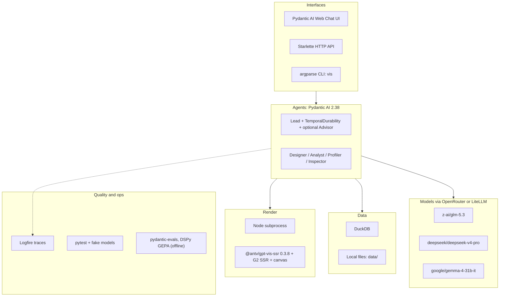
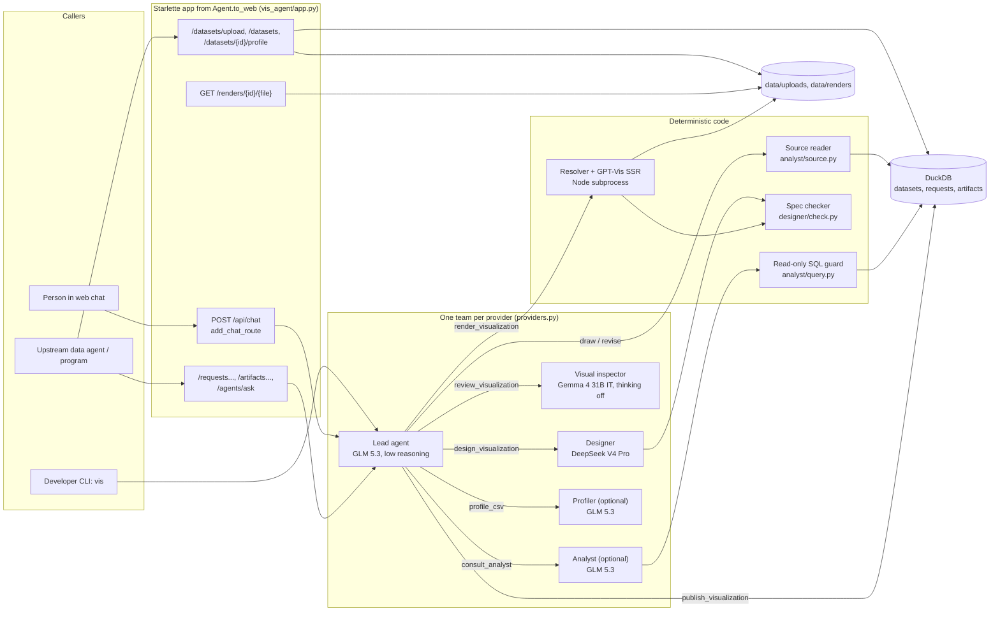
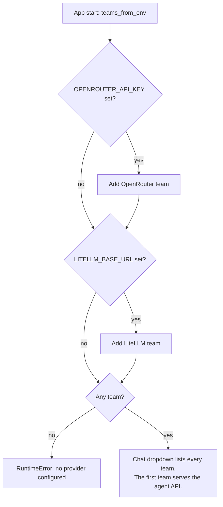
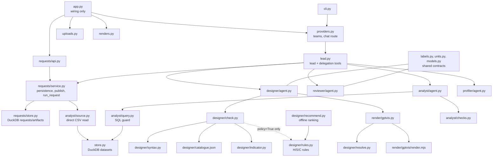

# 2. Stack & Architecture

Technologies, model seats, the architectural pattern, the module map, and where to start reading.

> Snapshot of branch `test-agent` at commit `8da1564`, verified against the code on 2026-10-18. `file.py:120` means line 120 of that file at this commit. Status labels such as **[Runtime]** are defined in the [index](README.md#status-labels).

[← 1. The System Structure](01-system-structure.md) · [Index](README.md) · [3. How It Works →](03-how-it-works.md)

---

## 2.1 Technology stack

| Layer | Technology (version) | Purpose | Evidence for why |
| --- | --- | --- | --- |
| Language | **Python 3.12**, managed by **uv** | Everything except drawing | `.python-version`, `pyproject.toml`, `AGENTS.md` |
| Agent framework | **Pydantic AI** (`pydantic-ai-slim[cli,openrouter,temporal,web] >= 2.38`) | Agents, tools, output functions, usage limits, web chat UI, Temporal capability | `AGENTS.md`. Rule 3 of the original design: "Follow the Pydantic AI documentation" (`docs/superpowers/specs/2026-09-06-vis-agent-design.md`). |
| Agent extras | **pydantic-ai-harness** (`[code-mode] >= 0.28.1`) | `Advisor` capability on the lead. CodeMode is installed but deliberately unused. | `vis_agent/lead.py:16, 661-663`. CodeMode was removed after Phase 1 because it cost a model turn for no benefit (`docs/phase-1-lessons.md`). |
| Validation | **Pydantic** | Every contract (brief, spec, reports, requests) | All `models.py` files under `vis_agent/` |
| Model access | **OpenRouter** (primary), **LiteLLM** proxy (air-gapped cluster) | One complete team per provider | `vis_agent/providers.py`, `docs/phase-6-lessons.md` ("Two providers in one dropdown") |
| Data and storage | **DuckDB** (`>= 1.5.5`) | CSV import, typed views, read-only SQL, request/artifact tables | `vis_agent/store.py`, `vis_agent/requests/store.py`, `vis_agent/analyst/query.py` |
| Web | **Starlette** (through Pydantic AI web), `python-multipart`, `httpx` | Chat, upload, render, and request routes, plus callbacks | `vis_agent/app.py`, `vis_agent/uploads.py`, `vis_agent/requests/api.py` |
| Renderer | **Node 22+**, **@antv/gpt-vis-ssr 0.3.8** (pinned), G2 SSR, `canvas` | Server-side PNG and HTML chart drawing | `vis_agent/render/gptvis/package.json`, `docs/spikes/2026-09-07-gpt-vis-server-renderer.md` |
| Observability | **Logfire** (`instrument_pydantic_ai`, sends only when a token is set) | Traces for agent runs, tools, and model requests | `vis_agent/app.py:21-22`. The experiment reports query Logfire for latency. |
| Evaluation | **pydantic-evals**, **DSPy** + `hijridate` (optional `optimize` group) | Offline eval harnesses and instruction optimization (GEPA) | `pyproject.toml`, `evals/**/optimize_instructions.py` |
| Tests | **pytest** with fake models through `agent.override` | Unit and integration tests with no credentials | `tests/`, `AGENTS.md` ("Use fake models through agent.override") |

## 2.2 High-level architecture

No specialist calls another, and no tool schedules another tool (`AGENTS.md`; `vis_agent/lead.py:44-107`). The chat
route is inserted in front of the web UI's own `/api/chat` so that the dropdown can choose a team
(`vis_agent/providers.py:126-151`). The agent API always uses the first configured team (`vis_agent/app.py:34, 46`).

## 2.3 Models per seat (current defaults)

| Seat | OpenRouter default | Settings | Override variable | LiteLLM team |
| --- | --- | --- | --- | --- |
| Lead | `z-ai/glm-5.3` | reasoning effort `low`, `require_parameters` | `PYDANTIC_AI_MODEL`, `PYDANTIC_AI_LEAD_REASONING_EFFORT` | `LOCAL_LLM`, no model settings |
| Profiler, Analyst | `z-ai/glm-5.3` | reasoning `low`, `require_parameters`, temperature 0 (`vis_agent/model_settings.py`) | `PYDANTIC_AI_PROFILER_MODEL`, `PYDANTIC_AI_ANALYST_MODEL` | `LOCAL_LLM` |
| Designer | `deepseek/deepseek-v4-pro` | thinking off, temperature 0 | `PYDANTIC_AI_DESIGNER_MODEL` | `LOCAL_LLM` |
| Fallback designer | same as designer | used only if the lead passes `use_fallback=true` | `PYDANTIC_AI_DESIGNER_FALLBACK_MODEL` | `LOCAL_LLM` |
| Visual inspector | `google/gemma-4-31b-it` | thinking off, temperature 0 | `PYDANTIC_AI_REVIEWER_MODEL` | `LITELLM_REVIEWER_MODEL`, default `Qwen/Qwen3.8-27B` |
| Advisor | unset (off) | native Advisor capability | `PYDANTIC_AI_ADVISOR_MODEL` | not available |

Sources: `vis_agent/providers.py:49-123`, `vis_agent/designer/agent.py:37-39`, `vis_agent/reviewer/agent.py:30, 104`,
`vis_agent/profiler/agent.py:50`, `.env.example`. How these seats were chosen, and what evidence is missing:
[Design Decisions 5.10](05-design-decisions.md).

The lead is text-only by design: rendered image bytes go only to the inspector (`vis_agent/lead.py:71-75`).

## 2.4 Architectural pattern

The system follows the **agent delegation** pattern from the Pydantic AI multi-agent docs, cited in
`docs/lead-directed-team.md`. Each specialist is a separate `Agent` that runs inside an `async` tool of the lead. It
shares the parent's `ctx.usage`, and its own request cap is clamped to the parent's limits. Three ideas sit on top:

| Idea | How it shows up | Source |
| --- | --- | --- |
| **"The model drives, the code checks."** | Models speak a small, line-oriented DSL. Code parses and checks every spec before it can reach the renderer. | Rule 9 of the original design (`docs/superpowers/specs/2026-09-06-vis-agent-design.md`, section 2) |
| **Output functions as gates** | Each specialist's final answer goes through a tool-style output function (`deliver_design`, `deliver_review`, `deliver_analysis`, `review_profile`). It validates the answer and can send the model back with `ModelRetry`. | specialist `agent.py` files |
| **Saved tool results, not a workflow engine** | Durability comes from saving each tool's result on the request record, not from a step machine. | `vis_agent/requests/service.py` |

## 2.5 Module map and dependencies

`vis_agent/requests/runner.py` holds **compatibility imports only**. The old fixed runner was removed
(`vis_agent/requests/runner.py:1-7`).

## 2.6 Entry points and the files to read first

| Order | File | Why read it |
| --- | --- | --- |
| 1 | `AGENTS.md`, `docs/lead-directed-team.md` | The product contract and the current architecture decision |
| 2 | `vis_agent/lead.py` | The instructions, every tool, budget hooks, and the output validator. This file *is* the control flow. |
| 3 | `vis_agent/requests/service.py` | How a request is prepared, invalidated, published, and run from the API/CLI |
| 4 | `vis_agent/designer/agent.py`, `vis_agent/designer/rulebook.md` | How a spec is produced and gated |
| 5 | `vis_agent/designer/check.py`, `vis_agent/designer/syntax.py` | What "valid spec" means at runtime |
| 6 | `vis_agent/designer/resolve.py`, `vis_agent/render/gptvis.py` | How a spec becomes a picture, and which errors appear only there |
| 7 | `vis_agent/reviewer/agent.py`, `vis_agent/reviewer/rulebook.md`, `vis_agent/reviewer/rubric.py` | The visual inspection contract |
| 8 | `vis_agent/providers.py`, `vis_agent/app.py` | Model wiring and HTTP surface |

| Entry point | Command or route | Code |
| --- | --- | --- |
| Web chat | `uv run uvicorn vis_agent.app:app --host 127.0.0.1 --port 7932` | `vis_agent/app.py`, `vis_agent/providers.py:126` |
| Upload | `POST /datasets/upload` (multipart `file` + `brief`); also `GET /datasets`, `GET /datasets/{id}/profile` | `vis_agent/uploads.py:42-116` |
| Agent API | `POST /requests`, `GET /requests/{id}`, `POST .../answer`, `POST .../resume`, `GET /artifacts`, `GET /artifacts/{id}`, `POST /agents/ask` | `vis_agent/requests/api.py:83-222` |
| Renders | `GET /renders/{render_id}/{file}` | `vis_agent/renders.py` |
| CLI | `vis chat / profile / ask / draw / revise / resume / requests / artifacts / suggest / failures / recommend / check / render / design / doctor` | `vis_agent/cli.py:48-96` |

---

[← 1. The System Structure](01-system-structure.md) · [Index](README.md) · [3. How It Works →](03-how-it-works.md)
