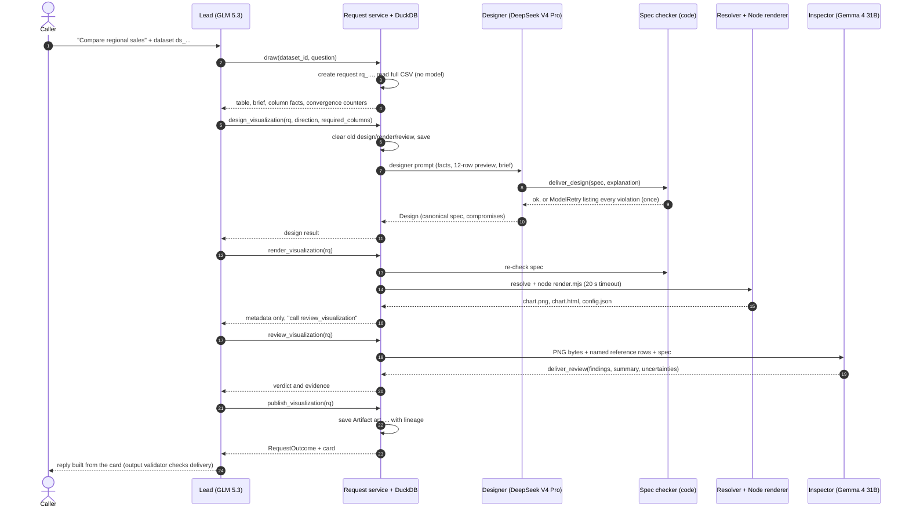
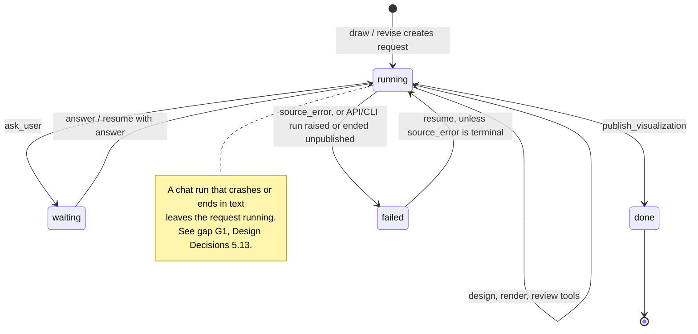
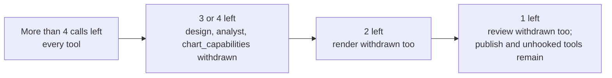

# 3. How It Works

One request step by step: the lead's tools, each stage, the request lifecycle, and the budgets.

> Snapshot of branch `test-agent` at commit `8da1564`, verified against the code on 2026-10-18. `file.py:120` means line 120 of that file at this commit. Status labels such as **[Runtime]** are defined in the [index](README.md#status-labels).

[← 2. Stack & Architecture](02-stack-and-architecture.md) · [Index](README.md) · [4. Rulesets →](04-rulesets.md)

---

## 3.1 A routine request, step by step

A 2026-09-19 trace analysis measured the common path for a prepared CSV at **7 tool calls and 8 model requests,
median 19.1 s** over 79 runs (`docs/experiments/2026-09-19-lead-gap-analysis.md`, "Verdict" and "Latency").

## 3.2 The lead's tools

All 14 tools are registered in `create_lead` (`vis_agent/lead.py:659-680`). Every tool except `find_dataset`,
`find_artifact`, and `chart_capabilities` is registered with `sequential=True`, so the lead never runs them in
parallel. Tools that change a saved request also take a per-request lock (`serialize_request`, `lead.py:307-313`).

| Tool | Purpose | Offered when (`prepare` hook) | Calls a model? |
| --- | --- | --- | --- |
| `draw` | Open a request, read the CSV | always | no |
| `revise` | Open a linked request for a published artifact | always | no |
| `resume` | Return saved work for an unfinished request | chat: only while one is unfinished; terminal/API: always | no |
| `design_visualization` | Ask the designer for a spec | more than 4 tool calls left | designer |
| `render_visualization` | Draw the saved spec | more than 2 tool calls left | no |
| `review_visualization` | Ask the inspector to check the PNG | more than 1 tool call left | inspector |
| `publish_visualization` | Save the artifact, or a table fallback | always | no |
| `consult_analyst` | Run an explicitly requested calculation | more than 4 left, and no analyst attempt yet | analyst |
| `ask_user` | Pause for an essential presentation choice | always | no |
| `answer_question` | Numbers-only answer, outside the chart flow | always | analyst |
| `profile_csv` | Explicit file profiling | always | profiler |
| `find_dataset`, `find_artifact` | Discovery | always | no |
| `chart_capabilities` | Exact renderer support lookup | more than 4 left | no |

## 3.3 Stage details

Each stage is a tool the lead chooses. Line references point to the tool and the code it delegates to.

| # | Stage | Trigger | What the code does | Output | Failure and next step |
| --- | --- | --- | --- | --- | --- |
| 0 | **Upload** [Runtime] `vis_agent/uploads.py:42` | `POST /datasets/upload` or a chat attachment | Size limit, then stores `data/uploads/ds_<32 hex>.csv` with SHA-256, headers, and the validated `DataBrief`. Does **not** start profiling. | dataset ID | invalid brief or oversize file is rejected |
| 1 | **`draw`** [Runtime] `vis_agent/lead.py:159`, `vis_agent/requests/service.py:84` | lead's first call (instructions, `lead.py:57`) | Resolve the dataset; create the request; detect language; `load_csv_report` (see below) | full table, brief, compact column facts, convergence counters, previous spec on a revision | `SourceUnavailable` → terminal `source_error`; later calls return it immediately |
| 2 | **`design_visualization`** [Runtime] `vis_agent/lead.py:389-509`, `vis_agent/designer/agent.py:328` | lead, with `direction`, optional `columns` annotations, `required_columns`, `use_fallback` | Apply the repair gate ([Rulesets 4.3.10](04-rulesets.md)); validate column names; **clear and save** old chart state; run the designer (45 s, ≤ 8 requests, clamped to the parent's limits) | `DesignReport` with a canonical spec, or `design=None` with warnings | diagnostic → lead retries with a new direction, uses the fallback designer, or publishes a table |
| 3 | **`render_visualization`** [Runtime] `vis_agent/lead.py:512-550`, `vis_agent/designer/agent.py:397`, `vis_agent/render/gptvis.py:167` | lead | `render_id = sha256(spec + report)[:12]`; increment and save `render_attempts` **before** the external call; re-check; resolve; `node render.mjs` (20 s) | `/renders/<id>/chart.png`, `chart.html`, `config.json`, compromises. The lead gets **metadata only**. | `RendererUnavailable`, `RenderFailed`, `ResolveError`, `SpecError`, `ValueError` → `specialist_feedback.error`. If a PNG already exists, it does not render again and says what to do next. |
| 4 | **`review_visualization`** [Runtime] `vis_agent/lead.py:553-591`, `vis_agent/reviewer/agent.py:152` | lead; required before publishing a PNG (`lead.py:610-613`) | One vision run (30 s, ≤ 3 requests) on the PNG, up to 30 named reference rows (cells cut at 40 characters, geometry left out), the spec, compromises, labels, clarifications | review + `review_feedback` saved | inspector cannot finish, or no reviewer configured → `not_reviewed`; the chart can still be published and the card says so |
| 5 | **Visual repair** [Runtime, lead's choice] `vis_agent/lead.py:404-431, 488-502` | lead calls `design_visualization` again after a render | Allowed **once**, only for an `error` finding owned by `designer` or `renderer`, with a new non-empty direction | new design | same `render_id` as before → old preview restored, flagged "no change" |
| 6 | **`publish_visualization`** [Runtime] `vis_agent/lead.py:594-616`, `vis_agent/requests/service.py:160-207` | lead | Idempotent: an existing artifact is returned. Records version, parent, review rounds, lineage (brief fingerprint, catalogue hash, `rules_version="expert-led-v1"`, model names), and `publication_run_id` | `RequestOutcome` + card | `no_chart_reason` publishes the unchanged table as an explicit **unverified fallback** |
| 7 | **Final reply** [Runtime] `vis_agent/lead.py:626-656` | lead writes text | Output validator `require_finished_preview`: any request this run opened or designed that has a design but no artifact → `ModelRetry` ("a promise is not delivery"). Calls no tools. | reply built from the card | lead `retries=1` |

**Inside `draw`: reading the source** (`vis_agent/analyst/source.py:34-142`)

- **Dataset resolution** (`vis_agent/lead.py:130-145`). It accepts a `ds_` ID or an exact uploaded filename. An
  unknown name ending in `.csv` is a `ToolFailed`, never a guess. Any other unknown string is a `ModelRetry`
  ("Invalid file ID"). A name shared by several uploads is a `ToolFailed` that lists the IDs.
- **Duplicate guard** (`vis_agent/lead.py:168-178`). If the conversation already has a `running` request:
  - Same dataset and same question (or a saved `source_error`): the tool returns that request.
  - Otherwise: `ToolFailed`, "already active ... Resume and finish it".
- **Typing.** The CSV is read as an all-text DuckDB snapshot, then exposed through a typed view:
  - Arabic-Indic digits are converted to numbers only when every cell parses as a number, no value has a leading
    zero, and the column name is not time-like.
  - Leading-zero values stay text.
  - Geometry columns, WKT values, and cells over 256 bytes stay local, and the lead is warned.
  - Columns with `code_meanings` or `display_labels` become categories.

**Side paths**

| Tool | When | What it does |
| --- | --- | --- |
| `revise(artifact_id, change, redo_analysis=False)` | A change to a published chart | Opens a linked request. Reuses the parent's table unless `redo_analysis`. The designer gets the revision rulebook (`vis_agent/designer/rulebook-revise.md`). Refused if this same lead run published the artifact (`vis_agent/lead.py:199-204`). |
| `resume(request_id, answer)` | "continue", or an answer to a pending question | Returns saved work. **Never** runs a specialist (`vis_agent/lead.py:266-286`). |
| `consult_analyst(request_id, task)` | The user explicitly asks for a calculation | One attempt per request, counted before the call. A successful result replaces the table and resets the chart budgets (`vis_agent/lead.py:335-372`). |
| `ask_user(request_id, question, reason)` | An essential presentation choice | Sets the request to `waiting` with a 24 h deadline. The CLI exits with code 3 (`vis_agent/cli.py:187-188`). |

## 3.4 Request lifecycle

`stopped` exists in `RequestStatus`, but nothing assigns it (`vis_agent/requests/models.py:14`). Proposed patch 3 would
use it ([Design Decisions 5.13](05-design-decisions.md)).

## 3.5 Budgets that bound every run

**How the run budgets apply per entry point**

| Entry point | Model requests | Tool calls | Code |
| --- | --- | --- | --- |
| Web chat | **18 per lead run** | **16 per lead run** | `vis_agent/providers.py:148` |
| API / CLI (`run_request`) | **18 per request, cumulative across resumes** (`requests_used` is saved) | **16 per lead run** | `vis_agent/requests/service.py:236-246` |

**Which tools stay on offer as tool calls run out.** The `prepare` hooks reserve the last calls for render, review,
and publish (`vis_agent/lead.py:222-263`).

| Budget | Value | Defined at | Enforced how |
| --- | --- | --- | --- |
| Initial design attempts | 2 per request | `vis_agent/lead.py:410-415` | `ToolFailed` |
| Visual repairs | 1 per request, never the same direction twice | `vis_agent/lead.py:417-431` | `ToolFailed` |
| Analyst consultations | 1 per request | `vis_agent/lead.py:251-257, 342-350` | tool hidden, plus `ToolFailed` |
| Designer | 8 requests, 45 s, 3 `check_spec` calls, 2 output retries | `vis_agent/designer/agent.py:43-45, 308` | clamped `UsageLimits`, `asyncio.timeout`, `prepare` |
| Inspector | 3 requests, 30 s, 2 output retries | `vis_agent/reviewer/agent.py:32-33, 102` | same mechanisms |
| Analyst | 8 requests, 90 s, 3 queries; SQL 10 s, 1,000 rows | `vis_agent/analyst/agent.py:45-47`, `vis_agent/analyst/query.py:16-17` | same mechanisms, plus DuckDB interrupt |
| Renderer | 20 s per Node process | `vis_agent/render/gptvis.py:22` | `subprocess.run(timeout=...)` |

> **[Gap]** The README says chat and API runs allow **24** model requests. The code says **18**
> (`vis_agent/requests/service.py:27`). The 2026-09-19 gap analysis flagged the same mismatch.

How the repair and design counters gate each call: [Rulesets 4.3.10](04-rulesets.md). Why budgets live in code
rather than in prompts: [Design Decisions 5.5](05-design-decisions.md).

---

[← 2. Stack & Architecture](02-stack-and-architecture.md) · [Index](README.md) · [4. Rulesets →](04-rulesets.md)
