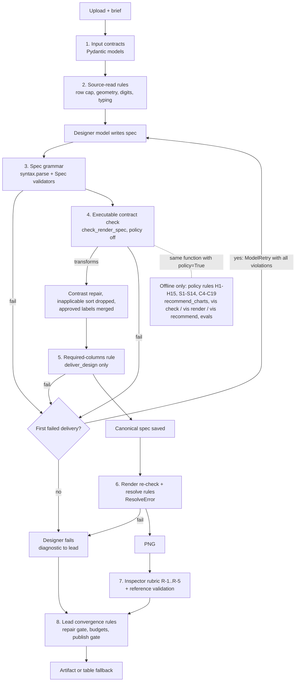
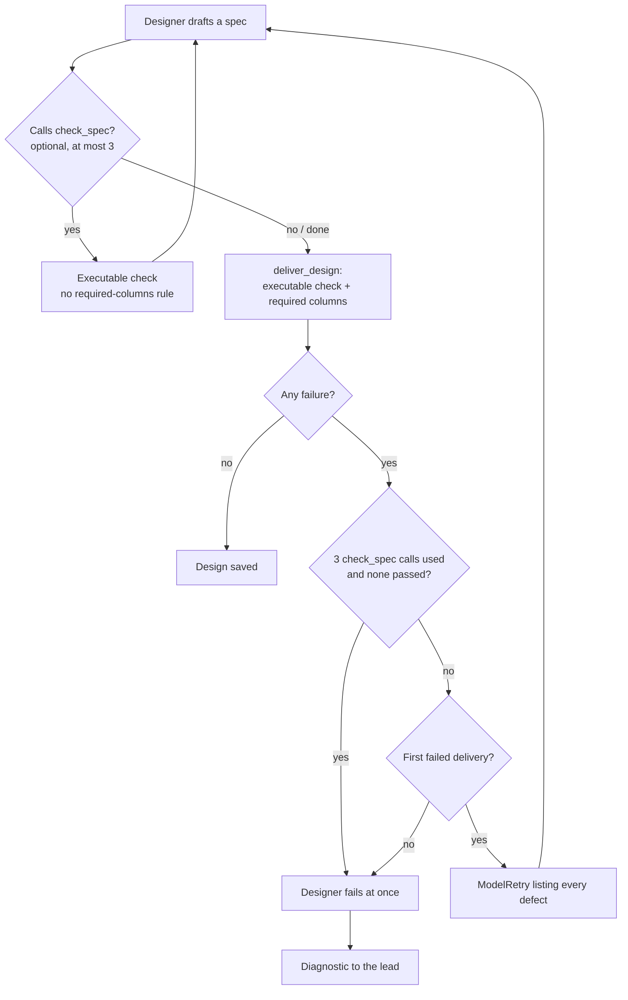
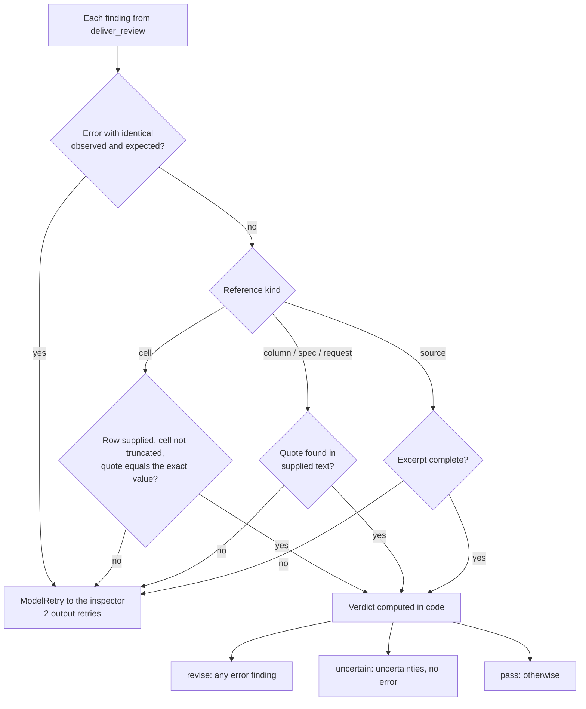
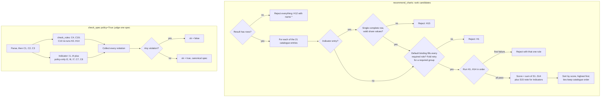
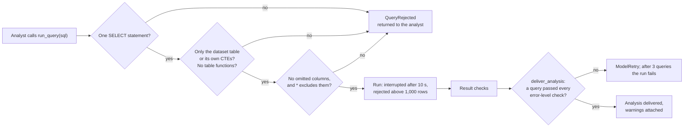
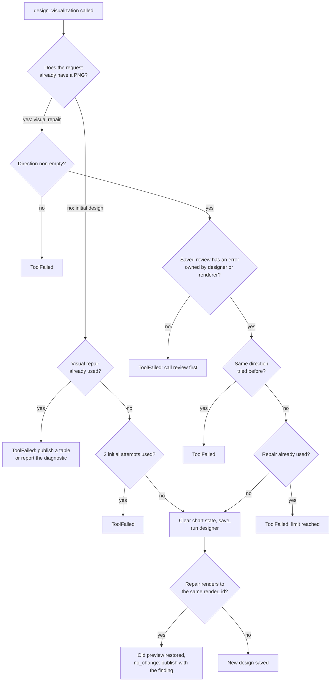
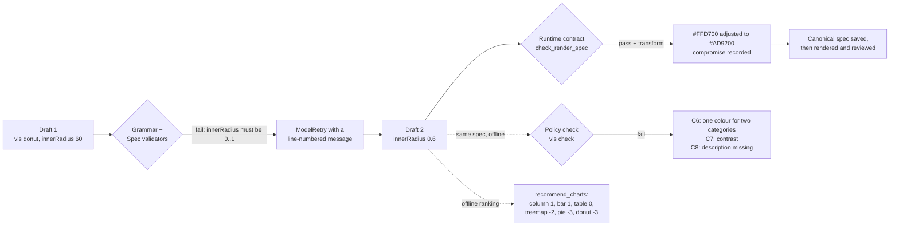

# 4. Rulesets

Every validation layer, from input contracts to policy rules, and how they reject, repair, or rank.

> Snapshot of branch `test-agent` at commit `8da1564`, verified against the code on 2026-10-18. `file.py:120` means line 120 of that file at this commit. Status labels such as **[Runtime]** are defined in the [index](README.md#status-labels).

[← 3. How It Works](03-how-it-works.md) · [Index](README.md) · [5. Design Decisions →](05-design-decisions.md)

---

## 4.1 How the rule layers run

## 4.2 Rule categories compared

| # | Ruleset | Defined in | Applied at | Effect | Hard or soft | Runtime? |
| --- | --- | --- | --- | --- | --- | --- |
| 1 | Input contracts | `vis_agent/models.py`, `vis_agent/analyst/models.py`, `vis_agent/requests/models.py`, `vis_agent/designer/models.py` | API parsing, tool arguments, saved records | Reject, or **normalise** (for example `"null"` becomes `None`) | Hard | **[Runtime]** |
| 2 | Source-read rules | `vis_agent/analyst/source.py` | `draw`, `revise` | Reject (terminal), or **transform types** (digits, kinds) | Hard | **[Runtime]** |
| 3 | Spec grammar | `vis_agent/designer/syntax.py` | Every check | Reject; quoted hex is canonicalised | Hard | **[Runtime]** |
| 4 | Executable contract (C1, C2, C3, C20, label_binding, color_hex, renderer, I1–I4, indicator C6/C7) | `vis_agent/designer/check.py`, `vis_agent/designer/indicator.py`, `vis_agent/render/gptvis.py:31` | `check_spec` tool, `deliver_design`, `render_design` | Reject, plus **transform** (contrast, sort) and **disclose** compromises | Hard | **[Runtime]** |
| 5 | Required columns | `vis_agent/designer/agent.py:274-283` | `deliver_design` | Reject | Hard | **[Runtime]** |
| 6 | Resolve-time rules | `vis_agent/designer/resolve.py` | Rendering | Reject (`ResolveError`), or disclose (dropped null rows) | Hard | **[Runtime]** |
| 7 | Inspector rubric R-1..R-5 + evidence contract | `vis_agent/reviewer/rubric.py`, `vis_agent/reviewer/agent.py:44-93` | `review_visualization` | **Advise** the lead; malformed evidence goes back to the inspector | Soft for the pipeline, hard for evidence format | **[Runtime]** |
| 8 | Lead convergence rules | `vis_agent/lead.py` | Tool calls | Refuse or withdraw tools; output validator retries | Hard | **[Runtime]** |
| 9 | Analyst SQL guard + result checks | `vis_agent/analyst/query.py`, `vis_agent/analyst/checks.py` | Analyst runs only | Reject the query; error-level checks block delivery, warnings travel with it | Hard (errors), soft (warnings) | **[Optional]** |
| 10 | Policy rules: hard H1–H15, soft S1–S14, spec C4–C19 (no C17), I6–I7 | `vis_agent/designer/rules.py`, `vis_agent/designer/recommend.py`, `vis_agent/designer/indicator.py` | `recommend_charts`, `check_spec(policy=True)` | **Reject** candidates (H), **rank** them (S), reject specs (C, I) | Hard and soft | **[Offline]** |
| 11 | Prompt rulebooks | `vis_agent/designer/rulebook*.md`, `vis_agent/reviewer/rulebook.md`, `vis_agent/analyst/rulebook*.md`, `vis_agent/profiler/rulebook.md`, `LEAD_INSTRUCTIONS`, `labels.LABEL_INSTRUCTIONS` | Model instructions | Guidance only | Soft | **[Runtime]** |

> **Important: one checker, two modes.** `vis_agent/designer/check.py:check_spec` runs differently by caller.
>
> | Mode | Caller | Flags | Result |
> | --- | --- | --- | --- |
> | Runtime | `check_render_spec` (`check.py:258-263`) | `policy=False, repair_colors=True` | Only executable rules. Colours are *repaired*, not rejected. |
> | Offline | `vis check`, `vis render` (`vis_agent/cli.py:122, 140`) | default `policy=True` | Also applies the historical aesthetic and semantic C-rules. |
>
> The same spec can therefore pass at runtime and fail the CLI check. 4.5 shows this.

## 4.3 The rulesets in detail

### 4.3.1 Input contracts (Pydantic) [Runtime]

| Rule | Where | Behaviour |
| --- | --- | --- |
| `DataBrief` forbids unknown keys | `vis_agent/models.py:27` | Upload rejected |
| `Caller.return_address` must be http(s) | `vis_agent/requests/models.py:31-36` | Request rejected |
| `ResultColumn`: placeholder strings (`null`, `n/a`, `-`) become `None` | `vis_agent/analyst/models.py:35-42` | **Transform**. Added after a table printed "20 null" (`docs/phase-4b-lessons.md`). |
| `ResultColumn`: unit only on measure/share; a share without a denominator gets `"not stated"`; `partition_by` is dropped on non-shares | `vis_agent/analyst/models.py:44-62` | Reject or transform |
| `Spec.inner_radius` must be in [0, 1] | `vis_agent/designer/models.py:68-69` | Reject. Added after a real run emitted `innerRadius 60` (`docs/experiments/2026-09-17-latency-and-fidelity.md`). |
| Tool argument coercion: JSON-string lists, `"null"` strings | `vis_agent/lead.py:375-386` | Transform. Some OpenRouter routes double-encode arguments. |

### 4.3.2 Source-read rules [Runtime] (`vis_agent/analyst/source.py`)

| Rule | Behaviour | Lines |
| --- | --- | --- |
| Row cap | More than 10,000 rows is a terminal `SourceUnavailable`. Nothing is sampled or aggregated. | `:109-113` |
| Unsafe columns | Geometry names, WKT values, or any cell over 256 bytes are left out with a warning. If every column is unsafe, the read is terminal. | `:82-84, 114-119` |
| Arabic-Indic digits | Become numbers unless the column has leading zeros or a time-like name | `:57-80` |
| Column kind | `code_meanings`/`display_labels` → `category`; numeric → `measure`; time types or time-like names → `time`; otherwise `category` | `:85-88` |

> **[Gap]** A column DuckDB reads as numeric is typed `measure` even when its name is `year`. A spec that binds it to
> `time` without `sort none` is drawn in value order (gap analysis finding 7; proposed patch 4).

### 4.3.3 Spec grammar [Runtime] (`vis_agent/designer/syntax.py:81`)

- The first line must be `vis <type>`, and the type must be one of the 21 types in `vis_agent/designer/models.py:12-16`.
- Indentation is two spaces per level, with no tabs. Keys, roles, and card fields are known and appear once. Values
  are typed (integer, number, boolean, enum, number-format pattern).
- Every issue is collected with its line number, so one retry can fix all of them.
- A Pydantic range error (for example `innerRadius`) becomes a line-numbered `SpecError` with an actionable message
  (`vis_agent/designer/syntax.py:238-249`).

### 4.3.4 Executable contract check [Runtime] (`vis_agent/designer/check.py:120-255`, policy off)

| Rule ID | Checks | Fails when |
| --- | --- | --- |
| `syntax` | the grammar above | the spec does not parse |
| `color_hex` | palette and background are hex | a colour like `gold` is used |
| `C1` | the renderer supports the chart type | the capability rejects `*` |
| `label_binding` | `columnLabels` / `valueLabels` keys exist; values are non-empty; no value labels on numeric columns | a label names a missing column or relabels a measure |
| `C20` | `fold` lists two or more measures of one kind, unit, and aggregate; no manual `group`/`value` | mixed units, or a category folded (`vis_agent/designer/fold.py:40-60`) |
| `C2` | bound columns exist; roles are allowed for the type; required roles are bound; numeric roles hold numeric cells | for example, a line chart with no `time` |
| `C3` | the key is accepted by this chart type | for example, `innerRadius` on a bar |
| `renderer` | the key is not rejected by GPT-Vis for this type | for example, axis keys on an indicator |
| `I1`–`I4` | indicator: exactly one row, 1–6 cards, value/support numeric, context categorical, format keeps the unit, size limits | for example, a two-row result drawn as cards |
| `C6`, `C7` (indicator only) | one hex accent colour; a hex background | two accent colours on cards |

Transforms performed instead of rejections:

| Transform | What happens | Where |
| --- | --- | --- |
| Contrast repair | The palette is mixed with black or white until it reaches 3:1 against every painted surface. A `palette` compromise is recorded. | `vis_agent/designer/check.py:48-83` |
| Sort on an unbound role | Dropped and disclosed as a compromise | `vis_agent/designer/check.py:236-246` |
| Degraded keys (for example `direction`) | Disclosed as compromises | `vis_agent/render/gptvis.py:26-28` |
| Approved display labels | Merged into the spec before checking, so approved wording always wins | `vis_agent/designer/agent.py:229-235`, `vis_agent/labels.py:68-74` |

### 4.3.5 Required columns and the designer's delivery loop [Runtime] (`vis_agent/designer/agent.py:238-299`)

The lead can name `required_columns`: the columns whose omission would change the chart's meaning. `deliver_design`
rejects a spec that does not bind all of them (through bind, fold, or cards; a table binds every column).

An empty table never reaches the model: `design_chart` returns a warning without a model call
(`vis_agent/designer/agent.py:345-350`).

> **[Gap]** `check_spec` does **not** apply the required-columns rule, so a spec can pass `check_spec` and still fail
> delivery (gap analysis finding 6; proposed patch 1). The list is also not carried to the next
> `design_visualization` call, so the lead must repeat it (finding 3).

### 4.3.6 Resolve-time rules [Runtime] (`vis_agent/designer/resolve.py`)

These fire only at render time and return to the lead as render failures.

| Rule | Behaviour | Lines |
| --- | --- | --- |
| Measure cells | Text or boolean raises `ResolveError`. Rows with null measures are dropped and disclosed. | `:95-122` |
| Static table height | Needs `38 + 30 × rows` px, at most 2,400 px (about 78 rows). A longer table raises an honest error; nothing is sampled. | `:264-279` |
| `limit` (top-N with "Other") | Needs a category, additive values (or a share), and a value sort | `:335-341` |
| Indicator | Does not accept `fold` | `:239-240` |
| Time order | Gregorian time text is drawn chronologically under `sort none`. Hijri and other text keeps its source order. | `:133-137, 332-333` |

> **[Gap]** Check and render are not fully in line. A direct CSV marks every column `aggregate="none"`, so `limit`
> passes the check and fails at render unless the value column is a share (finding 5). Long tables also fail only at
> render.

### 4.3.7 Inspector rubric and evidence contract [Runtime] (`vis_agent/reviewer/rubric.py`, `vis_agent/reviewer/agent.py`)

| Rule | Level | Meaning |
| --- | --- | --- |
| R-1 | error | Every visible number, label, and mark matches the same row and binding. |
| R-2 | warning | Text and marks are readable, not clipped or overlapping. Missing meaning-bearing content is an error. |
| R-3 | error | Marks and series required by the spec are present and not blank. |
| R-4 | warning | Titles, legends, and localized labels match the spec and the caller's language. RTL placement alone is not a defect. |
| R-5 | error | The axis, sort, legend, or colour encoding does not misrepresent the rows. |

Findings carry an owner: `designer`, `renderer`, or `none`. The rubric forbids `analyst` and `user` findings.

Code checks the **evidence, not the perception** (`vis_agent/reviewer/agent.py:44-93`):

The lead is told that findings are "observations, not infallible conclusions" (`vis_agent/lead.py:72-78`).

### 4.3.8 Policy rules [Offline] (`vis_agent/designer/rules.py`, `vis_agent/designer/recommend.py`, `vis_agent/designer/indicator.py`)

These are the historical chart-taste rules. **They decide nothing at runtime** (`AGENTS.md`: "Historical chart policy
checks may remain in offline evals; they do not gate runtime design"). The runtime checker calls the same
`check_spec` with `policy=False` (`vis_agent/designer/check.py:258-263`), which skips every rule in this section.

**Where the rules run**

| Entry point | What it does with the rules | Rules | Callers (all offline) |
| --- | --- | --- | --- |
| `recommend_charts` (`recommend.py:59-114`) | Ranks all 21 catalogue entries for a result table, using an automatic default binding per chart (`recommend.py:14-56`) | H1–H15 reject; S1–S15 score | `vis recommend` (`cli.py:114`), `evals/designer/run.py`, `evals/designer/agent/run.py`, `evals/designer/agent/optimize_instructions.py` |
| `check_spec(policy=True)` (`check.py:120-255`) | Judges one written spec with the designer's own binding | C4–C19 via `check_rules` (`check.py:233-235`); indicator policy rules via `check_indicator` and I7 | `vis check`, `vis render` (`cli.py:122, 140`), designer agent evals |
| Runtime `check_render_spec` | Executable rules only (4.3.4) | none of these | — |

Two situations these rules reject are handled differently at runtime: an unbound sort (C18) is **dropped** with a
compromise (`check.py:237-246`), and low contrast (C7) is **repaired** (`check.py:48-83`).

**How to read the tables below**

- **Hard rules reject; soft rules only rank.** In `recommend_charts` a chart that fails a hard rule is removed, and
  only its **first** failure is recorded (`recommend.py:93-98`). Soft rules never remove a chart. They add to or
  subtract from its score.
- **Spec rules collect every violation at once.** Each one makes `check_spec(policy=True)` return `ok=false`.
- **Why each rule exists** is quoted or paraphrased from the rule's own message and fix text in the code. The longer
  original rationale is in `docs/superpowers/specs/2026-09-07-phase-3-design-foundation-design.md` (section 7). It was
  not re-checked rule by rule for this document.
- **Examples** come from the tests, so every example below has been executed. Fixtures are in
  `tests/designer/conftest.py`: `cities(n)` (n cities with a `count` measure), `monthly(n)` (n months with a `sum`
  measure), `gender_share()` (60/40 shares), `grouped()` (city × gender), `raw_amounts(n)`, `scatter_points(n)`,
  `single_number()`, `two_units()`.
- **Tests:** functions in `tests/designer/test_rules.py` unless another file is named.

#### Hard rules H1–H15: reject a candidate

Effect: in `recommend_charts`, the chart is rejected. In `check_spec(policy=True)`, H2–H14 also run inside C10.

| ID / function | Triggers when | Applies to (threshold) | Violating example | Satisfying example | Source / test |
| --- | --- | --- | --- | --- | --- |
| **H1** `h1_shape` — "Required roles need columns of allowed kinds" | A required role is unbound, or a bound column's kind is not allowed for its role. In ranking, also when `default_binding` cannot fill a required role (`recommend.py:89-92`). | Every chart with roles | `single_number()` → `column` rejected (no category) | `cities()` → `column` offered | `rules.py:48` / `test_h1_shape:46` |
| **H2** `h2_time_kept` — "The time column is left unbound" | The result has a `time`-kind column, the chart is not `table`/`indicator`, and no bound column is `time` | All except table, indicator | `cities()` plus a `month` time column → `column` rejected | `monthly()` → `column` (month binds as category) | `rules.py:55` / `test_h2_time_kept:54` |
| **H3** `h3_whole` — "This chart needs an additive value or share" | The chart is marked `additive_value` and the bound value's aggregate is not `sum`, `count`, or `count_distinct`, and it is not a share | stacked_column, stacked_bar, area, stacked_area, pie, donut, treemap | `cities()` with aggregate `avg` → `pie` rejected | `cities()` (`count`), `gender_share()` | `rules.py:60` / `test_h3_whole:63` |
| **H4** `h4_sign` — "Parts of a whole cannot be negative" | The bound value has a negative cell | pie, donut, treemap, stacked_column, stacked_bar, stacked_area | `cities()` with one value −1 → `pie` rejected | `cities()` | `rules.py:65` / `test_h4_sign:71` |
| **H5** `h5_slices` — "categories fall outside this chart's limits" | Category distinct count is below `category_min` or above `category_max` (a max of 50 is left to H11) | pie, donut: 2–6; radar: 3–12; word_cloud: at least 20 | `pie` with 1 or 7 cities; `radar` with 13; `word_cloud` with 19 | `pie` with 2 or 6; `radar` with 12; `word_cloud` with 20 | `rules.py:70` / `test_h5_slices:78` |
| **H6** `h6_colors` — "groups exceed the limit" | Bound group distinct count is above `group_max` | 10: grouped/stacked column and bar, multi_line, stacked_area; 5: radar | 11 groups → `grouped_column` rejected | 10 groups | `rules.py:77` / `test_h6_colors:90` |
| **H7** `h7_points` — "The time axis needs at least N points" | Bound time distinct count is below `min_points` | 3: line, multi_line, area, stacked_area | `monthly(2)` → `line` rejected | `monthly(3)` | `rules.py:83` / `test_h7_points:100` |
| **H8** `h8_order` — "The horizontal axis needs time or ordinal values" | A column bound to the `time` role is neither `time` nor `ordinal` | charts with a time role | `line` with `time=city` (direct call only) | `monthly()` | `rules.py:89` / `test_h8_order:115` |
| **H9** `h9_raw` — "needs at least N rows of unaggregated values" | The chart is marked `raw_values` and either rows < `min_rows` or the value's aggregate is not `none` | histogram, boxplot: 30 rows | `raw_amounts(29)`; `cities()` (a `count` aggregate) | `raw_amounts(30)` | `rules.py:95` / `test_h9_raw:121` |
| **H10** `h10_units` — "The two measures have the same unit" | `value` and `value2` are on one scale: the units are equal, and either a unit is written or both aggregates match. The fix suggests folding them. | dual_axes | both `SAR`; both unitless with aggregate `sum` | `visits` vs `SAR`; unitless `sum` vs `avg` | `rules.py:102` / `test_h10_units:131`, `:453` |
| **H11** `h11_many` — "categories exceed fifty" | Category distinct count is above 50 on a chart whose `category_max` is 50 | column, bar, grouped/stacked column and bar, treemap, dual_axes | 51 cities | 50 cities | `rules.py:113` / `test_h11_many:143` |
| **H12** `h12_empty` — "The result is empty" | Zero rows. Ranking stops early with one rejection named `*` (`recommend.py:64-67`). | all | `cities(0)` | `cities()` | `rules.py:119` / `test_h12_empty:149` |
| **H13** `h13_alias` — "The group is a label of the category" | The chart has a group role, and the bound category and group are aliases: a 1:1 mapping between their values (`shape.py:97-104`) | charts with a group role | `gender_label` as category with the `gender` code as group | `grouped()` (city × gender) | `rules.py:124` / `test_h13_alias:166` (direct call) |
| **H14** `h14_whole` — "The shares are of different wholes" | Any share column in the result (bound or not) does not sum to 99–101 or 0.99–1.01; non-numeric shares count as not whole (`shape.py:105-114`) | pie, donut, treemap | `own_share_by_region()` (each region's own share) | `gender_share()` (60 + 40); five shares 40/25/20/10/5 | `rules.py:131` / `test_h14_whole:177`, `:189`, `:197` |
| **H15** (inline, no function) — indicator eligibility | `indicator_data_violations(policy=True)` reports anything: not exactly one row, duplicate or mismatched column names, ragged rows, no measure or share, a non-finite or non-numeric measure cell, or an I6 share out of range. Only the first message is kept. | indicator | `cities(3)` (three rows) | `single_number()` | `recommend.py:76-80` / no test asserts the ID; indirectly `tests/designer/test_indicator.py:223` |

#### Soft preferences S1–S15: rank candidates, never reject

Effect: a chart's score is the sum of its entries. The scores use the automatic default binding, not a designer's
binding. Rules return nothing when they do not apply. S9, S12, and S15 can be recorded with 0 points as an
explanation.

| ID / function | Condition | Score | Applies to | Example: lower | Example: higher | Source / test |
| --- | --- | --- | --- | --- | --- | --- |
| **S1** `s1_intent` — serves the intent | The intent is among the chart's catalogue `purposes` | **+3** | all except table | `column` with no intent or `trend`: 0 | `column` with intent `rank`: +3 | `rules.py:139` / `test_s1_intent:157` |
| **S2** `s2_suggested` — matches the suggested chart | `suggested` matches the chart's name or alias (case-insensitive). Skipped for `indicator` unless the intent is none, `summary`, or `share`. | **+3** | all | `bar` with suggestion `missing`: 0 | `bar` with suggestion `Horizontal Bar`: +3 | `rules.py:144` / `test_s2_suggested:204` |
| **S3** `s3_caution` — rated "caution" | Catalogue `rating` is `caution` | **−1** | pie, donut, radar, dual_axes, word_cloud | `pie`: −1 | `column`: 0 | `rules.py:151` / `test_s3_caution:209` |
| **S4** `s4_count` — category count | A category is bound | **+1** for ≤ 12; **0** for 13–20; **−2** for > 20 (fix: top N with Other) | bar, column, grouped/stacked bar and column | 25 cities: −2 | 12 cities: +1 | `rules.py:156` / `test_s4_count:214` |
| **S5** `s5_long_labels` — long labels | Longest category label is over 15 characters | bars **+1**; columns **−2** | bars and columns | 20-character labels on `column`: −2 | same labels on `bar`: +1 | `rules.py:165` / `test_s5_long_labels:221` |
| **S6** `s6_balance` — near-equal slices | Smallest value ≥ 0.9 × largest | **−2** | pie, donut | shares 50.4 / 49.6: −2 | shares 60 / 40: 0 | `rules.py:174` / `test_s6_balance:230` |
| **S7** `s7_time_reads` — time on the axis | The time role, or else the category, is bound to a `time`-kind column | lines/areas **+2**; bars **−2** | line, multi_line, area, stacked_area; bars | `bar` with a month category: −2 (direct call only) | `monthly()` on `line`: +2 | `rules.py:180` / `test_s7_time_reads:237` |
| **S8** `s8_composition` — arrangement fits the intent | A stacked chart with intent `composition`, or grouped_column/grouped_bar with `compare` | **+1** | stacked and grouped charts | `stacked_column` with `compare`: 0 | `stacked_column` with `composition`: +1 | `rules.py:189` / `test_s8_composition:244` |
| **S9** `s9_unbound` — unbound columns | One point per unbound measure or share, and per unbound label column. A label is exempt if it shares a `source` with a bound label, or is an alias of a bound column. No cap. | **−1 each** (0 recorded when none) | all except table, indicator | six measures, one bound: −5 | `cities()`: 0 | `rules.py:194` / `test_s9_unbound:250`, `:266` |
| **S10** `s10_few_points` — little evidence | Fewer than 10 rows | **−2** | scatter | 9 points: −2 | 10 points: 0 | `rules.py:206` / `test_s10_few_points:274` |
| **S11** `s11_words` — sparse word cloud | Category distinct count below 20 | **−3** | word_cloud | 19 categories: −3 (only with `category_min` removed) | 20 categories: none | `rules.py:211` / `test_s11_words:279` |
| **S12** `s12_fallback` — table fallback | Always | **0** (explanation only) | table | — | identifier-only result: table is the only candidate, score 0 | `rules.py:216` / `test_s12_fallback:285` |
| **S13** `s13_one_number` — one-row results | Only when the result has exactly 1 row and at least one measure. Intent `summary`: indicator **+3**, others 0. Otherwise, indicator: **+1** for intent `share`, **−3** for any other or no intent. Otherwise, with exactly one measure and no intent: table **+2**, others 0. | +3 / +2 / +1 / 0 / −3 | all | `single_number()`, no intent: indicator −3 | same, no intent: table +2; intent `summary`: indicator +3 | `rules.py:221` / `test_s13_one_number:291` |
| **S14** `s14_few_parts` — few parts | Category distinct count ≤ 7 | **−2** | treemap | 7 cities: −2 | 8 cities: none | `rules.py:235` / `test_s14_few_parts:301` |
| **S15** (inline, no function) — cards need a question | An indicator candidate where no card was proposed, because the result has more than one measure | **0** (explanation only) | indicator | — | — | `recommend.py:105-108` / no test asserts the ID |

**Practical example** (`tests/designer/test_indicator.py:263`): for `single_number()` (one row, `total = 100`):

| Intent | indicator | table | Top candidate |
| --- | --- | --- | --- |
| none | S13 −3 | S13 +2 | **table** |
| `summary` | S1 +3, S13 +3 | S13 0 | **indicator** |

The worked example in 4.5 shows a full ranking for a two-row table.

#### Spec rules C4–C19: judge one written spec (policy mode only)

Effect: each failure is a `Violation` and makes `check_spec(policy=True)` return `ok=false`. All violations are
collected together (`test_checks_collect_all_errors_with_fixes:446`). All in `check_rules`, `rules.py:268-365`.

| ID | Triggers when | Threshold / detail | Violating example | Satisfying example | Source / test |
| --- | --- | --- | --- | --- | --- |
| **C4** sort on an ordered axis | The axis (time role, else category) is `time` or `ordinal`, and the effective sort is not `none`. With no explicit sort, the effective sort is `none` on an ordered axis and `value desc` otherwise. | — | `line` on `monthly()` with `sort value desc`; ordinal category with `category asc` | `sort none`, or no sort | `rules.py:281` / `test_c4_order:311` |
| **C5** limit needs Other | A `limit` is set and: no axis, or the effective sort is not `value asc/desc`, or the value (or a bound `value2`) is not additive | additive = `sum`, `count`, `count_distinct`, or a share | `limit 3` with `sort category asc`; `limit 3` on an `avg` value | `limit 3` with `value desc` or the default sort | `rules.py:287-293` / `test_c5_limit:320` |
| **C6** palette | A palette is given and an entry is not hex, or it has fewer colours than the chart's coloured series | Series count: group distinct count on charts with a group role; category distinct count on pie, donut, treemap, word_cloud; 2 on dual_axes; else 1 (capped at limit + 1 with a valid limit) | `palette red` ×5 | `#000000` once; `#000` ×5; no palette | `rules.py:298-304` / `test_c6_colors:329` |
| **C7** contrast | The background is not hex, or any hex palette colour (plus the accent `#1783FF` when `emphasis` is used) has contrast below 3:1 | Background: the spec's, else white for `default`/`academy`, black for `dark` | `#FFFFFF` on default; `#595959` on dark; emphasis on a `#1783FF` background | `#000000` on default; `#5A5A5A` on dark | `rules.py:305-312` / `test_c7_contrast:336` |
| **C8** words | Title or description is missing or blank | — | `title " "` | both written | `rules.py:313-314` / `test_c8_words:349`, `tests/test_cli.py:239` |
| **C9** emphasis | An `emphasis` value is not a value of the bound category, or of the group on charts with a group role | exact string match | `emphasis Missing`; any emphasis on a table | `City0`; `F` and `City0` on `grouped_column` | `rules.py:315-321` / `test_c9_emphasis:356`, `:362` |
| **C10** hard rules on the spec | Each of H2–H14 that fails on the spec's own binding becomes a separate C10 violation, `"Hn: ..."`. H1 is skipped (C2 covers it) and H15 is not included. It runs with no intent or suggestion, after any valid `limit`. | — | `pie` with 7 cities → C10 (H5); empty table → C10 (H12) | `pie` with 2 cities | `rules.py:322-327` / `test_c10_hard:368` |
| **C11** axis range | `axisYMin/Max` on a chart other than line, multi_line, scatter, boxplot, dual_axes; `axisXMin/Max` on anything but scatter; min ≥ max; or a plotted value outside the range | — | `line` with `axisYMin 200` above some values; `column` with any Y range | `line` with Y range 100–245 | `rules.py:329-344` / `test_c11_range:381` |
| **C12** cropped line | A line or multi_line is cropped (`zero false`, or `axisYMin` > 0), unless the values are positive and min > 0.5 × max | 0.5 × max | `monthly()` with `zero false` | values 200–245 with `zero false` | `rules.py:345-347` / `test_c12_crop:392` |
| **C13** percent | `percent true` unless the chart is stacked and the value is additive and never negative | — | `column` with percent; stacked with `avg`; stacked with a −1 | `stacked_column` with a `sum` value | `rules.py:348-349` / `test_c13_percent:404` |
| **C14** log scale | `axisYScale log` unless the chart is line, multi_line, or scatter and every plotted Y column is numeric, with min > 0 and max ≥ 100 × min | factor 100 | values 1–50; any value 0; `column` with log | values 1–100 or 1–1000 | `rules.py:350-355` / `test_c14_log:415` |
| **C15** data labels | `labels on` with more marks than the limit. Marks = rows, or for bars/columns (or a valid limit) category distinct count × group distinct count, capped at rows | 12 for bars and columns, 50 otherwise | 60 cities on `column`; `grouped(30)` | 12 cities; `labels off` | `rules.py:356-362` / `test_c15_labels:428` |
| **C16** contradiction | `zero true` with a nonzero `axisYMin` | — | `zero true`, `axisYMin 10` | `zero true`, `axisYMin 0` | `rules.py:363-364` / `test_c16_contradiction:436` |
| **C18** sort target | An explicit sort other than `none` whose target role (the first word: `value` or `category`) is not bound | — | `scatter` with `sort value desc`; `histogram` with `sort category asc` | no sort | `rules.py:283-284` / `tests/designer/test_check.py:349` |
| **C19** limit | `limit` below 1 | ≥ 1 | `limit 0`, `limit -2` | `limit 1` | `rules.py:285-286` / `tests/designer/test_check.py:369` |

> **C17 has no implementation.** The Phase 3 design defined C17 as the `format` pattern rule, with `%` on a non-share
> as a warning-level compromise (`docs/superpowers/specs/2026-09-07-phase-3-design-foundation-design.md`). Today:
> - A malformed pattern fails in the parser as a `syntax` violation (`parse_format`, `vis_agent/designer/syntax.py:35-38`).
> - `%` on a non-share produces a `format` compromise, in both modes (`check.py:111-116`).
> - No code emits the ID `C17`. The only trace is the `check_rules` docstring (`rules.py:271`), and
>   `test_c17_format:441` asserts that C17 never appears.

#### Indicator rules in policy mode

Indicators skip `check_rules`. `check_indicator` (`indicator.py:66-141`) and I7 apply instead. Only the parts below
are policy-only. The rest of I1–I4, C6 (a single hex accent), and the hex-background part of C7 also run at runtime
(4.3.4).

| ID | Triggers when (policy only) | Threshold / detail | Violating example | Satisfying example | Source / test |
| --- | --- | --- | --- | --- | --- |
| **I2** (unbound part) | A result column is not used as any card's value, context, or support | every column | `count` with context `entity`, `period` only → "unbound: location, id, level" | every other column as context | `indicator.py:120-122` / `tests/designer/test_indicator.py:77` |
| **I6** share range | A `share` whose unit is `%` is outside 0–100, or a `fraction` is outside 0–1. Other or missing units are not checked. | tolerance 1e-9 × scale | −20 %, 120 %, 100.00001 %; fraction 1.2 | 0, 100, null; unit unknown with 120 | `indicator.py:57-63` / `test_indicator.py:223`, `:235` |
| **I7** intent | The selected intent is `compare`, `trend`, `composition`, or `distribution` | — | intent `trend` | `summary`, `share`, `rank`, or none | `check.py:212-214` / `test_indicator.py:284` |
| **C7** (contrast part) | The accent is below 3:1 against the background or the card surface | background default `#f3f6fb` (dark `#141b26`); surface `#FFFFFF` (dark `#202938`) | white accent on a black background | — | `indicator.py:130-136` / `test_indicator.py:257` |
| **C8** | Title or description is missing or blank | — | — | — | `indicator.py:123-124` / no indicator test found |

In ranking, I6 also feeds H15: an out-of-range share removes the indicator candidate (`test_indicator.py:223`).

#### Coverage and open questions

| Item | Status |
| --- | --- |
| H1–H14, S1–S14, C4–C16 | Each has a dedicated test in `tests/designer/test_rules.py`. |
| C18, C19 | Tested in `tests/designer/test_check.py:349, 369`. |
| H15, S15 | Defined inline in `recommend.py` with no function name. Not part of `HARD_RULES`/`SOFT_RULES`, and no test asserts either ID. H15 is covered indirectly; S15 is not covered. |
| H8 | Cannot fire in `recommend_charts`: every time role accepts only `time`/`ordinal`, so H1 rejects first. It can fire through C10, and in direct calls. |
| S7 (−2 branch), S11 | Cannot affect a ranking: bar categories reject `time`-kind columns, and H5 removes word clouds under 20 categories first. The tests reach them only by direct calls or a modified catalogue entry (`test_rules.py:240, 280`). |
| C17 | No implementation. Its `format` compromise successor (`check.py:111-116`) has no test asserting its message. |
| Indicator C8 (policy) | No test found. |
| Phase 3 claim | The Phase 3 notes say H1–H12, S1–S14, and C4–C17 each had a violating and a satisfying test at that time (`docs/phase-3-lessons.md`). The current file still has those tests, except that C17's test now asserts absence. |

### 4.3.9 Analyst SQL guard and result checks [Optional] (`vis_agent/analyst/query.py`, `vis_agent/analyst/checks.py`)

| Level | Checks (`vis_agent/analyst/checks.py`) |
| --- | --- |
| Error (blocks delivery) | `result_not_empty`, `time_in_order`, `ordinal_in_order`, `labels_faithful`, `code_labels_match_profile`, `share_in_bounds`, `aggregate_in_bounds`, `source_column_exists`, `column_descriptions_match_result`, `share_partition_columns`, `summary_numbers_exist` |
| Warning (travels with the result) | `shares_add_up`, `total_explained`, `named_period_missing`, `share_partition_incomplete`, `share_partition_scale`, `share_partition_values` |

Sources: `vis_agent/analyst/query.py:34-120`, `vis_agent/analyst/agent.py:229-252`. The clarification guard refuses an
empty question, or one that only repeats the caller's words (`vis_agent/analyst/agent.py:255-270`).

### 4.3.10 Lead convergence rules [Runtime] (`vis_agent/lead.py`)

This decision tree is what `design_visualization` checks before it calls the designer (`vis_agent/lead.py:403-431`):

| Rule | Condition | Response |
| --- | --- | --- |
| Review before publish | a PNG exists, no review is saved, and no fallback reason is given | `ModelRetry`: "call review_visualization once" |
| Analyst once | `analyst_attempts` is greater than 0 | tool hidden, plus `ToolFailed` with the earlier failure |
| No revision to reset budgets | artifact published by this same run | `ToolFailed` |
| No duplicate draw | another `running` request in this conversation, for a different dataset or question | `ToolFailed`: "Resume and finish it" |
| Delivery validator | the run saved a design but published nothing | `ModelRetry` (lead `retries=1`) |

## 4.4 Hard constraints versus soft preferences

| Aspect | Hard constraints (code) | Soft preferences (models and offline scores) |
| --- | --- | --- |
| Purpose | A spec that passes must render faithfully | Choose a good chart |
| Examples | Grammar, role/column existence, numeric cells, required columns, renderer key support, row and size limits, budgets | Chart type, encodings, palette taste, label wording; offline S-scores; rulebook guidance |
| Failure | `ModelRetry` → diagnostic → lead decides | No failure at runtime: the lead and designer decide |
| Tested by | `tests/designer/test_check.py`, `tests/designer/test_syntax.py`, `tests/designer/test_resolve.py`, `tests/requests/*` | `evals/designer/run.py`, agent evals with human/agent judgments |
| Why separate | Code can verify these | Phase 4b found the rule list measures *agreement*, not correctness (`docs/phase-4b-lessons.md`) |

## 4.5 Worked example: one spec through the rules

**Executed for this document** against the real `check_render_spec`, `check_spec`, and `recommend_charts`, using a
two-row residents table. Inputs: `nationality` (category) with values وافد 375,161 and مواطن 373,877; `residents`
(measure, unit `people`, aggregate `sum`). The spec is a donut with a title, one palette colour `"#FFD700"`, and no
description.

| Step | Result |
| --- | --- |
| Draft 1 at runtime | Fails the grammar: *"innerRadius must be a finite ratio from 0 to 1 inclusive (for example 0.6), not a percentage or pixel count such as 60."* In `deliver_design`, the first failure is a `ModelRetry`. |
| Draft 2 at runtime | **Passes.** The parser canonicalises the quoted hex. Contrast repair darkens it, with the compromise *"Adjusted #FFD700 to #AD9200 to meet the 3:1 contrast requirement."* |
| Same spec, offline policy | **Fails** C6 (one palette colour for two categories), C7 (policy mode does not repair contrast), and C8 (no description). |
| Offline ranking | `column` and `bar` score 1 (S4 +1). `table` 0. `treemap` −2 (S14). `pie` and `donut` −3 (S3 −1 caution, S6 −2 for slices within 10%). Line, area, grouped, and stacked charts are rejected by H1 (no time or group column). |

The scores depend on the column metadata. With `aggregate="none"` (what a direct CSV read produces), pie, donut, and
treemap are rejected outright by H3 instead.

This is the runtime philosophy in a small example: **block what cannot render faithfully, repair what code can fix
safely, and leave taste to the experts.**

---

[← 3. How It Works](03-how-it-works.md) · [Index](README.md) · [5. Design Decisions →](05-design-decisions.md)
