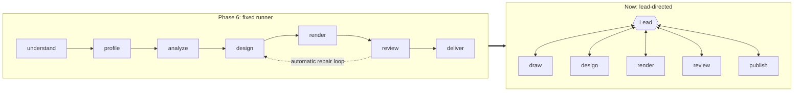
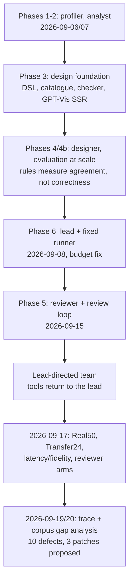

# 5. Design Decisions

Why the system is built this way, what it costs, the known gaps, and the evidence behind them.

> Snapshot of branch `test-agent` at commit `8da1564`, verified against the code on 2026-10-18. `file.py:120` means line 120 of that file at this commit. Status labels such as **[Runtime]** are defined in the [index](README.md#status-labels).

[← 4. Rulesets](04-rulesets.md) · [Index](README.md) · [Index →](README.md)

---

Each decision is marked **Confirmed** (stated in docs or code comments) or **Inferred** (read from the
implementation).

## 5.0 Decisions at a glance

| # | Decision | Main reason | Main cost | Status |
| --- | --- | --- | --- | --- |
| 5.1 | Lead with tools, no fixed pipeline | Prepared CSVs needed no re-analysis | Lead model calls dominate latency | Confirmed |
| 5.2 | CSV read by code, never by a model | Source fidelity, no model latency | Reshapes need an explicit analyst call | Confirmed |
| 5.3 | Small DSL with executable checks | Models write small languages reliably | Limited vocabulary | Confirmed |
| 5.4 | Taste rules offline only | Rules measured agreement, not correctness | One function, two modes | Confirmed |
| 5.5 | Budgets in the framework, not prompts | A designer looped until the request cap | More hooks and counters | Confirmed |
| 5.6 | Separate vision inspector, advisory only | Most defects visible only in the picture | Inspector not calibrated | Confirmed |
| 5.7 | Save before external calls; idempotent publish | Safe resume | Locks are per process | Confirmed |
| 5.8 | Pinned GPT-Vis SSR in Node | Fast, RTL/Arabic support | Package defaults constrain layout | Confirmed |
| 5.9 | One DuckDB file | Simple; also the SQL engine | One writer at a time | Inferred |
| 5.10 | One team per provider | Web UI has one `deps` per request; air-gapped cluster | Current seats lack recorded rationale | Partly confirmed |
| 5.11 | Display labels separate from data | Source cells never change | — | Confirmed |
| 5.12 | Prompt optimisation offline only | No reflection models at runtime | Slower iteration | Confirmed |

## 5.1 A lead with tools instead of a fixed pipeline. **Confirmed**

- **Problem:** the Phase 6 runner ran the stages above in a fixed order, with automatic repair loops
  (`docs/superpowers/specs/2026-09-08-phase-6-lead-and-conversation-design.md`). Re-analysing prepared CSVs added
  latency and could change the meaning of prepared totals (`docs/lead-directed-team.md`, "Decision").
- **Choice:** the lead calls each stage as a tool, and every tool returns to it. `vis_agent/requests/runner.py` keeps
  only imports.
- **Benefits:** routine prepared CSVs need no profiler or analyst call. The lead can skip, repeat, or fall back with
  judgment. The design matches the Pydantic AI delegation docs.
- **Trade-offs:** the lead makes about six model calls per routine run, and these dominate wall time (65.5% inside
  lead model calls across 79 runs; gap analysis, "Latency"). Correctness now depends on the lead's judgment, so many
  guards had to move into tool refusals and an output validator.

## 5.2 The CSV is authoritative and read without a model. **Confirmed**

- **Choice:** `draw` loads every row through DuckDB with a 10,000-row resource cap. No sampling, aggregation, or
  completeness questions.
- **Benefits:** source fidelity, with zero model latency for reading. The 20-case GLM run reported 20/20 source-cell
  fidelity (`docs/experiments/2026-09-17-latency-and-fidelity.md`). Transfer24 kept values and units in all 23
  published outputs of each arm (`docs/experiments/2026-09-17-generalization-results.md`).
- **Trade-offs:** a chart that needs a reshape requires an explicit `consult_analyst`. Tables with three categorical
  dimensions cannot be drawn by the grammar (gap analysis finding 4; 19 of 487 corpus files).

## 5.3 A small DSL with executable checks instead of raw renderer options. **Confirmed**

- **Choice:** line-oriented `vis` specs with typed keys, a JSON catalogue of 21 types
  (`vis_agent/designer/catalogue.json`), and a capability registry per renderer.
- **Why:** the AVA v4 proof of concept showed that small chart languages are easy for models to get right, and that
  nothing was checking numbers or labels (original design, section 3).
- **Trade-offs:** the vocabulary is limited (date formats, annotations, and hidden axes are outside it; Phase 3
  "Left for later"). The lead is told never to guess raw AntV options.

## 5.4 Taste rules moved offline; only executable rules run. **Confirmed**

- **Choice:** `check_render_spec(policy=False)` at runtime. The H, S, and C rules stay in `vis_agent/designer/rules.py`
  for evals and CLI commands. The lineage records `rules_version="expert-led-v1"`.
- **Why:** Phase 4b found the rule list measured agreement, not correctness. A DSPy-optimised rulebook only restated
  tool-enforced rules (`docs/phase-4b-lessons.md`). `AGENTS.md` says aesthetics belong to agents.
- **Trade-offs:** two modes of one function ([Rulesets 4.2](04-rulesets.md)). Contrast is still repaired in code, which the gap analysis notes
  is a partial exception to "aesthetics belong to agents". Every policy rule is listed in
  [Rulesets 4.3.8](04-rulesets.md).

## 5.5 Budgets enforced by the framework, not by prompt text. **Confirmed**

- **Problem:** on 2026-09-08 the designer called `recommend_charts` eight times in a row until the request cap.
  "You have used your calls" came back as a successful tool result, and a small model at temperature 0 repeated it
  (`docs/phase-6-lessons.md`, "The designer's loop").
- **Choice:** `prepare` hooks withdraw spent tools, `ModelRetry` for over-budget calls, `UsageLimits` shared with
  specialists, and saved attempt counters.
- **Lesson recorded:** "the old tests certified the bug" (`docs/phase-6-lessons.md`). New tests drive a model that
  ignores the message and assert that the run ends (for example `tests/designer/test_agent.py:338`,
  `tests/requests/test_runner.py:410`).

## 5.6 A separate vision inspector, with advisory findings and one repair at most. **Confirmed**

- **Choice:** the lead is text-only and never receives image bytes. The inspector reports evidence-backed findings.
  Code checks references and computes the verdict. The lead may repair once.
- **Why:** nine of the twelve first-pass defects in Phase 4 were visible only in the picture
  (`docs/phase-4-lessons.md`). False reviewer errors were then shown to cause needless redesigns: Real50 had 11 cases
  with false or over-strict errors and 7 with unnecessary repairs
  (`docs/experiments/2026-09-17-reviewer-designer-diagnosis.md`).
- **Trade-offs:** the inspector is not calibrated on the full 89-image labelled set. Phase 5 measured 0.674
  agreement on a Qwen seat against the 0.8 target. The current Gemma seat was tested only on small fixed-image sets
  (20 and 11 images). Code can verify where evidence points, not what the model saw.

## 5.7 Save before external calls; invalidate stale previews; publish idempotently. **Confirmed**

- Code comments state the intent: "Save invalidation before an external call: a crash cannot publish an obsolete
  preview" (`vis_agent/lead.py:477-479`). Attempts are counted before rendering (`vis_agent/lead.py:531-534`) and
  before calling the analyst (`vis_agent/lead.py:348-350`).
- **Benefit:** safe resume after a crash or timeout.
- **Limit:** request locks are per process (`vis_agent/requests/service.py:29-38`). Two servers on one database are
  not protected (`docs/lead-directed-team.md`; `docs/phase-6-lessons.md`, "Left for later").

## 5.8 Pinned GPT-Vis SSR in a Node subprocess. **Confirmed**

- **Choice:** `@antv/gpt-vis-ssr` pinned at 0.3.8, one Node process per render, with a single G2 hook for our options
  (`docs/phase-3-lessons.md`, "What the renderer is and is not").
- **Benefits:** 0.1 to 0.4 s per render; RTL and Arabic support checked by `vis doctor`.
- **Trade-offs:** functions in some chart configurations make the HTML page show a static picture (recorded as a
  compromise). Package defaults constrain layout. Node and system fonts are deployment dependencies.

## 5.9 One DuckDB file for datasets, requests, and artifacts. **Inferred**

- It is simple to run locally, and SQL is also the analyst's computation engine.
- Costs: one writer at a time (README troubleshooting: "Could not set lock"), and requests and artifacts are filtered
  in Python (`docs/phase-6-lessons.md`, "Left for later").

## 5.10 One team per provider, with measured model seats. **Partly confirmed**

- One full team per provider exists because the web UI gives each request a single fixed `deps` object, and the
  air-gapped cluster needs LiteLLM (`docs/phase-6-lessons.md`, "Two providers in one dropdown").
- Lead history: Sonnet 4.6 (Phase 6), then Gemma 4 31B on 2026-09-09 (`docs/phase-6-lessons.md`, "The lead on Gemma"),
  then GLM 5.3 (the 2026-09-17 experiments).
- **Information gap.** No committed note records why GLM 5.3 replaced Gemma as lead, or why DeepSeek V4 Pro became
  the designer default. `docs/lead-directed-team.md` calls DeepSeek "tested". The only committed DeepSeek designer
  numbers are 31/31 delivered in the 2026-09-09 trial and 3/6 valid renders (versus 6/6 for GLM 5.3) in the
  2026-09-17 isolated replay. Every integrated run on record used GLM 5.3 as designer.

## 5.11 Display labels kept separate from data. **Confirmed** (`docs/data-agent-handoff.md`)

- Approved labels from the brief are merged into the saved spec and applied only when drawing. Source cells,
  grouping keys, and ordering stay unchanged. A code's meaning belongs to its column ("M" in `sex` is not "M" in
  `marital_status`).

## 5.12 Prompt optimisation is offline only. **Confirmed**

- DSPy GEPA runs only in `evals/`, and reflection models never run at runtime. A candidate prompt is adopted only
  after it is rewritten in the runtime's terms and beats the seed on the real runtime evaluation
  (`docs/phase-6-lessons.md`). External optimisation is deliberately blocked until the metrics are validated
  (`docs/experiments/2026-09-17-runtime-maturity.md`).

## 5.13 Technical debt and known gaps

| ID | Item | Evidence | Status |
| --- | --- | --- | --- |
| G1 | A chat run that crashes or ends in text leaves its request `running`, which blocks new `draw` calls for other questions | gap analysis finding 1; `tests/requests/test_lead_gaps.py` | **[Proposed]** patch 3 |
| G2 | Running out of the 18-request budget ends the run with an exception; model requests are not reserved for the final steps | finding 2 | open |
| G3 | `check_spec` does not apply `required_columns` | finding 6 | **[Proposed]** patch 1 |
| G4 | A numeric year on a time axis is drawn in value order by default | finding 7 | **[Proposed]** patch 4 |
| G5 | `limit` and long tables pass the check and fail at render | finding 5, [Rulesets 4.3.6](04-rulesets.md) | open |
| G6 | Box-plot label binding defect published unnoticed | finding 10 | open |
| G7 | README says 24 requests; code says 18 | `vis_agent/requests/service.py:27` | doc fix needed |
| G8 | `uv run pytest -q` stops at collection without `uv sync --group optimize` (`dspy`, `hijridate`) | `uv run pytest -q`, run 2026-10-18 | open |
| G9 | `TemporalDurability` is attached but no worker runs; its interaction with proposed patch 3 is untested | `vis_agent/lead.py:661`, gap analysis | by design / open |
| G10 | Routes are unauthenticated; the app must stay on 127.0.0.1 | README | by design |

The three proposed patches live in `docs/experiments/2026-09-19-patches/` (numbered 1, 3, and 4). Their tests are
five `strict=True` xfails in `tests/requests/test_lead_gap_fixes.py`. None is applied at this commit.

## 5.14 Experiment evidence

The decisions above rest on the dated phase notes in `docs/phase-*-lessons.md` and the reports in `docs/experiments/`.
A separate narrative write-up, `docs/experiment-log-Turki/001-building-agent.md`, is not summarized here.

### 5.14.1 How the architecture evolved

### 5.14.2 Key measured results

All numbers are as reported in the cited files. None was re-run for this document.

| Experiment | Setup | Result | Source |
| --- | --- | --- | --- |
| **Real50** | 50 frozen development handoffs; GLM 5.3 text roles, Gemma inspector | Agent audit: **32 pass / 16 fail / 2 uncertain** (not human gold). Raw contract 34/50. Median 20.26 s; p95 at the 120 s watchdog. | `docs/experiments/2026-09-17-maturity50-real.md` |
| **Transfer24** | 24 synthetic transfer tasks, two arms | 23/24 outputs saved per arm; values and units kept in all 23 | `docs/experiments/2026-09-17-generalization-results.md` |
| **Concise 20** | 20 cases, GLM team | Source-cell fidelity 20/20; artifacts delivered 19/20 | `docs/experiments/2026-09-17-latency-and-fidelity.md` |
| **Isolated designer** | 6 saved inputs per model | GLM 5.3 6/6, Sonnet 4.5 6/6, DeepSeek V4 Pro 3/6 valid renders | same file |
| **Reviewer arms** | 20 fixed images (10 clean, 10 defective) | Gemma baseline 12/20; named rows 15/20; grounded + low thinking 17/20, which still identified only 4 of 10 actual defects | same file |
| **Reviewer on Qwen** | 89 labelled images | 0.674 agreement (target 0.8) | `docs/phase-5-lessons.md` |
| **Designer trial** | 31-case designer eval, 2026-09-09 | Gemma 4 31B 31/31 (4.8 s); DeepSeek V4 Pro 31/31 (9.1 s) | `docs/phase-6-lessons.md` |
| **Lead trial** | 21-case lead eval, 2026-09-09 | Sonnet 4.6 17/21; Gemma 4 31B 18/21; GLM 5.3 16/21; GLM 5.3 Flash 21/21 | `docs/phase-6-lessons.md` |
| **Trace analysis** | 79 routine runs | Median 19.1 s. Wall time: lead 65.5%, designer 21.2%, reviewer 10.5%, rendering 1.7% | `docs/experiments/2026-09-19-lead-gap-analysis.md` |

## 5.15 Key takeaways

1. **Control is in one place.** `vis_agent/lead.py` is both the policy and the flow. Read it first.
2. **Code guarantees fidelity; models make judgments.** Source values never pass through a model. Every spec is
   checked before rendering. Taste is left to agents.
3. **Bounded autonomy.** Every loop the lead could enter is capped in code: two initial designs, one repair, one
   analyst call, plus tool and request budgets. Tests check that the caps hold against models that ignore
   instructions.
4. **The weakest link is perception and judgment, not plumbing.** False inspector errors and lead latency are the
   main measured problems. Rendering takes under 2% of wall time.
5. **Evidence discipline is part of the culture.** Experiments keep raw failures, separate machine contracts from
   audited correctness, and withdraw claims that do not hold up.

---

[← 4. Rulesets](04-rulesets.md) · [Index](README.md) · [Index →](README.md)
