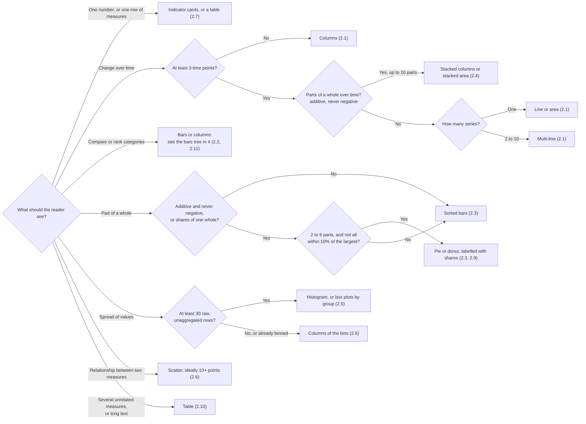
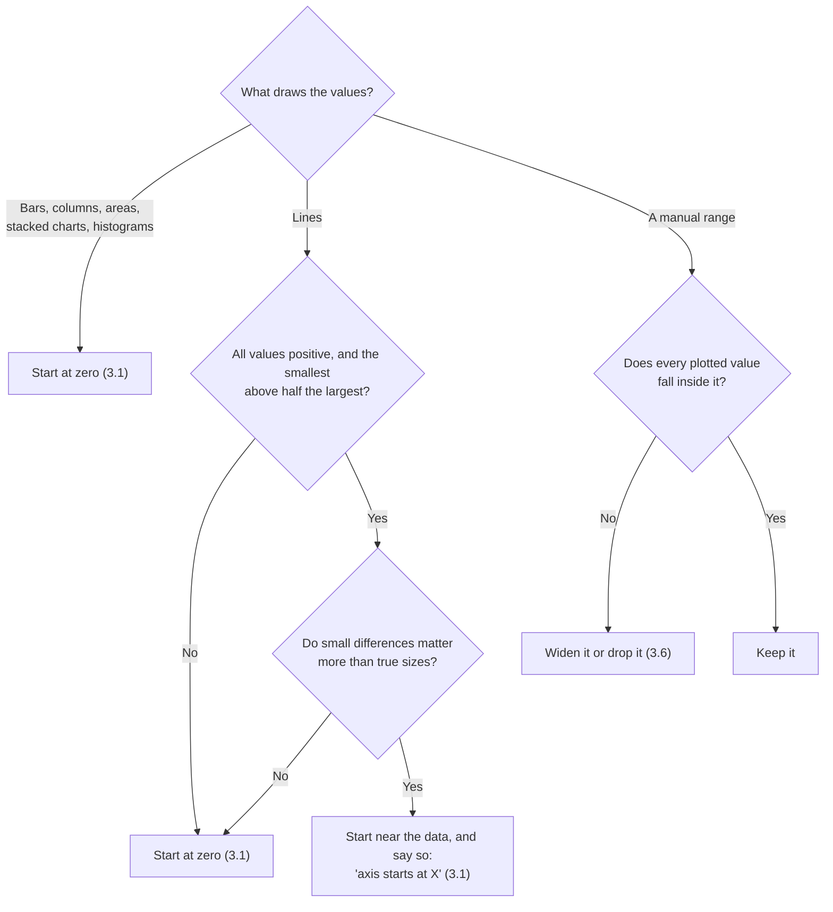
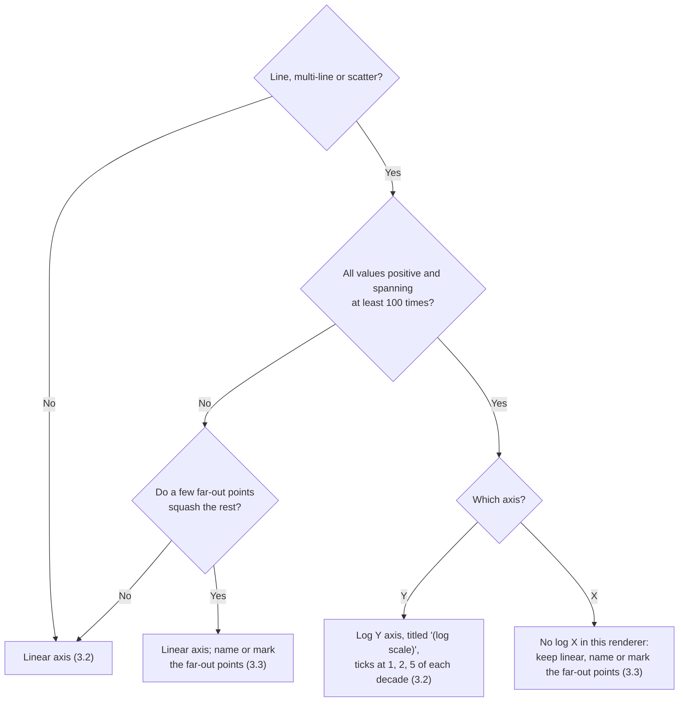
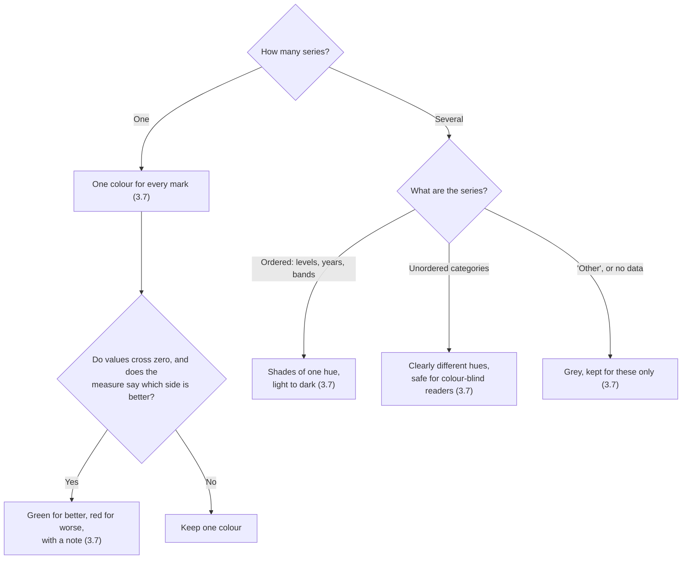
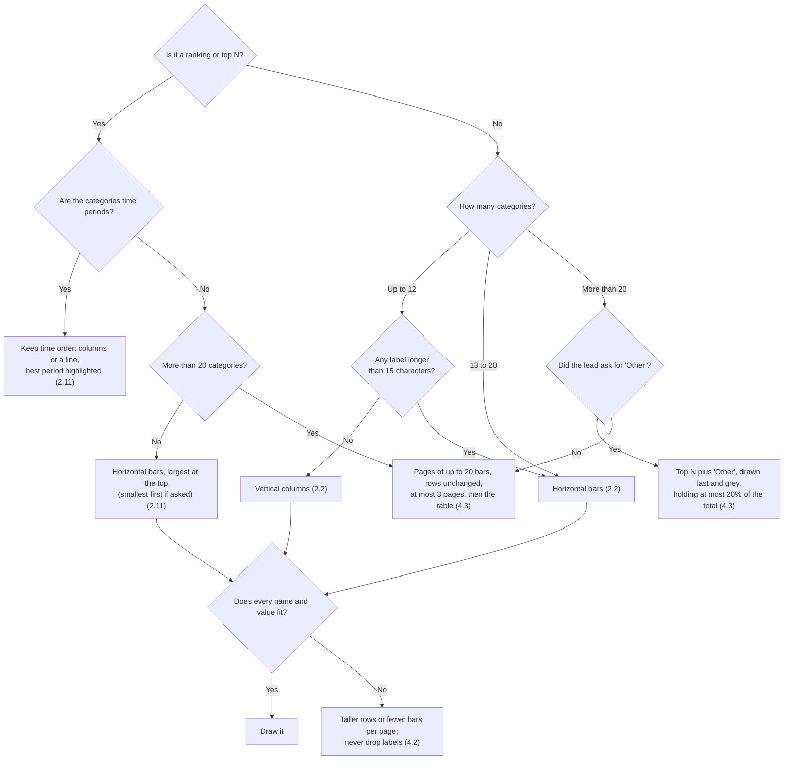

# Visualization standards

The rules a chart from this team is checked against. Use the [checklist](#checklist) to review a chart and the
[details](#details) for each rule's reasoning and limits. Problems found are logged in the
[chart issues log](chart-issues/README.md) with the rule numbers they break.

Adapted on 2026-10-18 from the standards of the earlier `chart-generator-model` project, renumbered and fitted to
this project. These are the standards we check against; most are not implemented here yet. Old standards that
don't fit this project are listed in [section 9](#9-not-adopted-from-chart-generator-model).
To propose a new rule, add it to [standards-suggestions.md](standards-suggestions.md) for review.

## Checklist

Links after a rule point to the chart issues that break it; `docs/chart-issues/new_issue.py` keeps them
current.

Decision trees for the harder calls: [which chart](#decision-tree-which-chart), [bars, rankings and long lists](#decision-tree-bars-rankings-and-long-lists), [where the value axis starts](#decision-tree-where-the-value-axis-starts), [log scale or marked outliers](#decision-tree-log-scale-or-marked-outliers), [what colour means](#decision-tree-what-colour-means).

### Data and responsibility

- [ ] **1.1** Every value comes from the CSV unchanged; nothing is invented.
- [ ] **1.2** The lead decides delegation, repair and publication.
- [ ] **1.3** The designer chooses the chart type.
- [ ] **1.4** No re-summing, percentages, "Other" or other calculations unless the lead asked. ([CI-012](chart-issues/2026-10-18-units-by-product-100-command-line.md), [CI-013](chart-issues/2026-10-18-units-by-product-100-chat.md), [CI-015](chart-issues/2026-10-18-messy-csv-accepted-command-line.md))
- [ ] **1.5** Every column the request needs is drawn.

### Chart choice

- [ ] **2.1** Time is a line or area with 3+ points, never horizontal bars or a pie.
- [ ] **2.2** Columns for up to 12 categories; horizontal bars for more, or labels over 15 characters.
- [ ] **2.3** Pie or donut only for 2–6 non-negative parts of one whole.
- [ ] **2.4** Composition over time: stacked columns or area, up to 10 parts.
- [ ] **2.5** Histogram or box plot only with 30+ raw rows.
- [ ] **2.6** Relationship: a scatter, ideally 10+ points.
- [ ] **2.7** One row of measures: indicator cards or a table.
- [ ] **2.8** Measures of one unit share an axis; different units get two axes or a table.
- [ ] **2.9** The chart answers the question's form: a share question shows shares. ([CI-009](chart-issues/2026-10-18-sales-share-arabic-donut-command-line.md))
- [ ] **2.10** A table when a chart would hide things; it shows every row.
- [ ] **2.11** A ranking or top N is horizontal bars, largest at the top; time periods keep their order.

### Honest encoding

- [ ] **3.1** Bars and areas start at zero; a line is cropped only when the values allow it, and says so.
- [ ] **3.2** Log scale only for positive values spanning 100×, labelled "(log scale)". ([CI-001](chart-issues/2026-10-18-gdp-co2-scatter-old-repo.md), [CI-002](chart-issues/2026-10-18-gdp-co2-scatter-command-line.md), [CI-003](chart-issues/2026-10-18-gdp-co2-scatter-chat.md))
- [ ] **3.3** Far-out values are named or marked, never left to squash the rest. ([CI-001](chart-issues/2026-10-18-gdp-co2-scatter-old-repo.md), [CI-002](chart-issues/2026-10-18-gdp-co2-scatter-command-line.md), [CI-003](chart-issues/2026-10-18-gdp-co2-scatter-chat.md))
- [ ] **3.4** Stacked and pie charts only for parts of one real whole.
- [ ] **3.5** Time and ordered categories keep their order.
- [ ] **3.6** A manual axis range never cuts off a value.
- [ ] **3.7** One series, one colour; distinct hues for unordered categories; grey only for "Other" or no data. ([CI-001](chart-issues/2026-10-18-gdp-co2-scatter-old-repo.md), [CI-004](chart-issues/2026-10-18-sales-by-region-old-repo.md), [CI-006](chart-issues/2026-10-18-spend-by-department-old-repo.md), [CI-008](chart-issues/2026-10-18-sales-share-arabic-donut-old-repo.md), [CI-009](chart-issues/2026-10-18-sales-share-arabic-donut-command-line.md), [CI-012](chart-issues/2026-10-18-units-by-product-100-command-line.md))
- [ ] **3.8** Every mark has 3:1 contrast with the background.
- [ ] **3.9** Gaps in time keep their place; a running period is marked partial.

### Readability

- [ ] **4.1** Within the chart's limits (pie 2–6 slices, 20 bars per page, 10 groups, …).
- [ ] **4.2** Every category name shows; labels are never dropped silently. ([CI-012](chart-issues/2026-10-18-units-by-product-100-command-line.md), [CI-015](chart-issues/2026-10-18-messy-csv-accepted-command-line.md))
- [ ] **4.3** Long rankings are paged (up to 20 bars a page), not folded into a huge "Other". ([CI-010](chart-issues/2026-10-18-units-by-product-45-command-line.md), [CI-011](chart-issues/2026-10-18-units-by-product-60-command-line.md), [CI-012](chart-issues/2026-10-18-units-by-product-100-command-line.md))
- [ ] **4.4** Axis titles sit on the right axes. ([CI-005](chart-issues/2026-10-18-sales-by-region-command-line.md))
- [ ] **4.5** All text has 4.5:1 contrast with the background. ([CI-001](chart-issues/2026-10-18-gdp-co2-scatter-old-repo.md), [CI-002](chart-issues/2026-10-18-gdp-co2-scatter-command-line.md), [CI-003](chart-issues/2026-10-18-gdp-co2-scatter-chat.md), [CI-004](chart-issues/2026-10-18-sales-by-region-old-repo.md), [CI-005](chart-issues/2026-10-18-sales-by-region-command-line.md), [CI-006](chart-issues/2026-10-18-spend-by-department-old-repo.md), [CI-007](chart-issues/2026-10-18-spend-by-department-command-line.md), [CI-010](chart-issues/2026-10-18-units-by-product-45-command-line.md), [CI-011](chart-issues/2026-10-18-units-by-product-60-command-line.md), [CI-013](chart-issues/2026-10-18-units-by-product-100-chat.md), [CI-015](chart-issues/2026-10-18-messy-csv-accepted-command-line.md))
- [ ] **4.6** A title and a one-sentence description. ([CI-002](chart-issues/2026-10-18-gdp-co2-scatter-command-line.md))

### Numbers and units

- [ ] **5.1** Short numbers on axes and bars (`2.5M`); full numbers in tooltips; unit once, in the axis title. ([CI-001](chart-issues/2026-10-18-gdp-co2-scatter-old-repo.md), [CI-002](chart-issues/2026-10-18-gdp-co2-scatter-command-line.md), [CI-004](chart-issues/2026-10-18-sales-by-region-old-repo.md), [CI-005](chart-issues/2026-10-18-sales-by-region-command-line.md), [CI-006](chart-issues/2026-10-18-spend-by-department-old-repo.md), [CI-007](chart-issues/2026-10-18-spend-by-department-command-line.md), [CI-010](chart-issues/2026-10-18-units-by-product-45-command-line.md), [CI-011](chart-issues/2026-10-18-units-by-product-60-command-line.md), [CI-015](chart-issues/2026-10-18-messy-csv-accepted-command-line.md))
- [ ] **5.2** Every value axis uses the same number format. ([CI-001](chart-issues/2026-10-18-gdp-co2-scatter-old-repo.md), [CI-002](chart-issues/2026-10-18-gdp-co2-scatter-command-line.md), [CI-003](chart-issues/2026-10-18-gdp-co2-scatter-chat.md))
- [ ] **5.3** Units come from the data; formatting never rescales a value. ([CI-003](chart-issues/2026-10-18-gdp-co2-scatter-chat.md))
- [ ] **5.4** A number keeps its `%` or unit next to it, in Arabic too. ([CI-008](chart-issues/2026-10-18-sales-share-arabic-donut-old-repo.md))

### Language

- [ ] **6.1** Chart text is in the requested language.
- [ ] **6.2** Source labels, Hijri dates and approved display labels stay verbatim.
- [ ] **6.3** Codes are translated only from known meanings; unknown codes stay raw.
- [ ] **6.4** Arabic charts read right to left, legend included. ([CI-008](chart-issues/2026-10-18-sales-share-arabic-donut-old-repo.md), [CI-009](chart-issues/2026-10-18-sales-share-arabic-donut-command-line.md))
- [ ] **6.5** Arabic-Indic digits change only the display, never the value.

### Delivery and review

- [ ] **7.1** The card shows the picture, the table with its row count, the review status and the IDs.
- [ ] **7.2** Every compromise (dropped rows, cropped axis, adjusted colour) is stated.
- [ ] **7.3** Nothing is sampled or aggregated silently; a limit is reported as a limit. ([CI-012](chart-issues/2026-10-18-units-by-product-100-command-line.md), [CI-013](chart-issues/2026-10-18-units-by-product-100-chat.md))
- [ ] **8.1** One visual review after rendering; it advises the lead.
- [ ] **8.2** A chart that couldn't be reviewed says so. ([CI-002](chart-issues/2026-10-18-gdp-co2-scatter-command-line.md), [CI-015](chart-issues/2026-10-18-messy-csv-accepted-command-line.md))
- [ ] **8.3** The review catches visible defects. ([CI-002](chart-issues/2026-10-18-gdp-co2-scatter-command-line.md), [CI-003](chart-issues/2026-10-18-gdp-co2-scatter-chat.md), [CI-005](chart-issues/2026-10-18-sales-by-region-command-line.md))

## Details

### What the tags mean

Each detailed rule ends with a tag saying how the current code relates to it. The tags describe today's
behaviour, so a reviewer knows where to look; they don't mean the rule is implemented.

- **[CODE]** Existing code already does this on every request (`check_render_spec` in
  [`designer/check.py`](../vis_agent/designer/check.py), the resolver
  [`designer/resolve.py`](../vis_agent/designer/resolve.py), or the renderer
  [`render/gptvis/`](../vis_agent/render/gptvis/)).
- **[RULEBOOK]** The designer, lead or reviewer instructions ask for it
  ([`designer/rulebook.md`](../vis_agent/designer/rulebook.md),
  [`reviewer/rulebook.md`](../vis_agent/reviewer/rulebook.md), [`lead.py`](../vis_agent/lead.py)); nothing
  checks that the model did it.
- **[OFFLINE]** An old policy rule in [`designer/rules.py`](../vis_agent/designer/rules.py) (H1–H14, S1–S14,
  C4–C16) checks it in `vis check`, `vis recommend` and the evaluations, not when charts are made
  ([AGENTS.md](../AGENTS.md) keeps those checks out of runtime).
- **[NOT ENFORCED]** Nothing in the code does it.

### 1. Who decides what

- **1.1 Source values never change.** The upstream CSV is final. Models bind column names; they never write data
  values, formulas or extra rows into a spec. Numeric roles need numeric source cells. [CODE] `check_spec`
  binding checks (C2); [`analyst/source.py`](../vis_agent/analyst/source.py) reads the table without a model.
- **1.2 The lead owns the outcome.** It chooses delegation, repair, fallback and publication; every tool returns
  control to it. There is no fixed step order and no automatic review or repair loop. [CODE] tool design in
  [`lead.py`](../vis_agent/lead.py).
- **1.3 The designer chooses the chart.** The catalogue is the renderer's vocabulary, not a ranking it must
  follow. [RULEBOOK]
- **1.4 No new calculations unless the lead asks.** Re-summing prepared rows, recomputing percentages, `percent`,
  `limit` and "Other" all change chart values, so the designer avoids them unless the lead explicitly requests
  that presentation. Requested calculations go through the analyst as read-only, validated SQL. [RULEBOOK]
  designer rulebook; [CODE] SQL safety in [`analyst/`](../vis_agent/analyst/)..
- **1.5 Every column the request requires is drawn.** Mentioning a column in the explanation doesn't count.
  [CODE] `deliver_design` rejects a spec missing a `required_columns` entry.

### 2. Choosing the chart

Guidance for the designer and for review. Limits are the catalogue's
([`designer/catalogue.json`](../vis_agent/designer/catalogue.json)).

- **2.1 Trend.** A line or area over a time axis with at least 3 points; several series as a multi-line
  (up to 10). Never time on horizontal bars, and never a pie for time. [OFFLINE] H2, H7, H8, S7.
- **2.2 Comparison.**
  - Vertical columns for 12 categories or fewer.
  - Horizontal bars for more categories, or when the longest label is over 15 characters.
  - At most 20 bars on one chart; more are paged (see 4.3).

  [OFFLINE] H11, S4, S5.
- **2.3 Part of a whole.** A pie or donut only for 2–6 parts of a non-negative, additive measure (or shares of one
  whole), and not when every slice is within 10% of the largest. Rated "caution" in the catalogue; a sorted bar
  is usually clearer. [OFFLINE] H3, H4, H5, H14, S6.
- **2.4 Composition over time.** Stacked columns or a stacked area, up to 10 parts, additive and non-negative.
  [OFFLINE] H3, H4, H6, S8.
- **2.5 Distribution.**
  - A histogram or box plot needs at least 30 raw, unaggregated rows.
  - Bins the data agent already computed are drawn as columns.

  [OFFLINE] H9; [RULEBOOK]
- **2.6 Relationship.** A scatter, preferably with at least 10 points. [OFFLINE] S10.
- **2.7 One row of measures.** Indicator cards (one per independent measure) or a table, never a chart that
  selects a row or computes a total. [CODE] indicator checks
  ([`designer/indicator.py`](../vis_agent/designer/indicator.py)); [RULEBOOK]
- **2.8 Several measures.**
  - Measures of one unit share an axis through `fold`, which reshapes without changing cells.
  - Measures of different units use `dual_axes` (caution) or a table.

  [CODE] `fold` checks (C20); [OFFLINE] H10.
- **2.9 Answer the question's form.** A question about shares shows shares; a question about a ranking shows a
  sorted ranking. [NOT ENFORCED]
- **2.10 A table when a chart would hide things.** Use a table when several unrelated measures or long labels
  must stay readable. A table shows every row: its height grows to fit, up to a 2,400-pixel limit that is reported,
  never cropped. [RULEBOOK]; [CODE] table height in the resolver.
- **2.11 Rankings read like a leaderboard.** When the question asks for a ranking or a top N ("top 10
  products", "which regions sell most"), draw horizontal bars sorted with the largest at the top, however few
  the categories. Names get room without rotating, and the list reads top to bottom.
  - A question about the smallest ("lowest-cost suppliers") sorts smallest first, still with the answer at the
    top.
  - Time periods ("which month was best?") keep their time order, as columns or a line, with the best period
    highlighted, so the trend stays visible.
  - More than 20 categories are paged (4.3).

  [NOT ENFORCED] The offline rules favour horizontal bars only for long labels (S5).

#### Decision tree: which chart

### 3. Honest encoding

- **3.1 Bars and areas start at zero.** [CODE] renderer default. Lines start at zero too unless the designer
  crops them, which is allowed only for positive values whose smallest is above half the largest. A cropped
  axis is disclosed as a compromise. [CODE] resolver default and compromise; [OFFLINE] C12, C16.
- **3.2 Log scales only when they help.**
  - Only on line, multi-line or scatter, for positive values spanning at least 100 times. [OFFLINE] C14.
  - The renderer offers a log Y axis only; there is no log X axis.
  - A log axis says so in its title ("(log scale)"), with ticks at 1, 2 and 5 of each decade. [NOT ENFORCED]

- **3.3 Far-out values are marked, never hidden or left to squash the rest.** A few far-out points are named, or
  marked at the axis edge with their values. [NOT ENFORCED]
- **3.4 Parts make a real whole.** Stacked, pie, donut and treemap charts only for additive, non-negative values,
  or shares of the same whole; `percent` only on stacked charts. [OFFLINE] H3, H4, H14, C13.
- **3.5 Time and ordered categories keep their order.** `sort none` on a time or ordinal axis; Hijri and other
  calendar labels stay in source order. [RULEBOOK]; [OFFLINE] C4. Known gap: numeric years can be drawn in value
  order (defect 7 in the [lead gap analysis](experiments/2026-09-19-lead-gap-analysis.md)).
- **3.6 Axis ranges hold every value.** A manual range may not cut off a plotted value. [OFFLINE] C11.
- **3.7 Colour changes only when it means something.**
  - One series is one colour. [CODE] the resolver colours a single-series chart with one accent, unless the spec
    sets a palette or emphasis.
  - Grey is kept for "Other" and missing data. [NOT ENFORCED]
  - Unordered categories get clearly different hues, distinct for colour-blind readers too; shades of one hue are
    for ordered values only. [NOT ENFORCED]
  - Green and red for better and worse only when the measure says which side is better. [NOT ENFORCED]
- **3.8 Every mark is visible.** Palette colours reach 3:1 contrast with the background. [CODE] colours below
  that are adjusted, and the change is disclosed.
- **3.9 Time intervals are honest.** [NOT ENFORCED] targets:
  - Periods with no data keep their place, and a line breaks there.
  - A latest period still in progress is marked partial.
  - Time labels have two levels (months under their year).

#### Decision tree: where the value axis starts

#### Decision tree: log scale or marked outliers

#### Decision tree: what colour means

### 4. Readability

- **4.1 Limits per chart.**

  | Chart | Limit | Enforced by |
  | --- | --- | --- |
  | Pie, donut | 2–6 slices | [OFFLINE] H5 |
  | Bar, column (all kinds) | 20 categories per page; more are paged (4.3) | [NOT ENFORCED]; the offline rules allow 50 (H11, S4) |
  | Grouped, stacked, multi-line, stacked area | 10 groups | [OFFLINE] H6 |
  | Line, area | at least 3 time points | [OFFLINE] H7 |
  | Histogram, box plot | at least 30 raw rows | [OFFLINE] H9 |
  | Radar | 3–12 categories, 5 groups | [OFFLINE] H5, H6 |
  | Word cloud | at least 20 categories | [OFFLINE] S11 |
  | Direct table read | 10,000 rows, reported, never sampled | [CODE] `SOURCE_ROW_CAP` |

- **4.2 Labels.**
  - Data labels on bars and columns up to 12 marks; on other charts up to 50. [OFFLINE] C15.
  - Every category name is shown. Labels that don't fit change the chart (taller rows, fewer bars per page);
    they are never dropped silently. [NOT ENFORCED]
- **4.3 Long lists are paged, not folded.** A ranking with many categories is split into pages that show the
  supplied rows unchanged; "Other" is used only when the lead asks, and is drawn last and muted. Target, from the
  earlier project:
  - Show up to 20 bars.
  - Size a requested "Other" so it holds at most 20% of the total.
  - Use at most 3 pages, then point to the table.

  [NOT ENFORCED]
- **4.4 Axis titles name the right axis.** On a horizontal bar the measure is on X and the category on Y.
  [RULEBOOK]; [CODE] the resolver swaps titles to the physical axes.
- **4.5 Text is readable.** Titles, axis titles, ticks and labels reach 4.5:1 contrast with the background.
  [NOT ENFORCED]
- **4.6 Every chart has a title and a one-sentence description** that make it understandable on its own.
  [RULEBOOK]; [OFFLINE] C8.

#### Decision tree: bars, rankings and long lists

### 5. Numbers and units

- **5.1 Short numbers on axes and bars, full numbers in tooltips** (decided 2026-10-18).
  - Axis ticks and bar labels use short numbers: `7M`, `2.5M`, `500K`, `6.66M`.
  - The unit appears once, in the axis title, not on every tick.
  - The tooltip gives the full number with its unit: `6,656,360 SAR`.
  - The Arabic short form (`مليون` or `M`) is not decided yet.

  [NOT ENFORCED]
- **5.2 Every value axis uses the same number format,** including a scatter's X axis. [NOT ENFORCED]
- **5.3 Units come from the data.** A unit comes from column metadata or the brief. Formatting changes precision
  and grouping, never the value: `%` is added only when the unit is a percentage and never multiplies by 100.
  [RULEBOOK]; [CODE] a percent format on a non-share is disclosed; indicator cards may not change a unit (I3).
- **5.4 A number keeps its sign and unit together,** in Arabic too (`41.2%`, never `%` beside the name).
  [NOT ENFORCED]

### 6. Language and labels

- **6.1 Chart text in the requested language.** Titles, descriptions, axes and labels follow the requested
  language. [RULEBOOK]
- **6.2 Source labels stay faithful.**
  - Hijri dates, leading-zero identifiers and source labels are kept verbatim.
  - Approved `display_labels` from the brief are copied exactly into the saved design.

  [CODE] label-binding checks and saved display mappings; see the
  [data agent handoff](data-agent-handoff.md).
- **6.3 Codes are translated only from established meanings.** Meanings come from `code_meanings` or clear
  column context, per column; ambiguous codes stay raw. [RULEBOOK]
- **6.4 Right-to-left.**
  - Arabic titles and category order follow the right-to-left direction. [CODE] the resolver, with the remaining
    package limits recorded as compromises.
  - The legend starts on the right. [NOT ENFORCED] the package has no right-to-left legend.
- **6.5 Arabic-Indic digits are a display option;** values never change. [CODE]
  [`render/gptvis/format.js`](../vis_agent/render/gptvis/format.js).

### 7. What every delivered chart discloses

- **7.1 The card.** Every delivered card shows the picture, a short explanation, the data table with its row
  count ("20 of 45 rows") and a link to the full table, the review status, any compromises, and the artifact
  and request IDs. [CODE]
- **7.2 Compromises are stated.** Rows dropped for null measures, a cropped axis, an adjusted colour and package
  limits are listed as compromises. [CODE]
- **7.3 Nothing is sampled or aggregated silently.** A technical limit is reported as a limit. [CODE]

### 8. Review

- **8.1 One scoped inspection, advisory only.** After a successful render, one visual inspection checks only
  visible defects against the source rows and spec. Its findings go back to the lead, which decides what to do.
  [CODE] and [RULEBOOK] reviewer.
- **8.2 A chart that couldn't be reviewed says so.** [CODE] the card has no review verdict and lists a warning
  with the reason (for example "The reviewer could not finish: TimeoutError").
- **8.3 The reviewer should agree with human judgement at least 0.8 of the time** on the labelled set
  ([AGENTS.md](../AGENTS.md)). Not reached yet; see `evals/reviewer/`.

### 9. Not adopted from chart-generator-model

These standards of the earlier project conflict with this project's contract or have no component here. They
are listed so they are not lost; adopting one needs a decision first.

| Earlier standard | Why not here |
| --- | --- |
| Total rows ("Total", the whole country) removed before charting | The CSV is authoritative; removing rows changes the data agent's answer. A brief caveat or the lead can say how to present them. |
| Code chooses the aggregate, weighted means for rates, and derived measures (share, change, per capita, rank) | No re-aggregation of prepared measures; calculations happen only when the lead asks the analyst. |
| Code sizes the top-N and adds "Other" | Folding rows into "Other" aggregates them; paging (4.3) keeps the rows as supplied. |
| Option cards and ranked insights when a question is unclear | The lead makes reasonable presentation decisions itself; it asks only when a choice can't be inferred. |
| Every number the question names must appear in the answer | Upstream research is not repeated here; the brief and CSV already carry the question's scope. |
| Grounded insight sentences checked against computed facts | No insight-text component; the designer's explanation is free text (see 1.3). |
| Maps (regions, points, density) | The pinned renderer's catalogue has no map charts. |
| Chart reveal and motion rules | The built-in Web Chat UI shows static PNGs; there is no custom front end. |
